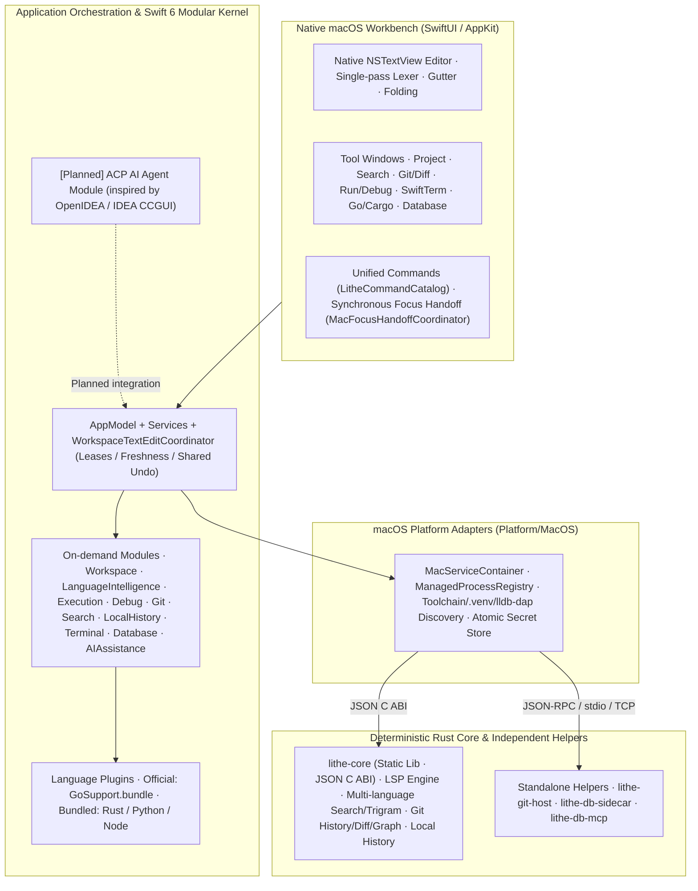

<div align="center">
  

  <h1>Lithe</h1>

  <p><strong>An AI-Agent-friendly, lightweight, high-performance macOS IDE (Go / Rust / Python first, Web planned)</strong></p>

  <p>
    <a href="./README.zh-CN.md"><strong>简体中文</strong></a> ·
    <a href="#current-focus">Current focus</a> ·
    <a href="#feature-progress-and-benchmarks">Progress &amp; benchmarks</a> ·
    <a href="#future-todo">TODO</a> ·
    <a href="#core-features">Core features</a> ·
    <a href="#product-tour">Product tour</a> ·
    <a href="#download-and-install">Download</a> ·
    <a href="#architecture-overview">Architecture</a> ·
    <a href="#develop-lithe">Develop Lithe</a>
  </p>

  <p>
    <a href="https://hellogithub.com/repository/1lck/Lithe-IDEA" target="_blank"></a>
  </p>

  <p>
    <a href="https://qm.qq.com/cgi-bin/qm/qr?k=&amp;group_code=163027877"></a>
    <a href="https://gcnctzuuwe9u.feishu.cn/wiki/HJFbwZ0hZirAPnkWF3xcPWkCnid?from=from_copylink"></a>
  </p>

  <p>
    <a href="https://github.com/1lck/Lithe-IDEA/releases/latest"></a>
    <a href="https://github.com/1lck/Lithe-IDEA/releases"></a>
    
    
    <a href="#download-and-install"></a>
    <a href="./LICENSE"></a>
  </p>
  <p>
    
    
    
  </p>
</div>

> **Fork positioning & status — 2026-11-26 (`dev/aiide`, verified baseline `36e45432`):** This fork builds a **macOS-only lightweight, high-performance IDE** designed to be **AI-Agent-friendly** (planning **ACP-based AI Agent** integration inspired by **OpenIDEA** and **IDEA CCGUI**). Tier-1 focus is **Go, Rust, and Python**—targeting **GoLand / RustRover / PyCharm** parity across project/framework tooling, syntax highlighting, completion/recommendations, navigation, refactoring, and debugging—with **Web (TypeScript / JavaScript / HTML / CSS)** planned as Tier 2. Windows, Java ecosystem/framework increments, Linux.do, and the Monaco editor migration remain excluded/deferred.

## Why Lithe

AI coding tools and agents now handle an increasing share of code authoring, yet developers still need a responsive native IDE to **understand code, jump through symbols, run and debug, and review every diff**—and to provide **AI agents with a safe, verifiable host loop** (transactional multi-file edits with undo, LSP diagnostics, Git diff review, and terminal/debug feedback). Keeping a multi-gigabyte heavyweight runtime open just for those workflows is increasingly hard to justify.

## Meet Lithe

Lithe is a **macOS-only** native IDE built with SwiftUI / AppKit, native `NSTextView`, and a deterministic Rust Core. It delivers project browsing, editing, semantic navigation, project-wide search and replacement, run and breakpoint debugging, Git diff review, local history, integrated terminal, and a multi-database SQL workspace.

- **Tier-1 languages (active priority):** **Go, Rust, and Python**, continuously closing gaps with **GoLand / RustRover / PyCharm**.
- **Tier-2 languages (planned):** **Web stack (TypeScript / JavaScript / HTML / CSS)**, extending the existing Node run/debug base and HTML/SVG preview after Tier-1 parity milestones land.
- **AI-Agent-friendly architecture (planned roadmap):** Keeps existing AI Commit and local provider import; plans to add **ACP (Agent Client Protocol)** agent workflows inspired by **OpenIDEA** and **IDEA CCGUI**, reusing Lithe's native cross-file edit transactions, shared Undo, Git Diff review, LSP verification, and Run/Debug channels (planned, not yet implemented).
- **Trimmed scope & upstream sync:** The default package omits JDK/JDTLS and Java Debug/Test; Maven, Spring, Windows, and Linux.do integrations have been removed, and the Monaco migration remains deferred. Upstream releases through **v0.5.0** have been merged with original history preserved, plus selected output, Git, and terminal fixes through **v0.6.5**. See the [integration and acceptance record](./docs/architecture/ai-ide-phase-one.md).

Lithe typically uses about **300–400 MB of baseline memory** after opening a regular project. Language servers, terminals, build tools, debuggers, and database helpers start on demand.

> **AI and agents accelerate coding. Lithe gives you a low-memory native macOS workbench to understand, run, debug, and safely review every change.**

## Current focus

- **Deep Go / Rust / Python parity:** Close the remaining high-frequency editor gaps against GoLand / RustRover / PyCharm—LSP editor interactions (L4a), incremental Tree-sitter syntax and completion engine (L0–L3/L6), remaining semantic refactorings (B6), and test/benchmark run gutters (B7b).
- **Native macOS performance & safe multi-file edits:** Preserve strict SwiftUI/AppKit + `NSTextView` + Rust Core boundaries and low baseline RSS; keep document freshness checks, mutation leases, exclusions, shared Undo/Redo, and disk compensation across replacement and language edits.
- **AI-Agent-ready foundation (ACP roadmap):** Keep edit transactions, Diff review, LSP diagnostics, and Run/Debug reusable so the planned **ACP** agent module (inspired by OpenIDEA & IDEA CCGUI) plugs in safely on demand without bloating idle memory.
- **Future Web stack expansion:** Extend modular language plugins to TypeScript / JavaScript / HTML / CSS once Go/Rust/Python parity stabilizes.

See the [architecture, parity & benchmark overview](./docs/architecture/goland-parity-implementation.md), [refactoring status](./docs/architecture/goland-parity-b6-refactor.md#b6-current-implementation-rulings), and [language plan](./docs/architecture/syntax-and-completion.md) for full details and evidence.

<a id="feature-progress-and-benchmarks"></a>

## Feature progress and benchmarks

### Completed capabilities (vs. GoLand / RustRover / PyCharm)

| Area | Parity target | Delivered & verified in Lithe (baseline `36e45432`) |
| --- | --- | --- |
| **Project & tool windows** | GoLand Go Tools, RustRover Cargo, PyCharm envs | Go Tools & Cargo right-sidebar windows (read-only metadata isolation, target trees, independent tasks, cancel/refresh); auto-detection of `go.mod`/`Cargo.toml`/Python `.venv`; native multi-project windows & multi-line tabs |
| **Syntax, highlighting & editing** | Core editor ergonomics | Native `NSTextView` with stable Undo, UTF-16 surrogate & IME safety, bracket matching, code folding; single-pass lexer state-machine highlighting for Go / Rust / Python / C-family / SQL; HTML / SVG / Markdown preview |
| **Navigation, search & replace** | Search Everywhere, Find/Replace | Focus-safe Double-Shift / `⌘⇧O` (All/Classes/Files/Symbols/Actions/Text); Rust Core multi-language symbol indexing (Go/Rust/Python/JS-TS/C-family) & non-ASCII-safe trigram index; scoped replace preview, exclusions, binary-safe Apply, shared Undo & disk compensation |
| **LSP navigation & refactoring** | Semantic actions | Cross-file Definition (`⌘B`), Implementation (`⌥⌘B`), References (`⌥⌘U`); unified language shortcuts (`⇧F6`/`⌥⌘L`/`⌥↩`/`⌃Space`/`F1`); ordered `WorkspaceEdit`, `codeAction.dataSupport` + `resolve`, UTF-16 range code actions, `prepareRename`, restored-tab sync & single-step cross-file `⌘Z`; in-flight activation deduplication preventing dual `gopls` spawns |
| **Run & breakpoint debugging** | Delve / LLDB / debugpy | Go/Rust/Python/Node debug extension registration (incl. `GoSupport.bundle` v2), multi-language gutter breakpoints, Rust auto `cargo build` before debug, Python `.venv` & Swiftly `lldb-dap` discovery, `/tmp` symlink normalization & DAP process-group cleanup (verified locally with Rust `cargo + lldb-dap` hitting `main.rs:4`, reading locals, exiting `0`; `dlv`/`debugpy` runtime pause awaits a host with those tools) |
| **Terminal & focus handoff** | GoLand / Zed terminal | Native SwiftTerm terminal (shell/env/cwd/font/venv auto-detection, close-on-exit, Control chords to PTY); `MacFocusHandoffCoordinator` synchronously resigns editor focus and buffers early input, fixing `⌥F12`/`⌘⇧O` keystroke leakage |
| **Git & local history** | Git Log / Diff / Local History | Rust backend streaming Git log filtering (up to 50,000 commits; text/author/date/path), local timezone display, branch graph, side-by-side Diff, Blame, Stash/Shelf/Worktree; throttled Local History snapshot pruning |
| **Database & AI assistance** | DataGrip SQL basics + AI Commit | Multi-database workspace (SQLite/Postgres/MySQL/SQL Server/MongoDB/Redis/Nacos), `lithe-db-sidecar` (SQLite dynamic value decoding, safe SQL exports, SSH tunnel cleanup & injection hardening, SQL Server rollback) & `lithe-db-mcp`; AI Commit Message generation & local AI provider import |

### Measured performance comparison

> Desktop GUI comparisons come from the **2026-11-25 side-by-side run** (Apple M6 / 16 GB / macOS 27.0 against GoLand 2026.2.3, RustRover 2026.3.1.1, and PyCharm 2026.3.0.2). Automated suites, installed-app checks, and real-tool smokes reflect the **2026-11-26 post-fix baseline `36e45432`**. Full methodology and raw logs live in [Measured performance comparison](./docs/architecture/goland-parity-implementation.md#performance-comparison-2026-11-26).

| Metric | Scenario / fixture | Lithe measured | Reference IDE (GoLand / RustRover / PyCharm) | Notes & 2026-11-26 status |
| --- | --- | --- | --- | --- |
| **Baseline main RSS** | Opening a regular project | **~300–400 MB** | JetBrains IDEs typically **1.5–2+ GB** | Native AppKit + on-demand modules |
| **Large-repo RSS (main / tree)** | Hugo (2,619 files + Git log, 120s median) | Main **349.9 MiB**; tree 1,573.7 MiB (included 2× `gopls` 1,216.1 MiB) | GoLand main **1,815.8 MiB**; tree 2,170.0 MiB | Lithe main RSS is **~1/5** of GoLand; dual-`gopls` race fixed in `e2433a52` (tree RSS awaits desktop re-measure) |
| **Git log hot open** | Hugo (1,037 commits, `⌘9` ×3) | **773 / 791 / 807 ms** | GoLand **2,100 / 1,870 / 1,867 ms** | **2.3×–2.6× faster**; `96285483` added 50K backend streaming filter & local timezone |
| **Search Everywhere (Core)** | Release Core cold / hot median (×5) | Hugo **537.7 / 11.1 ms**; Cargo **575.6 / 9.6 ms**; Django **1,443.3 / 111.3 ms**; Vue **236.4 / 2.6 ms** | *(Core only; desktop Hugo: Lithe 2,221–2,502 ms vs GoLand 1,280–1,320 ms)* | `aee8a009` added Go/Rust/Python symbol indexing & fixed trigram bypass; focus leakage fixed, awaits desktop re-measure |
| **Run to first output** | `21 × 2` to first `42` | Go **665 ms** · Rust **501 ms** (incl. Cargo dev build) · Python **58 ms** | All reference IDEs print `42` and exit `0` | Fast direct execution |
| **Terminal hot-open + command** | Warm shell, `⌥F12` + immediate `sh t` | **98 / 98 ms** (successful runs) | GoLand **105 / 110 / 95 ms** | Hot latency on par; `553fa143` fixed first-run focus leakage into open editors |
| **SQLite query latency** | `SELECT sum(v) AS parity_sum FROM sample` | **22 / 35 / 32 / 32 ms** | GoLand SQLite JDBC **500 / 335 / 85 / 331 ms** | Verified 2026-11-26 on packaged `lithe-db-sidecar` with dynamic expression columns |
| **Debugging & full regression** | `36e45432` (2026-11-26) | Rust `cargo + lldb-dap` hits `main.rs:4`, reads `count=21, result=42`; Rust **564/564** + macOS Swift **1,630/1,630** passing | All reference IDEs hit breakpoints & show locals | `/Applications/Lithe.app` rebuilt cleanly from `HEAD`; `dlv`/`debugpy` awaits host toolchains |

### Deferred & excluded scope

- **Deferred (unchanged unless re-approved):** B2 (Project / Commit / Pull Requests rework), E1 extensions (cross-language Problems panel, multi-cursor/column selection, call/type hierarchy, bookmarks, test coverage), built-in `.http` runner.
- **Permanently excluded:** Windows product and CI, Java ecosystem/framework increments (Maven / Spring / MyBatis / JDT / JDTLS / bundled JDK), Linux.do integration; Monaco editor migration remains deferred.

## Future TODO

Prioritized for Lithe's macOS lightweight IDE & AI-Agent-friendly direction (full batch table and root causes in [architecture, parity & benchmarks](./docs/architecture/goland-parity-implementation.md#feature-progress-2026-11-26) and [code review log](./docs/architecture/goland-parity-implementation.md#code-review-todo-2026-11-25)):

- [x] **2026-11-25 · B6a2 initial text-edit slice installed acceptance:** Verified Go rename, formatting, code actions, and completion with disk-verified undo; Rust completed a real `codeAction/resolve` round trip. [Acceptance record](./docs/architecture/goland-parity-b6-refactor.md#b6-text-edit-acceptance-2026-11-25)
- [x] **2026-11-26 · P0 blockers & correctness fixes (`aee8a009`..`36e45432`):** Fixed `⌥F12`/`⌘⇧O` focus leakage, restored Go/Rust/Python breakpoint & DAP pipelines (Rust `cargo + lldb-dap` verified locally), added multi-language Search Everywhere symbol indexing & trigram/binary-Replace fixes, eliminated dual-`gopls` race & restored-tab rename rejection, replaced regex highlighting with single-pass lexers, fixed Git backend search/timezone/`parse_diff`/`pop_stash`, and hardened `lithe-db-sidecar`.
- [x] **2026-11-26 · P1 language shortcuts, B6a2 protocol closure & platform hardening:** Registered `⇧F6`/`⌥⌘L`/`⌥↩`/`⌃Space`/`F1`; enabled `codeAction.dataSupport`, UTF-16 selected-range code actions, and `prepareRename` (real `gopls` smoke verified); hardened process FDs, atomic `0o600` secret storage, Local History pruning, and LSP process reaping. [B6](./docs/architecture/goland-parity-b6-refactor.md)
- [ ] **P1-A · L4a direct LSP editor interactions:** Wire `inlayHint`, `signatureHelp`, `documentHighlight`, `documentSymbol` (Structure & breadcrumbs), and `semanticTokens`. [L4a](./docs/architecture/syntax-and-completion.md#l4a-split)
- [ ] **P1-B · L0–L3 / L6 offline syntax & modern completion engine:** Incremental Tree-sitter document state, high-precision offline Go/Rust/Python highlighting and folding, auto-triggered/filtered/snippet/docs completion popup, and `formatOnSave`. [L0–L2](./docs/architecture/syntax-l0-l2-engine.md)
- [ ] **P1-C · Remaining B6 refactorings & B7b runnable gutters:** Inline Rename UI (B6c), file/directory resource transactions (B6b1), Extract/Inline/Change Signature/Safe Delete (B6d), on-demand server `workspace/applyEdit`; test/benchmark line gutters and real-host `dlv`/`debugpy` breakpoint verification. [B6](./docs/architecture/goland-parity-b6-refactor.md)
- [ ] **P1-D · AI Agent capabilities (ACP-based, inspired by OpenIDEA & IDEA CCGUI):** Design and integrate an on-demand **ACP (Agent Client Protocol)** client, permission approval, and tool-call UI backed by Lithe's native edit transactions/shared Undo, Git Diff review, LSP verification, and terminal/debug loop without increasing idle memory.
- [ ] **P2-A · Web stack support (TypeScript / JavaScript / HTML / CSS):** Following Tier-1 Go/Rust/Python closure, add modular Web language plugins for TS/JS/HTML/CSS LSP, syntax highlighting, project/framework detection, formatting, and frontend debugging.
- [ ] **P2-B · Workbench polish & deferred-scope review:** Recent files & `⌘E` (B3c/B3d), remaining B4/B5 settings and declarative theme plugins, TODO tool window, and final Git graph comparison (G1); B2 (Project/Commit/PR), E1, and `.http` remain deferred.

## Core features

1. Multi-language project browsing, editing, and navigation.
2. Breakpoint debugging and custom run configurations.
3. Git management and side-by-side diff review.
4. Double-Shift search and `Command + Shift + F` project-wide search.
5. Process-free lightweight completion and current-file navigation, with on-demand language servers for richer completion, hover, and semantic navigation.
6. Local snapshot history.
7. Multiple projects open within the app.
8. Multiple files open independently in the same window.
9. AI-generated commit messages with customizable formats.
10. Rich Markdown rendering consistent with Yuque syntax.
11. Local application memory usage monitoring.
12. One-command installation and updates through Homebrew.
13. One-click in-app updates and installation.
14. Entry-point detection and run support focused on Rust/Cargo, Go, and Python, retaining existing Make and shell workflows.
15. Per-language service switches so language servers can be enabled or disabled independently to match the machine's resources.
16. Multi-line editor tabs for keeping more files visible in the same workspace.
17. Database connection workspace with multiple database types, connection management, SQL history, table browsing, and database operations.
18. Select useful upstream fixes while retaining the native editor, trimmed package, and simple configuration.

## Product tour

<p align="center">
  
  
</p>

<p align="center">
  
</p>

<p align="center">
  
  
</p>

<p align="center">
  
</p>

<p align="center">
  
  
</p>

<p align="center">
  
  
</p>

<p align="center">
  
</p>

<p align="center">
  
  
</p>

<p align="center">
  
  
</p>

## Download and install

The release links below point to upstream builds. Build this fork locally with `./scripts/package-app.sh` to obtain the trimmed package.

- **macOS 13+:** Download the `arm64` DMG for Apple silicon or the `x86_64` DMG for Intel Macs from [GitHub Releases](https://github.com/1lck/Lithe-IDEA/releases/latest).

Homebrew is the recommended installation and update method on macOS:

```bash
brew tap 1lck/lithe https://github.com/1lck/Lithe-IDEA.git
brew install --cask 1lck/lithe/lithe
brew upgrade --cask lithe
```

### If macOS says it cannot open `Lithe.app`

If macOS says that Apple cannot verify whether `Lithe.app` contains malware, the manually downloaded package may not yet be notarized by Apple. First confirm that the app came from the trusted [GitHub Releases](https://github.com/1lck/Lithe-IDEA/releases/latest), then use one of these methods:

<p align="center">
  
</p>

1. In **Applications**, Control-click `Lithe.app`, choose **Open**, and choose **Open** again in the confirmation dialog.
2. If macOS still blocks it, open **System Settings > Privacy & Security**, click **Open Anyway** next to the security warning, and launch the app again.
3. You can also remove the quarantine attribute in Terminal:

   ```bash
   sudo xattr -dr com.apple.quarantine /Applications/Lithe.app
   ```

Only use these steps for an app whose source you trust. Homebrew installations usually do not require manual quarantine removal.

## Architecture Overview

Lithe uses a layered architecture combining a **native macOS workbench & platform adapter layer**, a **modular Swift 6 application kernel**, and a **deterministic Rust Core with independent helper processes**, continuously enforced by automated boundary checks (see [Architecture Overview](./docs/architecture/goland-parity-implementation.md#architecture-overview-2026-11-26) and [Repository layout and shared boundaries](./docs/architecture/repository-layout.md)):



<a id="develop-lithe"></a>
<details>
<summary><strong>Develop Lithe</strong></summary>


Development requires Swift 6.2 or later. Running the complete test suite requires Xcode; basic SwiftPM builds only need Command Line Tools.

Run the development build from the repository root:

```bash
./scripts/preview.sh
```

The script builds and links Rust Core before launching the macOS app. To validate only the Swift source, run:

```bash
swift run --disable-sandbox Lithe
```

Build an app bundle:

```bash
./scripts/package-app.sh
open dist/Lithe.app
```

Before submitting a change, run:

```bash
./scripts/test-macos.sh
./scripts/test-git-performance-baseline.sh
./scripts/verify-core.sh
./scripts/verify-git-graph.sh
./scripts/verify-service-boundaries.sh
./scripts/verify-shared-contracts.sh
./scripts/verify-rust-core.sh
```

`test-git-performance-baseline.sh` runs deterministic Git graph work gates and
records an optimized multi-sample timing baseline under `.artifacts/`.

See [Repository layout and shared boundaries](./docs/architecture/repository-layout.md) for directory ownership, cross-platform boundaries, sharing rules, and the required Rust Core comment standard. Include your verification steps and known limitations when submitting a change.

</details>

## Project support

### ❤️ Sponsors

<p align="center">
  <a href="https://www.fastaitoken.com/">
    
  </a>
</p>
<p align="center">
  <a href="https://www.fastaitoken.com/"><strong>FastAI</strong></a><br>
  FastAI provides convenient relay access to a range of leading large language models, making it easier to connect AI capabilities to everyday development workflows. Its support helps Lithe continue improving its AI-assisted experience. Thank you to FastAI for supporting this project! Scan the QR code above to join the FastAI Token community chat group #2 (group ID: 1073874006).
</p>

<a href="mailto:2188718831@qq.com">Want to be featured below?</a>

<table>
  <tr>
    <td width="112" align="center">
      <a href="https://www.fastaitoken.com/">
        
      </a>
    </td>
    <td>
      <a href="https://www.fastaitoken.com/"><strong>FastAI</strong></a> provides convenient relay access to a range of leading large language models, making it easier to connect AI capabilities to everyday development workflows. Its support helps Lithe continue improving its AI-assisted experience. Thank you to FastAI for supporting this project!
    </td>
  </tr>
  <tr>
    <td width="112" align="center">
      <a href="https://torchai.ai/sign-up?aff=FdkE">
        
      </a>
    </td>
    <td>
      <a href="https://torchai.ai/sign-up?aff=FdkE"><strong>TorchAI</strong></a> provides large language model relay services for developers who need convenient API access across coding, content, and automation scenarios. Its support helps sustain Lithe's development and exploration of practical AI-powered tools. Thank you to TorchAI for supporting this project!
    </td>
  </tr>
  <tr>
    <td width="112" align="center">
      <a href="https://api.axis.fan/register?aff=4EZFN7322WTH">
        
      </a>
    </td>
    <td>
      <a href="https://api.axis.fan/register?aff=4EZFN7322WTH"><strong>Yuanliu Token</strong></a> offers relay access to multiple large language model APIs, giving developers a flexible entry point for experimenting with different models and building AI applications. Its sponsorship supports Lithe as the project expands and polishes its AI features. Thank you to Yuanliu Token for supporting this project!
    </td>
  </tr>
  <tr>
    <td width="112" align="center">
      <a href="https://codezsy.com/register?aff=fDyA">
        
      </a>
    </td>
    <td>
      <a href="https://codezsy.com/register?aff=fDyA"><strong>CodeZ</strong></a> focuses on stable relay access to GPT-family models, offering developers a straightforward way to integrate model APIs into their tools and projects. Its sponsorship contributes to the ongoing development and maintenance of Lithe. Thank you to CodeZ for supporting this project!
    </td>
  </tr>
</table>

### Contributors

Thank you to everyone who contributes to and improves Lithe.

<a href="https://github.com/1lck/Lithe-IDEA/graphs/contributors">
  
</a>

### License

Lithe is licensed under the [Apache License 2.0](./LICENSE).

## Star History

<a href="https://www.star-history.com/#1lck/Lithe-IDEA&Date">
  
</a>
