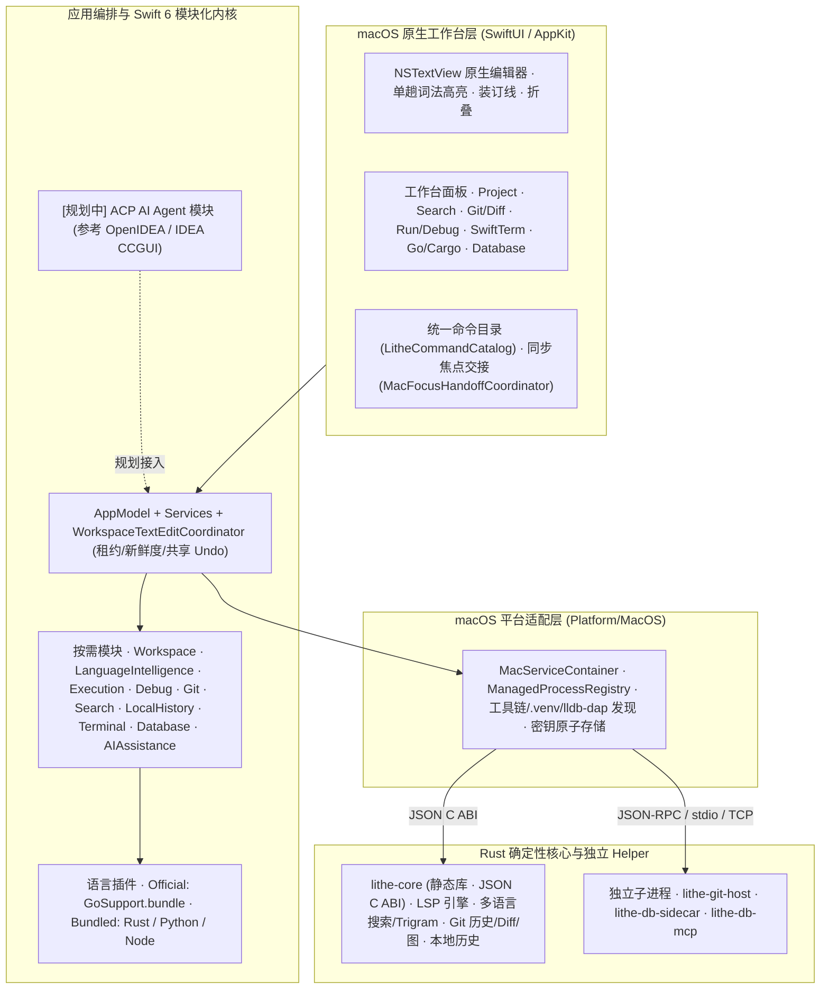

<div align="center">
  

  <h1>Lithe</h1>

  <p><strong>面向 AI Agent 协作的 macOS 专用轻量高性能 IDE（优先 Go / Rust / Python，后续扩展 Web）</strong></p>

  <p>
    <a href="./README.md"><strong>English</strong></a> ·
    <a href="#当前重点">当前重点</a> ·
    <a href="#功能进展与实测对比">进展与对比</a> ·
    <a href="#后续-todo">TODO</a> ·
    <a href="#核心功能">核心功能</a> ·
    <a href="#产品截图">产品截图</a> ·
    <a href="#下载与安装">下载</a> ·
    <a href="#架构概览">架构图</a> ·
    <a href="#如何开发">如何开发</a>
  </p>

  <p>
    <a href="https://hellogithub.com/repository/1lck/Lithe-IDEA" target="_blank"></a>
  </p>

  <p>
    <a href="https://qm.qq.com/cgi-bin/qm/qr?k=&amp;group_code=163027877"></a>
    <a href="https://gcnctzuuwe9u.feishu.cn/wiki/HJFbwZ0hZirAPnkWF3xcPWkCnid?from=from_copylink"></a>
  </p>

  <p>
    <a href="https://github.com/1lck/Lithe-IDEA/releases/latest"></a>
    <a href="https://github.com/1lck/Lithe-IDEA/releases"></a>
    
    
    <a href="#下载与安装"></a>
    <a href="./LICENSE"></a>
  </p>
  <p>
    
    
    
  </p>
</div>

> **分支定位与状态 · 2026-11-26（`dev/aiide`，验证基线 `36e45432`）：** 本分支专注构建 **macOS 专用轻量高性能 IDE**，本质面向 **AI Agent 友好**（后续规划参考 **OpenIDEA** 与 **IDEA CCGUI** 接入 **基于 ACP 的 Agent 能力**）。第一梯队优先支持 **Go / Rust / Python**（项目框架工具、语法高亮、智能推荐、跳转导航、重构与调试对标 **GoLand / RustRover / PyCharm**），后续规划扩展 **TypeScript / JavaScript / HTML / CSS** 等 Web 栈。永久排除 Windows、Java 生态与框架增量、Linux.do 集成，Monaco 迁移继续暂缓。

## 为什么做 Lithe

AI 编程与 Agent 协作正在承担越来越多代码生成与修改任务，但开发者仍然需要一个响应迅速的原生 IDE 来**看懂代码、语义跳转、运行调试、审查 Diff**，同时为 **AI Agent 提供安全可控的工作台闭环**（事务编辑与回滚、LSP 诊断验证、Git 变更审查与终端/调试反馈）。只为这些核心闭环而常驻占用数 GB 内存的重型开发环境，显得越来越沉重。

## Lithe 是什么

Lithe 是一款 **macOS 专用**的原生轻量高性能 IDE，坚持 SwiftUI / AppKit + 原生 `NSTextView` 编辑器 + Rust 确定性核心架构，提供项目浏览、代码编辑与语义导航、全局搜索替换、运行与断点调试、Git Diff 审查、本地历史、内置终端与数据库工作台等完整核心工作流。

- **第一梯队语言（当前主力）：** **Go、Rust、Python**——持续向 **GoLand / RustRover / PyCharm** 对齐日常开发与语义能力。
- **第二梯队语言（后续规划）：** **TypeScript / JavaScript / HTML / CSS 等 Web 栈**——在现有 Node 执行/调试底座与 HTML/SVG 预览基础上逐步扩展。
- **AI Agent 友好定位（规划演进）：** 当前已内置 AI Commit 与本机 AI 配置导入；后续计划参考 **OpenIDEA** 与 **IDEA CCGUI** 接入 **基于 ACP（Agent Client Protocol）的 Agent 能力**，复用原生跨文件编辑事务、共享 Undo、Diff 审查、LSP 与调试反馈（规划方向，尚未实施）。
- **精简边界与上游同步：** 默认包不包含 JDK/JDTLS、Java Debug/Test；Maven、Spring、Windows 和 Linux.do 集成已永久移除，Monaco 编辑器迁移继续暂缓。已按版本顺序合入上游至 **v0.5.0**（保留原始提交历史）并挑选截至 **v0.6.5** 的通用输出、Git 与终端修复，详见[集成与验收记录](./docs/architecture/ai-ide-phase-one.md)。

打开普通项目后，Lithe 应用本身的基础内存占用通常约为 **300～400 MB**。语言服务器、终端、构建工具、调试器和数据库组件均按需启停；实际占用随项目规模与启用服务变化。

> **AI 与 Agent 负责加速编写，Lithe 提供低内存原生工作台，帮你看懂、跑通、调试并安全审查每一次修改。**

## 当前重点

- **Go / Rust / Python 深度对标：** 围绕 GoLand / RustRover / PyCharm 的核心研发路径，持续补齐 LSP 编辑器直通交互（L4a）、离线语法与现代补全引擎（L0–L3/L6）、语义重构（B6）及测试/基准测试入口 gutter（B7b）。
- **原生 macOS 性能与跨文件修改安全：** 保持 SwiftUI/AppKit + `NSTextView` 与 Rust Core 严格分层；搜索替换与语言重构统一通过文档新鲜度检查、修改租约、文件/匹配排除、共享 Undo/Redo 与磁盘失败补偿落地。
- **面向 AI Agent 的底座建设（ACP 规划）：** 让编辑事务、Diff 审查、LSP 校验与 Run/Debug 成为可复用通道，为后续基于 **ACP**（参考 OpenIDEA 与 IDEA CCGUI）的 Agent 模块提供安全可控的宿主环境，同时不增加空载内存。
- **后续 Web 栈扩展：** 在 Go / Rust / Python 体验闭环后，通过模块化语言插件体系接入 TypeScript / JavaScript / HTML / CSS 支持。

完整架构、对标矩阵与验证证据见[架构、对标与实测总览](./docs/architecture/goland-parity-implementation.md)、[重构当前状态](./docs/architecture/goland-parity-b6-refactor.md#b6-current-implementation-rulings)和[语言能力方案](./docs/architecture/syntax-and-completion.md)。

<a id="功能进展与实测对比"></a>

## 功能进展与实测对比

### 已完成能力（对标 GoLand / RustRover / PyCharm）

| 能力域 | 对标参照 | Lithe 当前已落地并验证（基线 `36e45432`） |
| --- | --- | --- |
| **项目与框架工具** | GoLand Go Tools、RustRover Cargo、PyCharm 环境 | Go Tools / Cargo 右侧工具窗（元数据只读隔离、目标树、独立任务、取消/刷新）；`go.mod`/`Cargo.toml`/Python `.venv` 自动识别；原生多项目窗口与多行标签 |
| **语法、高亮与编辑** | 三 IDE 编辑器基础 | 原生 `NSTextView` 稳定 Undo、UTF-16 代理对与 IME 保护、括号匹配、代码折叠；Go / Rust / Python / C 系 / SQL 单趟词法状态机高亮；HTML / SVG / Markdown 预览 |
| **导航、搜索与替换** | Search Everywhere、Find/Replace | 双击 Shift / `⌘⇧O` 焦点安全搜索（All/Classes/Files/Symbols/Actions/Text）；Rust Core 多语言符号索引（Go/Rust/Python/JS-TS/C 系）与非 ASCII 兼容 Trigram；跨文件替换预览、排除项、二进制兼容、共享 Undo 与磁盘补偿 |
| **LSP 跳转与重构** | GoLand / RustRover / PyCharm 语义操作 | 跨文件 Definition（`⌘B`）、Implementation（`⌥⌘B`）、References（`⌥⌘U`）；统一语言快捷键（`⇧F6`/`⌥⌘L`/`⌥↩`/`⌃Space`/`F1`）；有序 `WorkspaceEdit`、`codeAction.dataSupport` + `resolve`、UTF-16 选区 Code Actions、`prepareRename`、恢复标签跨文件同步与跨文件单次 ⌘Z；并发激活去重防双 `gopls` |
| **运行与断点调试** | Delve / LLDB / debugpy | Go/Rust/Python/Node 调试扩展注册（含 `GoSupport.bundle` v2）、多语言装订线断点、Rust 调试前自动 `cargo build`、Python `.venv` 与 Swiftly `lldb-dap` 发现、`/tmp` 符号链接归一化与 DAP 子进程组回收（本机实测 Rust `cargo + lldb-dap` 命中 `main.rs:4` 读取局部变量并退出 `0`；`dlv`/`debugpy` 待对应工具链环境复验） |
| **终端与焦点交接** | GoLand / Zed 终端 | 原生 SwiftTerm 终端（shell/env/cwd/字体/venv 自动检测、退出关闭标签、Control 键归还终端）；`MacFocusHandoffCoordinator` 同步释放编辑器焦点并缓冲早期输入，修复 `⌥F12`/`⌘⇧O` 漏键写入源码 |
| **Git 与本地历史** | Git Log / Diff / Local History | Rust 后端流式 Git 历史过滤（最高 50,000 提交、文本/作者/日期/路径）、本地时区、分支图、双栏 Diff、Blame、Stash/Shelf/Worktree；Local History 节流快照清理 |
| **数据库与 AI 辅助** | DataGrip 基础工作台 + AI Commit | 多数据库工作台（SQLite/Postgres/MySQL/SQL Server/MongoDB/Redis/Nacos）、`lithe-db-sidecar`（SQLite 动态类型解码、安全导出、SSH 隧道自动回收与防注入、SQL Server 事务回滚）与 `lithe-db-mcp`；AI Commit Message 与本机 AI 配置导入 |

### 性能与实测对比

> 桌面 GUI 对比数据来自 **2026-11-25 实机对照**（Apple M6 / 16 GB / macOS 27.0，参照 GoLand 2026.2.3 / RustRover 2026.3.1.1 / PyCharm 2026.3.0.2）；自动化测试、安装校验与真实工具链冒烟来自 **2026-11-26 修复后基线 `36e45432`**。详细口径与原始日志见[性能与实测对比汇总](./docs/architecture/goland-parity-implementation.md#performance-comparison-2026-11-26)。

| 对比项 | 场景 / 样本 | Lithe 实测 | 参照 IDE（GoLand / RustRover / PyCharm） | 备注与当前状态 |
| --- | --- | --- | --- | --- |
| **普通项目主进程内存** | 打开常规项目常驻 RSS | 约 **300–400 MB** | JetBrains IDE 常驻通常 **1.5–2+ GB** | 原生 AppKit + 按需模块核心优势 |
| **大仓主进程 / 进程树 RSS** | Hugo（2,619 文件 + Git 日志，120s 中位数） | 主进程 **349.9 MiB**；进程树 1,573.7 MiB（当时含双 `gopls` 1,216.1 MiB） | GoLand 主进程 **1,815.8 MiB**；进程树 2,170.0 MiB | 主进程约 GoLand 的 **1/5**；双 `gopls` 竞态已于 `e2433a52` 修复，待同仓重测进程树 |
| **Git 日志热打开** | Hugo（1,037 commits，⌘9 三次热测） | **773 / 791 / 807 ms** | GoLand **2,100 / 1,870 / 1,867 ms** | Lithe 快 **2.3×–2.6×**；`96285483` 已补齐后端流式过滤与本地时区 |
| **Search Everywhere（Core）** | Release Core 首次 / 五次热查中位数 | Hugo **537.7 / 11.1 ms**；Cargo **575.6 / 9.6 ms**；Django **1,443.3 / 111.3 ms**；Vue **236.4 / 2.6 ms** | *(不含 UI/AX 开销，桌面端 Hugo：Lithe 2,221–2,502 ms vs GoLand 1,280–1,320 ms)* | `aee8a009` 补齐三语言符号索引并修复 Trigram 绕过；焦点泄漏已修复，待桌面重测 |
| **三语言 Run 启动** | `21 × 2` 到首个 `42` 输出 | Go **665 ms** · Rust **501 ms**（含 Cargo 构建）· Python **58 ms** | 三参照 IDE 均输出 `42` 退出 `0` | 轻快直接执行 |
| **终端热打开 + 首条命令** | 预热 shell 后 `⌥F12` 立即输入 `sh t` | **98 / 98 ms**（成功轮） | GoLand **105 / 110 / 95 ms** | 热响应持平；`553fa143` 已修复首轮焦点失序漏键与写入源码 |
| **SQLite 查询延迟** | `SELECT sum(v) AS parity_sum FROM sample` | **22 / 35 / 32 / 32 ms** | GoLand SQLite JDBC **500 / 335 / 85 / 331 ms** | 2026-11-26 打包版 `lithe-db-sidecar` 复验动态表达式列全对 |
| **断点调试与全量回归** | `36e45432`（2026-11-26） | Rust `cargo + lldb-dap` 命中 `main.rs:4` 读出 `count=21, result=42`；Rust **564/564** + macOS Swift **1,630/1,630** 全绿 | 三参照 IDE 均支持断点与局部变量 | `/Applications/Lithe.app` 已从干净 `HEAD` 重建验证；`dlv`/`debugpy` 待工具链环境复验 |

### 暂缓与排除范围

- **暂缓（保持现状，恢复前需重新确认）：** B2（Project / Commit / Pull Requests 改造）、E1 扩展能力（跨语言统一 Problems、多光标/列选择、调用/类型层级、书签、测试覆盖率）、`.http` 内置请求运行器。
- **永久排除：** Windows 产品与构建、Java 生态与框架增量（Maven / Spring / MyBatis / JDT / JDTLS / 内置 JDK）、Linux.do 集成；Monaco 编辑器迁移继续暂缓。

## 后续 TODO

以下按当前产品定位与优先级分层排序（完整根因、批次表与验收明细见[架构、对标与实测总览](./docs/architecture/goland-parity-implementation.md#feature-progress-2026-11-26)与[代码审查记录](./docs/architecture/goland-parity-implementation.md#code-review-todo-2026-11-25)）：

- [x] **2026-11-25 · B6a2 首个文本切片安装验收：** Go 重命名、格式化、代码动作、补全核实写盘与单次撤销；Rust 完成真实 `codeAction/resolve` 往返。[验收记录](./docs/architecture/goland-parity-b6-refactor.md#b6-text-edit-acceptance-2026-11-25)
- [x] **2026-11-26 · P0 阻断项与高频正确性闭环（8 批提交 `aee8a009`..`36e45432`）：** 修复 `⌥F12`/`⌘⇧O` 焦点泄漏、打通 Go/Rust/Python 断点调试链路（Rust `cargo + lldb-dap` 本机冒烟通过）、补齐三语言符号索引与 Trigram/替换 Apply、消除双 `gopls` 竞态与恢复标签重命名误拒、改写单趟词法高亮、补齐 Git 后端搜索/本地时区/`parse_diff`/`pop_stash`，并加固 `lithe-db-sidecar`。
- [x] **2026-11-26 · P1 语言快捷键、B6a2 协议与平台加固：** 注册 `⇧F6`/`⌥⌘L`/`⌥↩`/`⌃Space`/`F1`；补齐 `codeAction.dataSupport`、真实选区 Code Actions 与 `prepareRename`（真实 `gopls` 冒烟通过）；加固进程 FD、密钥 `0o600` 原子写、Local History O(N²) 与 LSP 子进程回收。[B6](./docs/architecture/goland-parity-b6-refactor.md)
- [ ] **P1-A · L4a LSP 编辑器直通交互：** 接通 `inlayHint`（类型/参数内联提示）、`signatureHelp`（函数参数提示）、`documentHighlight`（符号出现点高亮）、`documentSymbol`（Structure 面板与面包屑）与 `semanticTokens`（语义着色）。[L4a](./docs/architecture/syntax-and-completion.md#l4a-split)
- [ ] **P1-B · L0–L3 / L6 离线语法与现代补全引擎：** Tree-sitter 增量文档状态、Go/Rust/Python 高精度离线高亮与折叠结构、自动触发/过滤/排序/Snippet/文档预览补全 Popup，以及保存即格式化 `formatOnSave`。[L0–L2](./docs/architecture/syntax-l0-l2-engine.md)
- [ ] **P1-C · B6 剩余语义重构与 B7b 运行 gutter 深化：** 内联 Rename UI（B6c）、文件/目录资源事务（B6b1）、Extract/Inline/Change Signature/Safe Delete（B6d）、按需反向 `workspace/applyEdit`；测试/基准测试行级 gutter 与 Go `dlv` / Python `debugpy` 真机断点复验。[B6](./docs/architecture/goland-parity-b6-refactor.md)
- [ ] **P1-D · AI Agent 能力（基于 ACP，参考 OpenIDEA & IDEA CCGUI）：** 规划并接入 ACP（Agent Client Protocol）客户端会话、权限确认与工具面板，复用原生编辑事务/共享 Undo、Git Diff 审查、LSP 诊断与终端/调试反馈，保持低内存按需激活。
- [ ] **P2-A · Web 语言栈扩展（TypeScript / JavaScript / HTML / CSS 等）：** 在 Go/Rust/Python 核心体验闭环后，通过模块化语言插件接入 TS/JS/HTML/CSS LSP、语法高亮、框架/包管理识别、格式化与前端调试。
- [ ] **P2-B · 工作台体验补齐与暂缓项评估：** Search Everywhere 最近文件与 `⌘E`（B3c/B3d）、B4/B5 设置与主题资源插件、TODO 工具窗、G1 Git 图最终对照；B2（Project/Commit/PR）、E1 与 `.http` 继续暂缓。

## 核心功能

1. 多语言项目浏览、编辑与导航。
2. 支持断点调试和自定义启动配置。
3. 支持 Git 管理和 Diff 审查。
4. 支持双击 Shift 搜索，以及 `Command + Shift + F` 全局搜索。
5. 支持无需 LSP 的轻量补全和当前文件导航，并可按需使用语言服务器增强补全、悬浮与语义导航。
6. 支持本地快照保存。
7. 支持在应用内打开多个项目。
8. 支持在同一窗口打开多个文件，各文件相互独立。
9. 支持使用 AI 自动生成 Commit Message，并可自定义格式。
10. 支持多种 Markdown 语法渲染，与语雀一致。
11. 支持查看应用的本地内存占用情况。
12. 支持通过 Homebrew 一键安装和更新。
13. 支持在应用内一键更新并安装。
14. 自动识别 Rust/Cargo、Go、Python 等项目的可运行入口，也保留 Make、Shell 等已有运行能力。
15. 支持按语言独立开关语言服务，可根据电脑配置自由启用或停用。
16. 支持类似 IDEA 的多行编辑器标签，同时展示更多打开的文件。
17. 新增数据库连接工作台，支持多种数据库类型、连接管理、SQL 历史、表浏览和数据库操作。
18. 按需挑选上游通用修复，保持原生编辑器、轻量包体和简单配置。

## 产品截图

<p align="center">
  
  
</p>

<p align="center">
  
</p>

<p align="center">
  
  
</p>

<p align="center">
  
</p>

<p align="center">
  
  
</p>

<p align="center">
  
  
</p>

<p align="center">
  
</p>

<p align="center">
  
  
</p>

<p align="center">
  
  
</p>

## 下载与安装

以下发行链接指向上游构建。使用 `./scripts/package-app.sh` 本地构建本分支，得到裁剪后的安装包。

- **macOS 13+：**前往 [GitHub Releases](https://github.com/1lck/Lithe-IDEA/releases/latest) 下载 `.dmg`。M 系列芯片选择 `arm64`，Intel 芯片选择 `x86_64`。

macOS 推荐使用 Homebrew 安装和更新：

```bash
brew tap 1lck/lithe https://github.com/1lck/Lithe-IDEA.git
brew install --cask 1lck/lithe/lithe
brew upgrade --cask lithe
```

### macOS 提示“无法打开 Lithe.app”

如果 macOS 提示“Apple 无法验证 Lithe.app 是否包含可能危害 Mac 安全或泄漏隐私的恶意软件”，通常是因为手动下载的安装包尚未经过 Apple 公证。请先确认应用来自可信的 [GitHub Releases](https://github.com/1lck/Lithe-IDEA/releases/latest)，然后选择以下任一方式：

<p align="center">
  
</p>

1. 在“应用程序”中按住 Control 键点按 `Lithe.app`，选择“打开”，再在确认对话框中选择“打开”。
2. 如果仍被阻止，打开“系统设置 > 隐私与安全性”，在安全性提示旁点按“仍要打开”，然后再次启动应用。
3. 也可以在终端中移除下载文件的隔离标记：

   ```bash
   sudo xattr -dr com.apple.quarantine /Applications/Lithe.app
   ```

上述命令只应对你确认来源可靠的应用使用；通过 Homebrew 安装通常不需要手动执行这些步骤。

## 架构概览

Lithe 采用「**原生 macOS 工作台与平台适配层 + Swift 6 模块化内核 + Rust 确定性核心与独立 Helper**」的分层架构，各层边界由自动化脚本持续守护（详细分层职责见[当前架构总览](./docs/architecture/goland-parity-implementation.md#architecture-overview-2026-11-26)与[仓库目录与共享边界](./docs/architecture/repository-layout.md)）：



<a id="如何开发"></a>
<details>
<summary><strong>如何开发</strong></summary>


开发环境需要 Swift 6.2 或更高版本。运行完整测试需要 Xcode；基础 SwiftPM 构建只需要 Command Line Tools。

在项目根目录运行开发版本：

```bash
./scripts/preview.sh
```

该脚本会构建并链接 Rust Core，然后启动 macOS 应用。只验证 Swift 源码时可以运行：

```bash
swift run --disable-sandbox Lithe
```

构建 App Bundle：

```bash
./scripts/package-app.sh
open dist/Lithe.app
```

提交改动前运行：

```bash
./scripts/test-macos.sh
./scripts/verify-core.sh
./scripts/verify-git-graph.sh
./scripts/verify-service-boundaries.sh
./scripts/verify-shared-contracts.sh
./scripts/verify-rust-core.sh
```

目录归属、跨平台边界、共享规则以及 Rust Core 必须遵守的注释规范见[仓库目录与共享边界](./docs/architecture/repository-layout.md)。提交功能改动时，请说明验证方式和已知限制。

</details>

## 项目支持

### ❤️ 赞助商

<p align="center">
  <a href="https://www.fastaitoken.com/">
    
  </a>
</p>
<p align="center">
  <a href="https://www.fastaitoken.com/"><strong>FastAI</strong></a><br>
  FastAI 提供多款主流大模型的便捷中转服务，让开发者可以更轻松地把 AI 能力接入日常开发流程。其支持也帮助 Lithe 持续完善 AI 辅助体验。感谢 FastAI 对本项目的支持！欢迎扫码加入 FastAI Token 交流群②（群号：1073874006）。
</p>

<a href="mailto:2188718831@qq.com">想显示在下方？</a>

<table>
  <tr>
    <td width="112" align="center">
      <a href="https://www.fastaitoken.com/">
        
      </a>
    </td>
    <td>
      <a href="https://www.fastaitoken.com/"><strong>FastAI</strong></a> 提供多款主流大模型的便捷中转服务，让开发者可以更轻松地把 AI 能力接入日常开发流程。其支持也帮助 Lithe 持续完善 AI 辅助体验。感谢 FastAI 对本项目的支持！
    </td>
  </tr>
  <tr>
    <td width="112" align="center">
      <a href="https://torchai.ai/sign-up?aff=FdkE">
        
      </a>
    </td>
    <td>
      <a href="https://torchai.ai/sign-up?aff=FdkE"><strong>TorchAI</strong></a> 面向开发者提供大模型中转服务，便于在编程、内容生成和自动化等不同场景中调用模型 API。其支持帮助 Lithe 保持持续开发，并探索更实用的 AI 工具体验。感谢 TorchAI 对本项目的支持！
    </td>
  </tr>
  <tr>
    <td width="112" align="center">
      <a href="https://api.axis.fan/register?aff=4EZFN7322WTH">
        
      </a>
    </td>
    <td>
      <a href="https://api.axis.fan/register?aff=4EZFN7322WTH"><strong>元流 Token</strong></a> 提供多种大语言模型 API 的中转接入，为开发者体验不同模型、构建 AI 应用提供灵活入口。其赞助支持 Lithe 持续拓展并优化 AI 相关功能。感谢元流 Token 对本项目的支持！
    </td>
  </tr>
  <tr>
    <td width="112" align="center">
      <a href="https://codezsy.com/register?aff=fDyA">
        
      </a>
    </td>
    <td>
      <a href="https://codezsy.com/register?aff=fDyA"><strong>CodeZ</strong></a> 专注于 GPT 系列模型的稳定中转，为开发者在工具和项目中集成模型 API 提供简单直接的选择。其赞助为 Lithe 的持续开发与维护提供了助力。感谢 CodeZ 对本项目的支持！
    </td>
  </tr>
</table>

### 贡献者

感谢所有参与 Lithe 开发和改进的贡献者。

<a href="https://github.com/1lck/Lithe-IDEA/graphs/contributors">
  
</a>

### License

Lithe 采用 [Apache License 2.0](./LICENSE) 授权。

## Star History

<a href="https://www.star-history.com/#1lck/Lithe-IDEA&Date">
  
</a>
