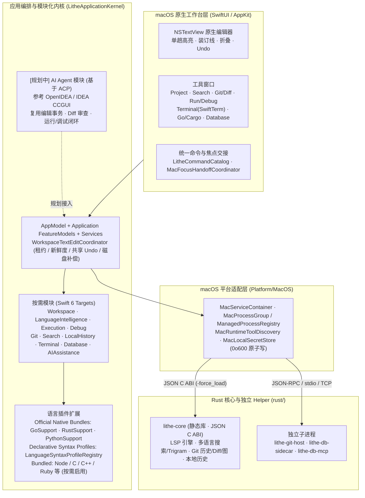

# Lithe macOS 轻量高性能 IDE：架构、能力对标、路线图与实测对比

> **产品定位（2026-11-27 更新，目标分支 `dev/aiide`）**
> - **macOS 专用轻量高性能 IDE（默认轻量智能 · LSP 按需升级）**：坚持原生 SwiftUI/AppKit + `NSTextView` 编辑器 + Rust Core。默认以 **Lightweight Mode（零 LSP 冷启动、零工具探测子进程、进程内 Rust 符号/Trigram 索引约 18.36 MB RSS、毫秒级响应）** 覆盖约 80% 日常编码需求；需要跨文件安全重构、格式化、Code Actions、Go to Implementation 或实时类型诊断时，可一键按窗口或全局升级至 **Precision LSP（`gopls` / `rust-analyzer` / `basedpyright`）**，切回轻量即刻停止 LSP 进程释放内存。
> - **第一梯队语言（优先深度对齐）**：**Go、Rust、Python**——官方签名原生包（`GoSupport` / `RustSupport` / `PythonSupport`）完整覆盖轻量智能、按需精确 LSP、Gutter 运行/测试与三语言断点调试。
> - **第二梯队语言（后续规划）**：**Web 栈（TypeScript / JavaScript / HTML / CSS 等）**——在现有 Node 执行/调试底座、单趟高亮与 HTML/SVG 预览之上逐步扩展。
> - **AI Agent 友好核心定位**：面向 AI Agent 协作设计，后续规划参考 **OpenIDEA** 与 **IDEA CCGUI** 接入 **基于 ACP（Agent Client Protocol）的 Agent 能力**，与原生编辑事务、Diff 审查、轻量/按需 LSP 验证和运行调试形成闭环（当前为规划方向，尚未实施）。
> - **显式排除与边界**：永久排除 Windows 产品与构建、Java 生态与框架增量（Maven/Spring/MyBatis/JDT/JDTLS/内置 JDK）、Linux.do 集成；Monaco 编辑器迁移继续暂缓。

历史演变说明：早期以 `c09f2cc4` 为基线推进 B1–B7、L0–L8 与 G1；B1、B3a/B3b 文本事务、B4a0–B4a6 Terminal、B7a（Cargo / Go Tools）与 B6a1a/B6a2 文本与协议切片已先后落地；2026-11-26 完成全仓审查与 8 批 P0/P1 修复（`aee8a009`..`36e45432`）并替换验收 `/Applications/Lithe.app`。总体方案复核见[审查记录](#plan-review)，2026-09-21 跨批次源码复核见[体验对齐复核](#experience-parity-review-2026-09-21)。

---

<a id="architecture-overview-2026-11-26"></a>

## 当前架构总览

Lithe 采用「**原生 macOS 界面与平台适配层 + Swift 6 模块化内核 + Rust 确定性核心与独立 Helper**」的分层架构，严格由 `./scripts/verify-service-boundaries.sh` 与 `./scripts/verify-module-boundaries.sh` 守护边界：



| 分层 | 关键目标 / 路径 | 核心职责与约束 |
| --- | --- | --- |
| **原生展示层** | `macos/Sources/Lithe/Views/` | SwiftUI 工作台与 AppKit 原生组件（`NSTextView`、`SwiftTerm`、`LitheSplitPaneView`）；禁止直接调用 Rust C ABI 或构造底层进程/文件适配器 |
| **应用与服务编排层** | `macos/Sources/Lithe/{Models,Application,Services}/` | `AppModel` 聚合、`EditorChromeModel` 高频隔离状态、`WorkspaceTextEditCoordinator` 跨文件文本事务、`DebugLaunch*Resolver`、`RustDebugBuildService`；禁止引入 AppKit/SwiftUI |
| **模块化内核与功能模块** | `LitheModuleAPI`、`LitheApplicationKernel`、`LitheCoreContracts`、`Lithe*Module`（10 个独立 Swift 6 模块） | 按需激活/休眠/关闭、在途激活去重防双进程、资源租约与 `ModuleRuntime` 生命周期管理；完全平台无关 |
| **语言插件层** | `Plugins/mac/Official/{GoSupport,RustSupport,PythonSupport}`、`LanguageSyntaxProfileRegistry`、`BundledLanguagePluginCatalog` | Go/Rust/Python 各自以独立签名 `.bundle` 导出 LSP、Run、Test、Debug（`.languageDebugExtension`）与声明式词法/高亮/离线关键字配置（`LanguageSyntaxExtensionProviding`）；其余轻量/仅高亮语言通过 `LanguageSyntaxProfileRegistry` 零进程常驻；冻结 v1 兼容契约 |
| **macOS 平台适配层** | `macos/Sources/Lithe/Platform/MacOS/` | 组合根 `MacServiceContainer`、进程组与 `ManagedProcessRegistry` 生命周期回收、工具链/Python `.venv`/Swiftly `lldb-dap` 发现、焦点交接与密钥存储 |
| **Rust 确定性核心与 Helper** | `rust/lithe-core`、`rust/lithe-git-host`、`rust/lithe-db-sidecar`、`rust/lithe-db-mcp` | 承载确定性搜索索引/符号提取/替换、Git 流式历史与分支图、LSP 协议状态机与进程管理、多数据库运行时与 MCP 能力 |
| **未来 AI Agent 扩展位（规划中）** | `LitheAIAssistanceModule` / 独立 ACP Agent 模块（待设计） | 计划参考 OpenIDEA 与 IDEA CCGUI 接入 ACP（Agent Client Protocol），通过原生事务与 Diff/LSP/Debug 通道实现可控、可回滚、可验证的 Agent 协作 |

---

<a id="feature-progress-2026-11-26"></a>

## 功能进展总览（已完成｜TODO｜暂缓与排除）

### 已完成能力（对标 GoLand / RustRover / PyCharm）

> 以下条目均已在源码实现并通过自动化测试、合约校验及对应实机/工具链验证（截至 `36e45432`）。

| 能力维度 | 对标目标 | Lithe 当前已交付能力 | 代表提交 / 验证证据 |
| --- | --- | --- | --- |
| **项目与工具窗口** | GoLand Go Tools、RustRover Cargo、PyCharm 项目环境 | Go Tools 与 Cargo 右侧工具窗（元数据只读隔离、目标树、独立工具任务、取消/刷新、G/R 图标）；自动识别 `go.mod`/`Cargo.toml`/Python 项目与 `.venv`/`VIRTUAL_ENV`；原生多项目窗口与多行标签 | `211395cc`、`3d97c080`、`279338a0`；[Go Tools](goland-parity-b7a3-go-tools-done.md)、[Cargo](goland-parity-b7a2c2-cargo-tool-window-done.md) |
| **语言插件与语法高亮** | GoLand / RustRover / PyCharm 语言插件与编辑器基础 | Go（`GoSupport.bundle`）、Rust（`RustSupport.bundle`）、Python（`PythonSupport.bundle`）全部收口为签名原生官方包，统一拥有 LSP + Execution + Test + Debug + `LanguageSyntaxExtensionProviding`；其余语言（JSON/YAML/TOML/SQL/Shell/Dockerfile/Makefile/Markdown 等）通过线程安全 `LanguageSyntaxProfileRegistry` 提供零进程单趟词法高亮与离线关键字补全；原生 `NSTextView` 稳定 Undo、UTF-16 代理对安全、IME 组合态保护、括号匹配、代码折叠、行级编辑；LSP `semanticTokens/full` 语义着色层（滚动局部重绘后自动重叠加）；HTML/SVG/Markdown 预览 | 本轮 `dev/aiide` 验证：`LitheOfficialPluginVerifier` 3/3 官方包通过，[plugin-architecture.md](plugin-architecture.md)、[language-support.md](language-support.md) |
| **导航、搜索与结构视图** | Search Everywhere、Structure（`⌘7`）、Breadcrumbs、Find/Replace in Files | 双击 Shift / `⌘⇧O` 原生焦点安全搜索框；`⌘7` Structure 侧边栏（支持搜索过滤、树形展开与跳转）+ 编辑器顶部 `EditorSymbolBreadcrumbsView`（LSP `textDocument/documentSymbol` 层次树 + Rust Core `workspace.documentSymbols` 离线即时回落）；Rust Core 多语言工作区符号提取（Go/Rust/Python/JS-TS/C 系）与非 ASCII 兼容 Trigram 索引；项目替换显式范围、预览、排除、共享 Undo 与磁盘补偿 | 本轮 `dev/aiide` 验证：`LspEditorInteractionsP1ATests`、真实 `gopls`/`rust-analyzer`/`basedpyright` 冒烟通过 |
| **默认轻量智能 + 按需精确 LSP** | 毫秒级日常编码（80% 高频需求）+ 显式精确语义引擎 | **默认 Lightweight Mode（零 LSP 冷启动）**：Rust Core 进程内符号/Trigram/前缀索引（`WorkspaceSearchIndex`）驱动跨文件定义跳转、Trigram 剪枝跨文件纯代码引用、带文档注释的富 Markdown Hover、UTF-16 参数签名提示（`lsp.builtinSignatureHelp`）、工作区+内建类型/代码片段无噪补全、Go/Rust/Python 多语言代码折叠（`editor.foldRegions`）与 O(log N) 隐藏区间、全语言同词高亮、450ms 悬停提示；状态栏胶囊 + `Settings → LSP` + 命令面板支持按窗口或全局切换 **Precision LSP**，触发 Rename/Format/Code Actions/Implementation 时一键升级，切回轻量立即回收全部 LSP 进程 | 本轮 `dev/aiide` 验证：Rust Core **572/572**（`lithe-core` 543、`db-sidecar` 19、`db-mcp` 4、`git-host` 6）、`test-git-execution.py` 11/11、macOS 关联测试 **248/248**（22 suites，2.116s）；Release C-ABI 真实 `rust/lithe-core` 实测 **18.36 MB RSS、0 子进程**（定义 1.09ms、Hover 0.96ms、签名 0.37ms、2,088 行折叠 0.59ms、补全 2.16ms、跨文件引用 3.35ms）；**三轮 Codex CLI（`gpt-6.1-sol` `high`）独立审查共 21 项问题（3 P1 + 18 P2）全部闭环修复并补回归测试** |
| **LSP 智能补全、提示与重构** | GoLand / RustRover / PyCharm 语义编码体验 | **P1-A（L4a）**：`inlayHint` 视口行尾胶囊（支持滚动增量刷新、跳过折叠行与开关设置）、`signatureHelp`（`(` / `,` / `⌘P` 非夺焦参数签名浮窗 + UTF-16 参数偏移高亮）、`documentHighlight`（光标符号读写区分着色）、`documentSymbol`、`semanticTokens`。<br>**P1-B**：非阻塞 AppKit 悬浮 `CompletionPopupController`（左侧类型徽章/加粗前缀/详情 + 右侧按需 `completionItem/resolve` 文档预览，按 `batchGeneration` 隔离防陈旧缓存、IME 组合态让权、光标移出锚点自动失效）、前缀/子序列与 `preselect`/`sortText` 排序、Provider 容错回落与同源重载去重、`$0`/`${1:default}`/`${1|a,b|}` Snippet 展开（含嵌套转义保留）与首 tabstop 选区；共享保存流 `beforeSaveDocument` 接入有界（1.5s）`formatOnSave`（覆盖 `⌘S`/切换标签/Save All/关闭确认）。<br>**P1-C**：非模态 `InlineRenamePanelController` 内联重命名浮框（`prepareRename` 预填、跨文件单次 `⌘Z` 撤销）、`Refactor This`（`⌃T`，走 `LitheContextMenuPresenter`）、跨文件 Definition/Implementation/References/Code Actions | 本轮 `dev/aiide` 验证：真实 `gopls`/`rust-analyzer`/`basedpyright` 实机协议冒烟通过，Codex CLI 审查意见全部闭环 |
| **运行、测试与断点调试** | GoLand Delve、RustRover LLDB、PyCharm debugpy | Go/Rust/Python 官方包均导出 `.languageDebugExtension` 与单测/基准测试规划；装订线（Gutter）行级运行与调试入口覆盖 Go（`func main`、`Test*`、`Benchmark*` `-benchmem`、`Example*`）、Rust（`fn main`、`#[test]`/`#[tokio::test]`/`#[rstest]`/`#[bench]` 自动解析文件模块与嵌套 `mod` 全限定路径如 `math::ops::tests::adds_numbers` 与 `--bin`/`--test` 目标）、Python（`__main__`、`def test_*`、`class Test*` `Class::test_*`）；点击装订线 Debug 直接路由至 Go `dlv`（`mode: "test"` + macOS 符号链接路径归一化）、Rust `cargo test --no-run` + `lldb-dap`（`--exact`）、Python `debugpy`（`module: "pytest"`）；`MacRuntimeToolDiscovery` 覆盖 `~/.local/bin`、`GOPATH/bin` 与 `.venv`；保留 `/tmp` 符号链接归一化与子进程组回收 | 本轮 `dev/aiide` 6/6 真机 DAP 断点与局部变量实测全通过（Go `dlv 1.25.2` 应用 `main.go:10` & 单测 `calc_test.go:8`、Python `debugpy 1.8.21 + pytest 8.4.2` 应用 `main.py:7` & 单测 `test_math.py:7`、Rust `cargo + lldb-dap` 应用 `main.rs:6` & 嵌套模块单测 `math::ops::tests::adds_numbers` `ops.rs:11` 全部命中并读出 `count=21, result=42` 并正常退出）；`InlineRenameAndRunnableGutterP1CTests` 与 170/170 关联测试全绿 |
| **终端与焦点交接** | GoLand / Zed 终端与键盘流 | 原生 SwiftTerm 终端（shell/参数/env/cwd/字体/滚动/venv 自动检测、退出关闭标签 `#1456`、Control 键归还终端 `#1360`）；`MacFocusHandoffCoordinator` 同步释放编辑器焦点并缓冲 250ms 按键，修复 `⌥F12`/`⌘⇧O` 按键泄漏写入源码 | `3724ea20`、`766b8619`、`c16c1201`、`553fa143`；[B4a](goland-parity-b4a-terminal-done.md) |
| **Git 审查与本地历史** | GoLand Git Log / Diff / Local History | Git 后端流式历史过滤（最多 50,000 提交，支持文本/作者/日期/路径）、本地时区显示、分支图、双栏 Diff、Blame、Stash/Shelf/Worktree、隐藏仓库过滤、`--continue` 非交互保护；Local History 文件与项目快照（节流清理防 O(N²)） | `e14399e1`、`96285483`、`553fa143` |
| **数据库与 AI 辅助** | DataGrip 基础 SQL 工作台 + AI Commit | 多数据库工作台（SQLite/Postgres/MySQL/SQL Server/MongoDB/Redis/Nacos）、`lithe-db-sidecar`（SQLite 动态类型解码、安全 SQL 导出/危险语句检测、SSH 隧道自动回收与防注入、SQL Server 事务回滚）与 `lithe-db-mcp`；AI Commit Message 生成与本机 AI 配置导入 | `6b729800`、`3ad474c3`；打包版 `lithe-db-sidecar` 冒烟通过 |

### 后续 TODO 路线图（按优先级分层）

| 优先级 | 方向 / 批次 | 核心目标 | 关键依赖与说明 |
| --- | --- | --- | --- |
| **P1-A** | **L4a · LSP 编辑器直通交互** | **已完成并验证**：`inlayHint`（含滚屏增量刷新）、`signatureHelp`、`documentHighlight`、`documentSymbol`（`⌘7` Structure + Breadcrumbs + Rust Core 离线回落）、`semanticTokens`（含滚屏重叠加） | 真实 `gopls` / `rust-analyzer` / `basedpyright` 协议冒烟通过；见 [rust-core-api.md](../../shared/contracts/rust-core-api.md) |
| **P1-B** | **现代非阻塞补全引擎与保存格式化** | **高收益主体已完成并验证**：非阻塞 AppKit 悬浮 `CompletionPopupController`、前缀/子序列/`preselect`/`sortText` 排序、`completionItem/resolve` 懒加载预览与代次隔离、Provider 容错回落与重载保留、Snippet 展开、共享保存流有界 `formatOnSave`；高复杂度离线多 Worker Tree-sitter 运行时（L1/L2）与外部语法 Worker（L7）移入下方「暂缓」 | 满足 Go/Rust/Python 接近 JetBrains 的日常编辑体验，且保持单趟词法 + LSP 语义层的低内存优势 |
| **P1-C** | **内联 Rename、Refactor This 与三语言运行/调试 Gutter** | **高收益主体已完成并验证**：非模态 `InlineRenamePanelController`（B6c）、`Refactor This`（`⌃T`）、Go/Rust/Python 行级运行/单测/基准测试 Gutter（含 Rust 全限定模块路径）及三语言单测断点调试路由（Go `dlv` / Rust `cargo test --no-run` + `lldb-dap` / Python `debugpy + pytest` 全部 6 路真机断点通过）；复杂文件/目录资源事务（B6b1）、反向 `workspace/applyEdit`（B6a1b）与自研 AST Change Signature 移入「暂缓」 | 复用 `WorkspaceTextEditCoordinator` 与 B6a2 协议；见 [goland-parity-b6-refactor.md](goland-parity-b6-refactor.md) |
| **P1-D** | **AI Agent 能力（基于 ACP，参考 OpenIDEA & IDEA CCGUI）** | 设计并接入 **ACP（Agent Client Protocol）** 客户端会话、权限审批与工具调用面板；复用 Lithe 原生跨文件编辑事务（租约/新鲜度/共享 Undo）、Git Diff 审查、LSP 诊断/跳转、终端与 Run/Debug 反馈，打造「低内存原生 IDE + ACP Agent」协作闭环 | 需先完成 ACP 架构与安全/事务边界细案，按独立按需模块落地，不拖累空载内存 |
| **P2-A** | **Web 语言栈（TypeScript / JavaScript / HTML / CSS 等）** | 扩展 `BundledLanguagePluginCatalog` 与 LSP/调试/项目识别：`typescript-language-server`/`vtsls`、HTML/CSS/Tailwind、ESLint/Prettier 格式化、`package.json`/Vite/Next 运行与前端调试、语法高亮与框架补全 | 排在 Go/Rust/Python 核心体验闭环之后推进，复用 L0–L8 语法与插件体系 |
| **P2-B** | **工作台与可配置性补齐** | Search Everywhere 空查询最近文件与 `⌘E`（B3c/B3d）、B4 其余 Editor/Keymap 导入设置、B5 主题与声明式资源插件包、TODO 工具窗、G1 Git 图最终对照 | 各批次相互独立，按需推进 |

### 暂缓与永久排除边界

- **暂缓（工程复杂度高 / 当前收益比低，保持现状，恢复前需重新确认范围）**：
  - **WASM / WASI 第三方插件沙箱（OpenIDEA `wit/plugin.wit` 模式）**：当前第一梯队语言（Go/Rust/Python）已通过同 Team 签名原生 `.bundle` 插件 + 声明式 `LanguageSyntaxProfileRegistry` 达成高原生性能与按需生命周期隔离，短期无第三方插件市场需求，暂不引入 WASM 运行时与跨边界序列化开销。
  - **多 Worker Tree-sitter 增量解析运行时（L1/L2）与外部语法 Worker / 本地收据协议（L7）**：当前单趟词法状态机（`LanguageSyntaxProfile`）+ LSP `semanticTokens/full` 叠加 + Rust Core `workspace.documentSymbols` 离线回落已覆盖 Go/Rust/Python 高亮与大纲高频诉求；引入独立增量解析线程池与跨进程收据同步工程复杂度极高、边际体验收益有限，列入暂缓。
  - **多 Tabstop 实时镜像编辑（Live Multi-Tabstop Snippet Session）**：当前已实现 LSP Snippet 展开（`$0`/`${1:default}`/`${1|a,b|}`/嵌套/转义）与主占位符自动选中，覆盖绝大多数函数调用补全场景；完整多游标实时镜像状态机复杂度高，暂缓。
  - **B6b1 跨文件/目录资源事务（含废纸篓子树回滚）、B6a1b 反向 `workspace/applyEdit`、自研 Go AST Change Signature**：多数重构（Rename、Extract、Organize Imports、Quick Fix）已由 LSP `rename` + `codeAction`/`codeAction/resolve` + `WorkspaceTextEditCoordinator` 覆盖；仅极少数 server-driven 文件级重构依赖反向 `applyEdit` 或子树级文件系统回滚，复杂度高、收益有限，暂缓。
  - **B2（Project / Commit / Pull Requests 改造）**：Project 按此前要求暂停；GitHub PR 待凭据与错误路径补齐后再开放。
  - **E1 编辑器与导航扩展能力**：跨语言统一 Problems 面板、多光标/列选择、调用/类型层级、书签、测试覆盖率（[明细见 E1](#e1-editor-navigation-gaps)，待确认批次号与排期）。
  - **`.http` 请求客户端**：当前仅支持文本编辑，是否新增内置 HTTP Runner 待后续评估。
- **永久排除 / 显式不做**：
  - **Windows 产品与构建**（仅维护 macOS 产品及 macOS 实际使用的平台无关 Rust Core/契约）。
  - **Java 生态与框架支持增量**（Maven、Spring、MyBatis、JDT/JDTLS、内置 JDK 及其打包/CI）。
  - **Linux.do 插件与集成**。
  - **Monaco 编辑器迁移**（坚持原生 AppKit/`NSTextView`，除非用户另行明确决策）。

---

<a id="performance-comparison-2026-11-26"></a>

## 性能与实测对比汇总（Lithe vs GoLand / RustRover / PyCharm）

> **口径说明**：下表整合 **2026-11-25 实机桌面对照（Apple M6 / 16 GB / macOS 27.0，基线 `ab305685` + SQLite 修复）** 与 **2026-11-26 修复后自动化/打包/工具链验证（基线 `36e45432`）**。凡 2026-11-26 代码已修复但尚未重跑桌面 GUI 采样的指标，均明确标出「历史实测」与「当前状态」，绝不虚构未测数值。原始日志位于 `.artifacts/parity-20261125/logs/` 与 `.artifacts/test-stability/`。

| 实测维度 | 样本 / 场景 | Lithe 实测 | 参照 IDE（GoLand / RustRover / PyCharm） | 2026-11-26 状态与备注 |
| --- | --- | --- | --- | --- |
| **主进程常驻内存（RSS）** | 打开普通项目基础内存 | 约 **300–400 MB** | JetBrains IDE 常驻通常 1.5–2+ GB | 原生 AppKit + 按需模块架构核心优势 |
| **大仓主进程 / 进程树内存** | Hugo（2,619 文件 + Git 日志，120s 中位数） | 主进程 **349.9 MiB**；进程树 1,573.7 MiB（当时含 2 个并发 `gopls` 1,216.1 MiB） | GoLand 主进程 **1,815.8 MiB**；进程树 2,170.0 MiB（辅助进程 ~354 MiB） | Lithe 主进程约为 GoLand 的 **1/5**；双 `gopls` 竞态已在 `e2433a52` 修复，待同仓重测进程树 RSS |
| **Git 日志热打开** | Hugo（1,037 commits，含 12 合并提交，⌘9 三次热测） | **773 / 791 / 807 ms** | GoLand **2,100 / 1,870 / 1,867 ms** | Lithe 快 **2.3×–2.6×**；`96285483` 已补齐后端流式过滤（50K 提交）与本地时区 |
| **Search Everywhere（Core 引擎）** | Release Core `workspace.searchEverywhere` 首次 / 五次热查中位数 | Hugo **537.67 / 11.10 ms**；Cargo **575.58 / 9.59 ms**；Django（7,104 文件）**1,443.27 / 111.26 ms**；Vue **236.42 / 2.58 ms** | *(不含 UI/AX 开销，不可直接与桌面端比值)* | `aee8a009` 新增 Go/Rust/Python 符号索引并修复非 ASCII 绕过 Trigram |
| **Search Everywhere（桌面热导航）** | ⌘⇧O 精确文件名到源码可读 | Hugo **2,502 / 2,398 / 2,221 ms**；Django（含 AX 稳定等待）16.50–16.59 s | GoLand Hugo **1,320 / 1,301 / 1,280 ms**；PyCharm Django **1.97 / 1.73 / 2.10 s**（类名 `SQLCompiler` 1.44–1.63 s） | 2026-11-25 历史测得 Lithe Django 类名无命中（已于 `aee8a009` 修复）且焦点偶发泄漏（已于 `553fa143` 修复），待安装版桌面复测 |
| **三语言 Run 启动** | 自建样本计算 `21 × 2` 到首个 `42` 输出 | Go **665 ms**、Rust **501 ms**（含 0.20s Cargo dev 构建）、Python **58 ms** | 参照 IDE 均成功输出 `42` 并退出 `0` | 轻快直接执行 |
| **终端热打开 + 首条命令** | 预热 shell 后 `⌥F12` 立即输入 `sh t` 并回显结果 | 成功轮 **98 / 98 ms**（2026-11-25 首轮曾因焦点失序漏键） | GoLand **105 / 110 / 95 ms** | 热响应持平；`553fa143` 已通过焦点交接协调器与冷启输入缓冲修复漏键与写入源码问题 |
| **SQLite 查询延迟** | `SELECT sum(v) AS parity_sum FROM sample`（四次） | **22 / 35 / 32 / 32 ms**（结果 `42`） | GoLand SQLite JDBC **500 / 335 / 85 / 331 ms** | 2026-11-26 打包版 `/Applications/Lithe.app/Contents/Helpers/lithe-db-sidecar` 复验动态表达式列全对（无 `<unsupported>`） |
| **三语言语法高亮** | 字符串内含 `//` / `#` 及关键字 | 2026-11-25 曾误染为注释色；`553fa143` 已改写为单趟词法状态机并通过单测 | GoLand / RustRover / PyCharm 正确保持字符串色 | 2026-11-26 单趟高亮单元测试全绿；高精度语法树着色归 L0–L2 |
| **三语言断点调试** | `main.go` / `main.rs` / `main.py` 及三语言单测断点停在输出前检查 `21, 42` | 本机实测 **6/6 全部命中并读出 `count=21, result=42` 并退出 `0`**：Go `dlv 1.25.2`（应用 `main.go:10` + 单测 `TestAdd` `calc_test.go:8`）、Python `debugpy 1.8.21 + pytest 8.4.2`（应用 `main.py:7` + 单测 `TestSuite::test_multiply` `test_math.py:7`）、Rust `cargo + lldb-dap`（应用 `main.rs:6` + 嵌套模块单测 `math::ops::tests::adds_numbers` `ops.rs:11`） | GoLand / RustRover / PyCharm 均命中并读出 `21, 42` | 三语言应用 + 单测断点调试全链路实机闭环 |
| **轻量模式 Core 引擎（Release C-ABI）** | 真实 `rust/lithe-core` 仓库（118 文件 / 2,833 符号，2026-11-27 实测） | 进程 RSS **18.36 MB**、子进程 **0**；跨文件定义 **1.09 ms**、富 Hover **0.96 ms**、参数签名 **0.37 ms**、2,088 行折叠（380 区）**0.59 ms**、跨文件补全 **2.16 ms**、Trigram 引用 **3.35 ms** | *(零后台语言服务器冷启动)* | 默认模式；需要类型诊断/安全重构/格式化/实现跳转时一键切精确 LSP |
| **全量工程回归基线** | `36e45432`（2026-11-26）+ `dev/aiide` 轻量默认迭代（2026-11-27） | 基线全量：Rust **564/564**、macOS Swift **1,630/1,630**（193 suites，47.056s）；本轮增量后：Rust **572/572**（`lithe-core` 543、`db-sidecar` 19、`db-mcp` 4、`git-host` 6）、`test-git-execution.py` 11/11、macOS 关联回归 **248/248**（22 suites，2.116s）、ARM64 Release `dist/Lithe-arm64.app` 签名/插件/真实 LSP+DAP 冒烟全通 | — | 定时报告见 `.artifacts/test-stability/*.json` 与 `index.html` |

---

<a id="workbench-parity-2026-11-25"></a>

## 2026-11-25 工作台实测明细（Go、Rust、Python 历史记录）

主机为 Apple M6、16 GB、macOS 27.0。Lithe 验收包基于 `ab305685` 的 ARM64 Release，最终包包含本轮 SQLite 修复。Go 参照 GoLand 2026.2.3，Rust 参照 RustRover 2026.3.1.1，Python 参照 PyCharm 2026.3.0.2。三语言均在同一组自建源码中检查运行、断点与跨文件跳转。工作台比较使用固定提交的公共项目。

**三种语言最影响日常使用的差距是断点调试。** Lithe 均可运行并跳转定义。三个参照 IDE 均在用户代码断点显示了 21 和 42 两个局部变量，继续运行均输出 42 并以 0 退出。Lithe 三语言各完成一次跨文件重命名，磁盘验证声明和引用同时更新，一次撤销后恢复。Go 的成功路径要求此次会话先打开调用文件并跳到声明，直接操作恢复的标签页曾被新鲜度检查拒绝。

| 操作 | Lithe | GoLand |
| --- | --- | --- |
| Go 编辑、保存、撤销 | 在 `main.go` 粘贴注释、⌘S，磁盘 diff 可见。⌘Z、⌘S 后与原提交一致 | 逐键输入注释并换行，自动续写注释。保存后 diff 可见，两次撤销和保存后恢复。两种输入方式的撤销步数单独记录 |
| 终端 | ⌥F12 建立样本目录的 shell。按键输入算式，工作目录内输出文件值为 42。自动化粘贴超时一次 | ⌥F12，执行 `pwd && expr 21 + 21`，控制台显示项目路径和 42 |
| Git | ⌘9，图中读到样本提交 `Local comparison fixture`、作者及引用 | ⌘9，在 Vue 日志中读到 main 分支和与 HEAD 一致的提交标题 |
| Go 调试 | 对第 8 行执行 ⌘F8 和 ⌃D，界面明确提示当前文件不支持断点和 Debug | 第 8 行 ⌘F8，首次构建提示编译器被终止。重试后 Delve 启动，切回用户帧确认 `main.main (main.go:8)`，恢复后输出 42、退出 0。再次调试时已在用户帧读到 count=21、result=42 |
| SQLite | 启用模块并重启，连接同一库。最初结果为一行 `<unsupported>`，修复后四次均显示一行 42，22、35、32、32 ms | 从样本文件进入连接配置，下载 SQLite JDBC 3.51.1.0，连接成功。在查询控制台 ⌘Enter 执行 `SELECT sum(v) AS parity_sum FROM sample`，四次均为一行 42。控制台显示 500、335、85、331 ms |
| HTTP | 同一 `.http` 文件可读，编辑区、工具菜单及 Actions 搜索均未找到发送请求入口 | 在请求编辑器点击运行。四次本机 GET 均为 200，JSON 值 42。客户端首次 135 ms，热请求 2、2、2 ms |
| 搜索入口 | Keymap 的 Search Everywhere 一行显示 ⇧ ⇧ 和 ⇧⌘O。导航菜单的“全局搜索”及 ⇧⌘O 均打开带 Files / Actions 的搜索框。Hugo、Cargo 可按精确文件名回车进入编辑器，Django 同名文件可按目录选择 | 工具栏“随处搜索”打开“所有”标签，⇧⌘O 可按文件名导航。在“操作”标签搜索“随处搜索”，命令显示 ⇧ ⇧。本轮再次点击工具栏，确认“所有”标签及输入框获得焦点。两端双 Shift 的系统投递记录见下文 |

**双 Shift。** 在自建 Go 样本的源码编辑器中，分别向 Lithe、GoLand 的进程发送两次左 Shift。每次按住 50 ms，松开后间隔 90 ms。macOS 对两次进程投递都记录了 `kTCCServicePostEvent` 拒绝（`authValue=0`），随后两端的焦点仍在编辑器。桌面控制接口也拒绝单独的 Shift。对照操作中，Lithe 的 ⌘⇧O 显示 Files、Actions 并聚焦输入框，GoLand 工具栏入口显示“所有”并聚焦输入框。双 Shift 在真实工作台能否触发仍未测得。21:43 复查时，macOS 将发键权限归到启动本次验收的 iTerm2（`com.googlecode.iterm2`），仍返回 `authValue=0`。实机键盘可直接检验这个手势，无需扩大终端权限。Lithe 的三个手势识别用例在 Debug 配置全部通过，覆盖两次独立点按、夹入大写或其他按键、重置后丢弃第一次点按。逐项报告为 `shift-gesture-debug.html`。首次用 Release 配置运行测试时，测试目标依赖仅在 Debug 中提供的接口，编译阶段退出。原始记录在 `.artifacts/parity-20261125/logs/double-shift-post-access.log` 和 `double-shift-workbench.json`。

### 大仓首次导航

GoLand 从单个项目信任确认到项目树首次可读，再从 ⌘⇧O 输入精确文件名到编辑区出现目标文件。下表记录 UI 自动化端观测墙钟，包含输入及辅助功能树读取，采用正常信任模式下的干净副本。每个首次样本只测一次，后台索引可继续运行。

| 仓库与版本 | 跟踪文件 | 目标文件 | 项目树可读 | 首次导航 | 热导航三次（ms） |
| --- | ---: | --- | ---: | ---: | --- |
| Hugo `7f0b4416` | 2,619 | `hugolib/breaking_changes_test.go` | 1,619 ms | 1,634 ms | 1,320 / 1,301 / 1,280 |
| Cargo `df742db3` | 3,094 | `src/ops/cargo_compile/unit_generator.rs` | 1,229 ms | 1,233 ms | 1,106 / 1,267 / 1,227 |
| Vue core `50aaa3c7` | 704 | `packages/runtime-core/src/renderer.ts` | 1,454 ms | 1,678 ms | 2,266 / 1,959 / 1,886 |

Django `f14af5a8` 有 7,104 个跟踪文件。PyCharm 安全预览将源码目录标为 excluded，Files 搜索完整相对路径结果为空。按路径直接打开则能读到 `django/db/models/sql/compiler.py` 的 `SQLCompiler` 定义。三个同名文件分别位于 MySQL 后端、PostgreSQL 后端和公共 SQL 模块，只有公共 SQL 模块在第 42 行定义该类。三份磁盘文件均与该提交的 Git 对象一致，路径与对象哈希见 `.artifacts/parity-20261125/logs/django-navigation-control.json`。安全预览不计入正常项目导航用时。

**Django 正常信任模式。** PyCharm 在同一提交的干净副本中仅信任该项目，沿用本机 IDE 缓存，项目未配置 Python 解释器。自点击信任至本轮最后一次退出索引模式为 **11.78 s**。主扫描遍历 7,414 个条目，选出 6,032 个送入索引。以下三轮桌面热测均从仓库根目录的 `.gitignore` 出发，计时从快捷键开始，到读出目标编辑器源码结束。

| Django 操作 | Lithe | PyCharm |
| --- | --- | --- |
| 按文件名查找 `compiler.py` | 三个同名结果可按目录区分。三次均打开公共 SQL 模块，桌面观测 16.59 / 16.50 / 16.51 s | 三次按 ⌘⇧O 按目录选中公共 SQL 模块。目标排在第 2 / 3 / 3 位，桌面观测 **1.971 / 1.726 / 2.100 s** |
| 按类名定位 `SQLCompiler` | Classes、Symbols 都显示无匹配。打开目标 Python 文件后再查，Classes 仍无匹配。切到 Text 后可点中类声明，编辑器到 `compiler.py:42:1` | 三次按 ⌘O 输入类名，`django.db.models.sql.compiler` 的精确匹配均排第一。桌面观测 **1.621 / 1.632 / 1.442 s**，核对光标为 `compiler.py:42:7` |

同一 Release Core 的 `workspace.searchEverywhere` 对 Go、Rust、Python 自建样本分别查询函数名，分别返回 2、2、3 条正文结果；Django 的 `SQLCompiler` 返回 33 条正文结果。四次都包含声明所在行，类型和符号结果均为零。原因可定位到 `rust/lithe-core/src/project/search_index.rs` 的 `read_search_data`：这里用 `java_symbols` 填充符号索引，它在 `project/files.rs` 对所有非 `.java` 路径直接返回空集合。这条工作区索引路径与前述三语言从调用跳定义所用的语言服务不同。逐次返回保存在 `.artifacts/parity-20261125/logs/go-rust-python-search-symbol-control.json`。

以上文件导航时间含辅助功能树的读取与界面稳定等待。Lithe 与 PyCharm 的等待开销不同，因此无法据此计算编辑器自身的速度差。索引日志及逐次 UI 记录在 `.artifacts/parity-20261125/logs/` 下的 `pycharm-django-trusted-index.log`、`pycharm-django-trusted-navigation.json` 和 `lithe-django-class-search.json`。

Vue 热测多了一次搜索弹窗焦点确认。早先从安全预览转为信任的副本里，Vue 源目录一度显示为排除项，按文件名没有命中。干净副本首次打开即信任，同一提交和路径可以命中。本表计时只覆盖文件查找。下节另列三语言的语义跳转、重命名和断点结果。

构建采用本机 Swift 6.4、SwiftPM native 后端及 macOS 26.5 SDK。默认后端缺少 Metal 编译器，27.0 SDK 缺少 SwiftUI 宏插件。首次混用后端时，旧构建产物中空的 `Contents/Resources` 使 bundle 查找语法映射失败。移出生成的 bundle 并用 native 后端重打后，打开 Vue 源文件的启动日志无这两条警告。本机原始构建和启动日志在 `.artifacts/parity-20261125/logs/`，GoLand 的四份 HTTP 响应在 `.artifacts/parity-20261125/fixture/.idea/httpRequests/`。

### 三语言编辑器高亮

同一份自建源码分别在 Lithe 和对应的 JetBrains IDE 中打开。每份样本把 `return` 和 `marker` 同时放进可执行代码、双引号字符串和下一条真正的行注释，另有整数字面量 `42`。在本次深色主题下，两端都将代码中的 `return`、普通标识符、整数和整行注释显示为可区分的颜色。差异出现在引号内。

| 语言与字符串 | Lithe | 对照 IDE |
| --- | --- | --- |
| Go · `"return // marker"` | `return` 为字符串色，从 `//` 到结束引号变成注释色 | GoLand 将整个字面量显示为字符串色 |
| Rust · `"return // marker"` | 同样从 `//` 开始变成注释色 | RustRover 保留完整字符串色，并在这份样本中显示局部变量的推断类型 |
| Python · `"return # marker"` | 同样从 `#` 开始变成注释色 | PyCharm 将井号及后续内容显示为字符串色 |

**编辑与撤销。** 在 Lithe 源码编辑器中把字符串内的分隔符改为 `::`，三个样本的 `marker` 都恢复为字符串色。每个样本一次 ⌘Z 即还原源码，移开选区后，尾部再次呈现注释色。与界面结果一致，通用高亮适配器先给字符串着色，随后在同一范围匹配注释并覆盖前景色。该规则也会匹配引号内的分隔符。[通用高亮适配器](../../macos/Sources/Lithe/Views/Editor/SyntaxHighlighting/GenericSyntaxHighlightingAdapter.swift)

本轮覆盖普通双引号字符串、行注释和一次编辑/撤销。多行字符串、转义、IME 和长文件增量绘制仍按 L2 验收范围跟踪。六个原始窗口的并排裁图在 `.artifacts/parity-20261125/logs/highlight-comparison.png`。同目录的 `highlight-observations.json` 保留三份源码、十二张截图的哈希、词元位置及 RGB 采样，可逐张与原图复核。

### 三语言运行、调试与查询结果复验

在 Plugins → More Language Support 启用 Go、Rust、Python，启用 Database，Confirm 后正常退出并重启。Go、Rust 通过项目设置指定本机工具链。验收期间强制结束过一次 Lithe，随后 Go 插件显示上次会话异常并已禁用。通过 Enable、Confirm 和重启恢复，后续在干净会话复核 Go。临时样本各自计算 21 × 2。Lithe 的 Run 控制台从命令行记录到首个 42 的时间分别为 Go 665 ms、Rust 501 ms、Python 58 ms。每项一次，包含对应工具链的启动，Go、Rust 还涉及构建。Rust 记录包含一次 0.20 s 的 Cargo dev 构建。

三种语言的 Run 均成功。对 `main.go`、`main.rs` 和 `main.py` 实际执行 ⌃D 均出现该文件无法调试的通知。本机构建已能定位 Delve、lldb-dap 和带 debugpy 的 Python。插件声明决定有效调试能力，Go 原生插件及内置 Python、Rust 声明均未注册调试模块。组合根同时会把这些语言标为由插件负责，`LanguagePackRegistry` 因而不创建宿主默认调试器的启动配置。此缺口直接影响从断点开始的日常工作流。GoLand 在相同 Go 样本成功命中第 8 行并正常退出。

| 同一语言样本 | Lithe 编辑器 | 对照 IDE |
| --- | --- | --- |
| Go | gopls 启动期间首次 ⌘B 提示找不到定义，就绪后从 `navigation.go` 跳到 `helper.go:3:6`。Shift F6 未唤起重命名。恢复旧标签后右键重命名两次未写盘，界面提示文档或服务器已变化。从调用重新 ⌘B 到声明后再重命名成功，磁盘两处一致，`go test ./...` 编译通过，一次 ⌘Z 两处恢复 | GoLand 从同一调用跳到 `helper.go:3:6`。Shift F6 成功更新声明和引用。撤销时提示 `navigation.go` 已更改，反向重命名后核实磁盘复原。Delve 在 `main.go:8` 显示 `count=21`、`result=42`，继续后输出 42、退出 0 |
| Rust | 从 `src/lib.rs:4` 的调用跳到 `src/helper.rs:1:15`。右键重命名后两份文件更新，`cargo check --offline` 通过，一次 ⌘Z 后两处恢复 | RustRover 附加 Cargo.toml 后识别 lib、bin。⌘B 到同一声明，Shift F6 更新声明和调用，撤销并确认后两份文件复原。LLDB 在 `main.rs:4` 显示两个 i32 局部变量 21、42。Resume Program 后控制台输出 42，退出 0 |
| Python | 从 `navigation.py:3` 跳到 `helper.py:1:5`。右键 Rename Symbol 后，两份文件中的声明、导入、调用均已更新。一次 ⌘Z，两份文件均恢复 | PyCharm 的 ⌘B 到同一声明。Shift F6 内联重命名、保存，两份文件的三处标识符同步，一次 ⌘Z 并确认后磁盘复原。使用已有 Python 3.9.6 的项目虚拟环境，debugpy 在 `main.py:4` 显示两个 int 局部变量 21、42，继续后输出 42、退出 0 |

| Lithe Release Core 随处搜索 | 首次调用（ms） | 五次热查中位数（ms） | 桌面操作结果 |
| --- | ---: | ---: | --- |
| Hugo | 537.67 | 11.10 | ⌘⇧O 命中 `hugolib` 下的目标，回车打开 Go 源码 |
| Cargo | 575.58 | 9.59 | ⌘⇧O 命中 `src/ops/cargo_compile`，回车打开 Rust 源码 |
| Django | 1,443.27 | 111.26 | 输入 `compiler.py`，三个同名命中可按目录区分，打开 `django/db/models/sql/compiler.py` |
| Vue core | 236.42 | 2.58 | 桌面按文件名回车打开 `packages/runtime-core/src/renderer.ts` |

计时逐仓启动新进程调用与本次 Release 同构建的 `workspace.searchEverywhere`，保留系统文件缓存，每次核对完整目标路径。范围包括 Core 的索引及查询和 JSON 边界，不含 UI 去抖、键盘输入及渲染。GoLand 上表为 UI 观测值，两组数据不能计算速度比。原始逐次值在 `.artifacts/parity-20261125/logs/core-search-*.json`。

在安装版 Lithe 上另做三次桌面热导航。每轮从仓库根目录的 `.gitignore` 出发，按 ⌘⇧O，等搜索框得到焦点，按文件名查询，点击完整目录匹配的行，再核对编辑区的源码。Cargo 的目标三次均为 `unit_generator.rs`，Django 三次均为包含 `SQLCompiler` 的 `django/db/models/sql/compiler.py`。自动化端从快捷键到源码可读分别为 Cargo 16.86 / 16.45 / 16.45 s、Django 16.59 / 16.50 / 16.51 s。逐步拆分后，读取搜索框、结果、编辑器三次各占约 5.1–5.3 s。改用截图匹配同名结果的目标行和源码，Django 一次为 15.99 s，三处都在返回的第一帧就已可见。由于两种观测方式均会等待界面稳定，用户实际看到首帧的时刻仍未知。上述数字仅供复查自动化过程。原始分步计时见 `.artifacts/parity-20261125/logs/desktop-navigation-samples.json`。

SQLite 原因已定位到表达式列没有声明类型时仍按声明类型解码。修复在结果映射时读取实际值的类型，保留 NULL。重建 ARM64 包后在 SQL 工作区按 ⌘Enter，四次原查询的 `parity_sum` 均为 42。SQLite 表达式整型、浮点、文本和 NULL 回归 7 ms，sidecar 共 14 项通过。HTML、JUnit 和原始计时位于 `.artifacts/test-stability/db-sidecar.*`。客户端各自显示的查询时间包含哪些开销仍需独立剖析。

Go 的格式化、整理导入和函数调用补全在 Lithe 与 GoLand 写出了相同的文件。Lithe 临时安装副本上，四种编辑各用一次 ⌘Z 均恢复原字节。Rust 的延迟代码动作完成了真实 `codeAction/resolve` 往返，包含原样传回的 data、服务器指定的文档版本、写盘和撤销核验。[逐项安装验收](goland-parity-b6-refactor.md#b6-text-edit-acceptance-2026-11-25)

### Hugo 同仓 Git 与桌面响应

Hugo 的浅克隆加深至 HEAD 可达 1,037 个提交，含 12 个合并提交。两端使用同一目录。⌘9、筛选并选中 `5fa3adb4` 后，两端详情均显示 `markup/goldmark: Adjust the ToC writer setup`。从初次打开的日志直接搜索 `df520e31`（`git log --skip=500 -1`），GoLand 给出 `resources/page: Fix shared reader in Source.ValueAsOpenReadSeekCloser`。Lithe 显示 `No commits match this view`。

在上述仓库清除筛选、保留 `5fa3adb4` 选择后，先隐藏 Git 窗口，再计时从 ⌘9 到日志与同一提交详情均可读。三次热测 Lithe 为 **773 / 791 / 807 ms**，GoLand 为 **2,100 / 1,870 / 1,867 ms**。界面辅助功能树的读取时间计入结果，两端窗口大小和辅助功能实现不同。Hugo 文件导航另测，Lithe 从 ⌘⇧O 到目标结果再到编辑器三次为 2,502 / 2,398 / 2,221 ms，GoLand 的阶段一观测见上表。样本量只支持本机本次操作的观察。

**跨页搜索与合并图复核。** 两端均选中拓扑顺序第 111 个提交 `5379c109`，并在相同的 3,840 × 2,100 像素窗口截图中显示合并线。真实父提交按 Git 记录顺序为 `0732eadd`、`36d24019`，日志中的相邻行按 `36d24019`、`0732eadd` 排列。两端都能分别选中这两个父提交，详情与 `git show` 一致。该提交的原始时间为 16:12（UTC+2），Lithe 显示 16:12，GoLand 在上海时区显示 22:12。

| 操作 | Lithe | GoLand |
| --- | --- | --- |
| 到达合并行 | 滚到首批 100 条底部并点 Load more commits，旧页末尾留在视口内，再向下滚一页到达合并行 | 在 Git 日志的“转到哈希/分支/标记”中输入哈希，直接选中合并行 |
| 翻页与窗口缩放 | 选中合并后向下滚两页、再向上滚两页，滚动条回到原位置，详情持续指向原提交。放大窗口并恢复，选中提交也保留 | 从 `0732eadd` 按 Page Down 到第 123 行 `ec69d0e6`，Page Up 回到原提交。合并详情在放大并恢复窗口后仍可读 |
| 查询第 501 条 | 在未筛选的历史逐页加载至第六页后，搜索同一个 `df520e31` 命中唯一一行，点击可见完整标题与哈希 | 首次查询即可命中 |

两张等尺寸截图里，主线都通过金色节点连接，文档父提交在右侧蓝线上。取合并点上方连续主线节点中心，Lithe 行距约 44 像素，GoLand 约 52 像素。配对截图位于 `.artifacts/parity-20261125/logs/{lithe,goland}-hugo-merge-max.jpg`，Git 校验结果在 `hugo-git-ui-control.json`，第六页的搜索结果在 `lithe-hugo-page-six.jpg`。此次覆盖 Hugo 的双父合并和加载边界。G1 的复杂交叉、多父提交和连续滚动绘制仍按原计划跟踪。

**打开 Hugo 后的进程内存。** 两个 IDE 分别重新启动，打开同一份 `breaking_changes_test.go` 和 Git 日志，选中 `5379c109`，窗口均为 3,840 × 2,100 像素。按各自主进程年龄取样，第 120 秒开始每秒一次，共五次。下表为 macOS `ps` 常驻内存（RSS）的中位数。

| IDE | 主进程 | 主进程及全部子孙进程 | 子进程构成 |
| --- | ---: | ---: | --- |
| Lithe | 349.9 MiB | 1,573.7 MiB | 两个 gopls 进程合计 1,216.1 MiB，另有 Git 进程 |
| GoLand | 1,815.8 MiB | 2,170.0 MiB | 文件监视与 Chromium 辅助进程合计约 354 MiB |

这是系统文件缓存和 IDE 缓存均已预热的一次配对启动。进程树 RSS 求和可能重复计算共享页。两个 IDE 的后台分析进度没有同步。另一次 Lithe 会话五次采样的进程树中位数达到 2,895.8 MiB，其中 gopls 占 2,668.4 MiB，不能把第 120 秒的结果作为长期上限。GoLand 启动时还报告 Hugo 仓库中的空 `internal/warpc/genwebp/go.mod` 缺少 module 声明。原始进程明细在 `.artifacts/parity-20261125/logs/{lithe,goland}-hugo-120s-memory.json`。

### 终端热打开与首条输入

两端在同一自建项目中预热 shell，再隐藏终端。每轮从 ⌥F12 开始立即逐键输入 `sh t` 并回车。脚本计算 21 + 21，把项目路径、结果和毫秒时间写入同一个本地日志。计时覆盖打开面板、分发按键、shell 执行到记录结果。

| 三轮热打开 | 第一次 | 第二次 | 第三次 |
| --- | ---: | ---: | ---: |
| Lithe | 仅收到 `t`，命令失败 | 98 ms | 98 ms |
| GoLand | 105 ms | 110 ms | 95 ms |

Lithe 首次失败时终端显示 `zsh: command not found: t`。另外五轮均在预期目录得到 42。两端成功样本的用时接近，Lithe 在打开面板后立即输入的可靠性需要复核。原始记录见 `.artifacts/parity-20261125/logs/terminal-paired-trials.json` 和同目录的 `terminal-shell-output.tsv`。

复核时新增一次性文本文件，每轮先隐藏已预热的终端，再点击编辑器并确认它持有键盘焦点。四轮交替采用两种输入时序，逐次检查 shell 的结果标记和编辑文件的磁盘内容。

| 起始焦点均在编辑器 | Lithe | GoLand |
| --- | --- | --- |
| ⌥F12 后立即逐键输入 `sh t` | 两轮都把命令写入文本文件，shell 没有结果记录 | 两轮 shell 都得到 42，距快捷键分别为 92、94 ms |
| 读到终端面板后再输入 | 两轮 shell 都得到 42 | 两轮 shell 都得到 42 |

Lithe 的临时文本文件最终多出两行 `sh t`，GoLand 的同一个文件复原后跑完对照仍与原始字节一致。该问题会改写编辑中的文档。证据位于 `.artifacts/parity-20261125/logs/terminal-focus-control.json`、`terminal-focus-reproduce.tsv` 和 `terminal-focus-before-source.txt`。

在独立的诊断构建中，快捷键分发、编辑区和终端挂载共用主线程时间戳，日志只记录事件类型。一次失败中，以识别 ⌥F12 为 0 ms，编辑器分别在 +2、+10、+11、+12、+13 ms 收到按键，命令回调在 +17 ms 执行，终端原生视图在 +46 ms 挂到窗口，+52 ms 请求键盘焦点。另一轮在视图挂到窗口后，编辑器又收到了两个事件。原始时序见 `focus-diagnostic-events.log`。诊断代码只用于该临时构建。

同样从临时文本文件开始，在普通 Release 按 ⌘⇧O 后立即逐键输入 `helper`。GoLand 两轮均在 Files 命中根目录的 `helper.go`，编辑文件保持原始内容。Lithe 一轮正确命中，另一轮搜索框为空，关闭搜索后在编辑文件中读到了完整的 `helper`，磁盘快照见 `search-focus-before-source.txt`。这些小样本可复现焦点交接失序，无法估算日常发生率。

<a id="code-review-todo-2026-11-25"></a>

## 2026-11-25 代码审查与当前 TODO 优先级

结合上方 2026-11-25 三语言工作台实测与历史批次（B1–B7、L0–L8、L4a、E1、G1），按 `doris-qt` 闭环工程治理原则（严守分层边界、消除热路径 O(N²) 与竞态、先红后绿回归、全量基线验证、理性止步边界与诚实留痕）对 `rust/lithe-core`、`rust/lithe-db-sidecar`、`macos/Sources` 与 `Plugins/mac` 源码做全量审查，按「数据安全 / 日常三语言阻塞 × 收益 ÷ 成本」重排当前优先级：

### P0 · 阻断项（数据安全、静默错结果与三语言核心工作流阻塞）

| 编号 | 项 | 源码根因定位 | 状态 |
| --- | --- | --- | --- |
| **P0-1** | 快捷键焦点交接失序导致输入写入源码（`⌥F12` / `⌘⇧O` / 双 Shift） | `MacShortcutDetector.swift` 使用 `Task { @MainActor }` 异步派发快捷键且未同步 resign 第一响应者；`TerminalSurfaceView.swift` 经 `.task` → `focusRequestID` → `DispatchQueue.main.async` 三跳延迟且冷启被 `guard session.isRunning` 阻断；`SearchEverywhereView.swift` 动画 overlay + SwiftUI `@FocusState` 竞态 | 已完成并验证（2026-11-26） |
| **P0-2** | Go / Rust / Python 断点调试全链路恢复（`⌘F8` / 装订线 / `⌃D` / Go Tools & Cargo & Gutter Debug） | 5 层断联：① Go/Rust/Python 插件声明缺 `debugModuleID` 致 `PluginLanguageProviderCatalogSource` 剥离 `.debugAdapter`；② `CodeEditorView.swift` 装订线硬编码 `fileExtension == "java"`；③ `AppModel+Development.swift` 仅放行 `.jdwpDebug`；④ `LanguagePackRegistry` 丢弃宿主默认启动器且无扩展注册路径；⑤ `DebugLaunchSourceResolver` 误回落 `javaMain`、`MacRunConfigurationStore` 丢弃非 Java `cwd`、缺 Rust build-before-debug / Python `.venv` 发现 / Go `dlv` PATH 注入、DAP 帧恢复越界（`...headerEnd.upperBound`）、适配器未纳入 `ManagedProcessRegistry` 与未等待清理及 `/tmp` 符号链接不匹配 | 已完成并验证（2026-11-26；Rust `cargo + lldb-dap` 真机断点通过，Go `dlv` / Python `debugpy` 待安装工具链环境复验） |
| **P0-3** | Search Everywhere 非 Java Classes/Symbols 归零 + Trigram 失效 + 二进制文件阻塞项目替换 Apply | `search_index.rs:452` 仅调 `java_symbols` 致 Go/Rust/Python 符号全空；`has_non_ascii_text = !text.is_ascii()` 致含非 ASCII 字符文件每次不区分大小写搜索全量绕过 trigram；`scoped_replacement.rs` 把 `unindexed_content_ids()` 中的二进制文件标成 `parse_failed` → `incomplete` 永久禁掉 `canApplyReplacementPreview`；`files.rs:269` 漏检 `content_limit`、未排序即截断、刷新清空索引 | 已完成并验证（2026-11-26） |
| **P0-4** | 双 `gopls` 进程并发派生（`ModuleRuntime.activate` 竞态）+ 恢复标签页 Go 重命名误拒 | `ModuleRuntime.swift:121-179` 复制值类型 `Entry` 跨 `await` 且无在途去重，冷启并发激活构造两份 `LanguageToolingSessionManager` 泄漏孤儿 `gopls`；`onCandidatesChanged` / `restartLanguageServers` 仅同步 `activeDocument`，`captureLanguageEditContext` 跳过未同步打开标签致 `LanguageWorkspaceEditPlanner` 抛 `staleSource` | 已完成并验证（2026-11-26） |
| **P0-5** | 三语言及 SQL 字符串/注释语法高亮错乱 | `GenericSyntaxHighlightingAdapter.swift` 与 `SQLSyntaxHighlighter` 多趟正则覆盖，注释正则无条件覆盖引号内 `//`/`#`/`--` 及 Rust `#[derive]`、Go raw string、Rust lifetime/raw string、Python 三引号 | 已完成并验证（2026-11-26） |
| **P0-6** | Git 历史搜索仅滤内存前 100 条 + 作者时区偏差 + `parse_diff` O(N²) + `pop_stash` 假冲突 | `GitFeatureModel.applyGitLogFilter` 仅过滤内存前 100 条且空结果隐藏 `Load more`、`path:` 引发 N+1 子进程；4 处 `--date=format:` 输出作者原时区并偏移本地日期过滤；`git/mod.rs:6224` 循环内逐行重算 `patch.split('\n').count()` 且 `line_similarity` 无行长上限；`pop_stash` / `checkout_with_auto_stash` 按 `stash@{0}` 位置判冲突；`diff` 吞非零退出码、`blame` 误解析 Go 制表符缩进行 | 已完成并验证（2026-11-26） |
| **P0-7** | `lithe-db-sidecar` Postgres 导出语法错、SSH 隧道泄漏与注入、SQLite 动态类型 `<unsupported>` | `postgres_sequence_sql` 少右括号 `)`；`SshTunnel` 缺 `Drop` 在 MongoDB/SQLServer/错误路径泄漏 `ssh -N` 且 `ProxyCommand` 存在 shell/参数注入；`row_json` 与 `sqlite_value` 动态类型列仍报 `<unsupported>`；`sql_literal` 漏转义 MySQL 反斜杠并损坏 decimal 导出；`mutation_sql` 对 `NULL` 生成 `= ?`；SQL Server 中途失败缺 `ROLLBACK` | 已完成并验证（2026-11-26） |

### P1 · 高价值体验与稳定性加固

| 编号 | 项 | 范围与定位 | 状态 |
| --- | --- | --- | --- |
| **P1-1** | 语言动作快捷键 + B6a2 核心协议闭环 | 在 `LitheCommandCatalog` 注册 `⇧F6` Rename、`⌥⌘L` Format、`⌥↩` Source Actions、`⌃Space` Complete、`F1` Quick Doc；开启 `textDocument.codeAction.dataSupport: true` 解锁 `gopls` 延迟 resolve；传递真实 UTF-16 选区与范围过滤诊断给 Code Actions；实现 `textDocument/prepareRename`（含嵌套 `renameProvider.prepareProvider` 探测与预填占位符，保持 `.rename` 门控） | 已完成并验证（2026-11-26） |
| **P1-2** | 平台与核心稳定性/性能加固 | `MacProcessRunner` 修复 `inputPipe` 双线程重复关闭 FD 竞态与单非法 UTF-8 字节丢全量输出；`MacLocalSecretStore` 消除 `0o644→0o600` TOCTOU；`project/history.rs` 节流 O(N²) `prune_expired` 与修正 nonce 单位溢出；`lsp/lightweight/symbols.rs` 消除 O(N²) 位置回扫、`lsp/interface/process.rs` 补 `Drop`/`wait()` 防僵尸进程 | 已完成并验证（2026-11-26） |
| **P1-3** | L4a LSP 直通交互（`inlayHint` / `signatureHelp` / `documentHighlight` / `documentSymbol`→Structure / `semanticTokens`） | 串行于 B6a2 之后推进；其中 `inlayHint` 在 Rust Core 已完备，其余需补协议与编辑区/面板消费 | 下一阶段（需先定 L4a 细案） |

#### 2026-11-26 验证记录（P0-1–P0-7、P1-1–P1-2）

- **Rust 全工作区定时套件（564/564 通过）**：`lithe-core` 535、`lithe-db-sidecar` 19、`lithe-db-mcp` 4、`lithe-git-host` 6，报告见 `.artifacts/test-stability/goal-rust-*.json`。
- **macOS 全量 Swift 定时套件（1,630/1,630 通过，193 suites，47.056s）**：覆盖全部新增回归套件（`ModuleRuntimeConcurrencyTests`、`GitLogBackendFilterTests`、`BatchCHardeningTests`、`BatchDMultiLanguageDebugTests`、`BatchELanguageActionsAndPrepareRenameTests`、`LanguageWorkspaceEditHostTests`），报告见 `.artifacts/test-stability/goal-macos-full.json` 与 `.artifacts/test-stability/index.html`。
- **全套仓库门禁通过**：`cargo fmt --all --check`、`verify-rust-core-comments.sh`、`verify-rust-core-layout.sh`、`verify-service-boundaries.sh`、`verify-module-boundaries.sh`、`verify-shared-contracts.sh`、`verify-test-stability.sh`、`verify-core.sh`、`verify-git-graph.sh`、`verify-official-plugins.sh`（重构并验证 `GoSupport.bundle` 含 `.languageDebugExtension("go")`）及 `verify-rust-core.sh`（含 `ProjectMetadataOperationsTests` 18/18、`test-git-execution.py` 及 12/12 桥接集成测试）。
- **ARM64 Release 打包与系统安装校验**：基于干净已提交 `HEAD`（`36e45432`，`LitheBuildGitDirty == false`）执行 `LITHE_ARCH=arm64 ./scripts/package-app.sh`，产出 `dist/Lithe-arm64.app` 并完成原子替换 `/Applications/Lithe.app`（保留回滚校验）；通过可执行文件、Sparkle、`lithe-db-sidecar`/`lithe-db-mcp`、`GoSupport.bundle`、强符号、`lipo -verify_arch arm64`、`codesign --verify --deep --strict`、SHA-256 与启动/退出及零残留进程校验。
- **本机真实工具链冒烟**：
  - `gopls`：使用更新后的 `client-initialize-v1.json` 协商，确认返回 `renameProvider.prepareProvider=true` 与 `codeActionProvider.resolveProvider=true`，并完成真实 `textDocument/prepareRename`（返回占位符 `greet`）与跨 2 文件 `textDocument/rename`。
  - Rust `cargo build --message-format=json-render-diagnostics` + `lldb-dap`：命中 `src/main.rs:4` 已验证断点，读取局部变量 `count=21, result=42`，继续运行后以 `exitCode=0` 正常退出。
  - 打包版 `/Applications/Lithe.app/Contents/Helpers/lithe-db-sidecar`：执行 SQLite 动态表达式查询 `SELECT sum(v) AS parity_sum, NULL AS empty_val, 3.5 AS ratio, 'ok' AS label FROM sample`，返回精确类型值且无 `<unsupported>`。
- **诚实限制**：当前主机未安装 `dlv`、`debugpy`、`pyright`，Go/Python 的真机调试器暂停体验留待有对应工具链的环境复验；2026-11-26 修复后的大仓桌面 GUI 计时与进程树内存采样尚未重跑，相关数值继续如实标明为 2026-11-25 历史基线。

### P2 · 中长期演进与显式暂缓/待确认边界

- **B6 剩余项**：B6a1b 反向 `workspace/applyEdit`（按具体动作必要性触发）、B6b1 完整资源事务（create/rename/delete 文件）、B6c 内联 Rename UI、B6d Extract/Inline/Change Signature。
- **L0–L8 语法与补全引擎**：增量 Tree-sitter 文档状态、离线三语言高亮/折叠/结构、自动补全 Popup/Snippet/文档面板、语言资源包、保存即格式化（保持 B6b2 → L0/L1 → L2/L3 依赖顺序）。
- **工作台其余批次**：B3c/B3d、B4 其余设置与 Keymap 导入、B5 主题资源、B7b 剩余 gutter 协议、TODO 工具窗、G1 Git 图最终对照，以及 `.http` 请求客户端评估。
- **显式暂缓 / 待用户确认**：B2 Project/Commit/PR（按用户要求继续暂缓）、E1 扩展能力（统一 Problems、多光标、调用/类型层级、书签、覆盖率；批次号与排期待用户确认）、Windows / Java 生态 / Linux.do / Monaco 编辑器迁移（继续永久排除或暂缓）。

## 功能文档导航

功能文档统一命名为 `goland-parity-<批次号>-<功能块>[-done].md`。
整份文档覆盖的功能已完成实现、审查及相应验收时才加 `-done`；部分完成或暂停的
功能不加。总方案保留职责名称，跨批方案审查摘要并入本文，不单独保留过程文档。
验收摘要并入各功能文档，原始日志、截图和计时报告沿用已有 `.artifacts/` 路径；
摘要中的通过结果均为注明日期的历史记录。

| 批次 / 范围 | 功能文档 | 状态 |
| --- | --- | --- |
| B1 | [菜单、命令与工具窗口](goland-parity-b1-commands-done.md) | 已完成 |
| B2 | [Project](goland-parity-b2-project.md) | 暂停；Commit / PR 范围见本总方案 |
| B3 | [搜索与替换](goland-parity-b3-search.md) | B3a、B3b1a 完成；B3b 当前事务已接入，B3c/B3d 待实施 |
| B3b | [替换事务](goland-parity-b3b-replacement.md) | 显式范围、实际 Apply、文件/occurrence 排除、缓冲区/磁盘事务、租约及共享 Undo/Redo 已接入；历史未提交审查不能代替[当前事务实施记录](goland-parity-b3b-replacement.md#buffer-transaction-integration) |
| B4a | [Terminal 设置与生命周期](goland-parity-b4a-terminal-done.md) | 已完成 |
| B4a4 | [Terminal 启动配置](goland-parity-b4a4-terminal-startup-done.md) | 已完成 |
| B4a5 | [Terminal 显示与输入](goland-parity-b4a5-terminal-display-done.md) | 已完成 |
| B4a6 | [Terminal 虚拟环境](goland-parity-b4a6-terminal-venv-done.md) | 已完成 |
| B6 | [语义编辑事务与重构](goland-parity-b6-refactor.md) | B6a1a 已验收；B6a2 文本切片（2026-11-25 安装验收）与核心协议闭环（2026-11-26：`codeAction.dataSupport`、`prepareRename`、UTF-16 选区 Code Action、语言快捷键与恢复标签同步，`e2433a52`/`41d991bc`）已完成；`documentSymbol`/`selectionRange` 消费、完整资源事务与 B6c/B6d 待实施，见[当前裁定](goland-parity-b6-refactor.md#b6-current-implementation-rulings) |
| B7a | [Go Tools / Cargo](goland-parity-b7a-go-cargo.md) | 部分完成 |
| B7a2a / B7a2b | [进程清理、工具捕获与插件资源](goland-parity-b7a2b-project-tool-capture-done.md) | 已完成 |
| B7a2c | [项目元数据读取与刷新](goland-parity-b7a2c-project-metadata-refresh.md) | c1/c2 完成，c3 随 B7a3 完成 |
| B7a2c2 | [Cargo 工具窗口](goland-parity-b7a2c2-cargo-tool-window-done.md) | 已完成，含独立审查、修复复核及安装验证 |
| B7a2c3 | [Go 元数据读取隔离](goland-parity-b7a2c3-go-metadata-isolation.md) | 实验和实现均完成，验收归 B7a3 |
| B7a3 | [Go Tools 工具窗口与独立工具任务](goland-parity-b7a3-go-tools-done.md) | 已完成：自动回归、真实编辑/运行/点击和 G/R 深浅色截图通过 |
| B7b | [运行入口 gutter 与右键配置](goland-parity-b7b-run-gutter.md) | 剩余协议/交互方案待重审；保留已有 Go/Rust runnable gutter；前置为 B6a2 符号协议预交付 |
| L0–L2 | [语法引擎、增量协议与三语言高亮](syntax-l0-l2-engine.md) | 2026-09-08 第二版方案复核通过，首轮 9 项闭环；未实施；L0 硬前置 B6b2 |
| L4a | [LSP 直通能力（signature / inlay / semantic tokens / Structure）](syntax-and-completion.md#l4a-split) | 2026-09-21 复核从原 L4 拆出并提到 P0；细案待写、未实施；不依赖 L1/L2 |
| E1 | [编辑器与导航基础能力](#e1-editor-navigation-gaps) | 2026-09-21 复核新识别；批次号待用户确认，方案未写、未实施 |

B4 其他设置、B5 资源插件和 G1 Git 对照范围见本文；语言引擎以
[L0–L8 分批方案](syntax-and-completion.md) 为准。

## 1. 目标与完成规则

本方案保留用户提出的十项工作台要求，以及 Tree-sitter / 插件语言扩展两项要求。上述方案完成后，还须按用户补充要求复验底部 Git 与分支图（G1）。Rust 专属行为以用户已打开的 RustRover 为参考。
“对齐”同时包括入口、布局、鼠标、键盘、持久化、真实操作结果和失败恢复；截图相似或单元测试通过不等于功能完成。
每批顺序为：现状证据 → 技术方案 → 独立 agent review → 修正审查问题 → 实现 → 自动检查与真实应用验收 → 独立代码审查 → commit。
审查不需要用户重复批准已经授权的工作。未通过的批次继续修正，不能用禁用占位按钮替代实现。

继续复用现有 Rust Core、SwiftUI/AppKit、SwiftTerm、LSP runtime、模块和插件体系，保持 macOS 产品范围和上游合并能力。
不恢复已移除的 Windows 产品、Java 工具链、Maven/Spring、Linux.do 集成。
语言方案详见 [syntax-and-completion.md](syntax-and-completion.md)，它定义离线语法层与完整 LSP 的协作，而非用 Tree-sitter 代替类型分析。

## 2. 证据基线

- 本机 GoLand **2025.2.4 / GO-252.27397.100**；本机 Zed **1.18.1 / 20260904.150309**。优先以用户正在使用的版本作视觉参考；官方在线帮助只补充行为契约，版本差异需显式记录。
- 本机 RustRover **2026.2.1 / 262.9437.161** 已实际打开 Cargo、`main` gutter 菜单、Modify Run Configuration 和 Rust 设置。证据为 `rustrover-cargo.png`、`rustrover-run-gutter.png`、`rustrover-run-config.png`、`rustrover-rust-settings-expanded.png`；未运行其示例程序，配置对话框均取消。补全与重构仍需后续实际操作核对。
- 代码审计覆盖 Commands、Workbench、Project/Commit/PR、Search、Settings、Keymap、Terminal、LSP edits、RunService、Go/Cargo detectors、PluginManifest 和右侧模块注册。
- 最近项目菜单实测：展开后 0.19 秒有 16 个可见菜单项，0.73 秒时全部消失；期间仅只读 AX 采样。故障已复现，Commands 过宽观察仍是需要 A/B 验证的原因候选。
- Zed Terminal 设置实际打开：Environment 下 Shell、Working Directory、Environment Variables、Detect Virtual Environment；Font 下 Font Size、Font Family、Font Fallbacks。
- 用户 `11.png` 是 Zed 扩展分类页，包含 TOML、Dockerfile/Compose、SQL、Make、LOG、CSV；这些格式进入语言验收矩阵。
- 本地截图、AX 快照与菜单生命周期采样位于 `.artifacts/goland-parity/iteration5-planning/`，包含 `recent-lifetime-baseline.json`、`zed-terminal.png`、`goland-menus.jsonl`。产物不进入产品资源或源码提交。

## 3. 要求到批次的映射

| 用户要求 | 当前缺口 | 完成批次 | 必需证明 |
| --- | --- | --- | --- |
| 1 左栏提示与快捷键 | 多数 help 只有标题，部分动作未注册命令 | B1、B4 | 鼠标提示显示实际生效键位；改键后提示、菜单和执行同步 |
| 2 Project/Commit/Pull/Structure/TODO | Project 假下拉；Commit 命名不一致；PR 全局关闭；Structure/TODO 缺失 | B2、B7、L4a/L4b | 每个工具能打开/关闭、保留状态、真实导航或完成动作；各自菜单验收 |
| 3 最近项目菜单 | 实测自动消失 | B1 | 后台状态更新时稳定展开，鼠标和键盘可选，同名/失效/多项目正确 |
| 4 View 菜单 | Tool Windows 在 Window 内，View 缺少已有能力入口 | B1、B4 | 可执行工具窗、编辑器显示与布局操作；菜单状态随真实设置同步 |
| 5 双 Shift / Find / Replace | 空搜索最近项缺失；scope 与未保存文本不一致；查找/替换分离 | B3 | 键盘、IME、最近项、搜索域、预览和替换/撤销完整工作 |
| 6 Appearance/Keymap/Editor/Plugins | 固定主题枚举；导入和 chord/context 缺失；Editor 设置少；Plugins 不在 Settings | B4、B5 | 每个核心设置有实际渲染/操作效应；预设和导入 fixture；主题安装/切换/卸载 |
| 7 Terminal 设置 | 仅 shell，改设置会重启当前终端；字体/回滚固定 | B4 | Zed 核心项生效，新会话参数不终止正在执行的会话 |
| 8 Refactor | 无 prepareRename、选区未传 code actions、跨文件版本/undo 不足 | B6 | Go 重构矩阵逐项执行，预览/取消/应用/冲突/undo，项目仍可构建 |
| 9 入口运行与参数 | detector 有缺口，无行级 gutter | B7 | Go/Rust/Python 入口位置正确，Run/Debug/Edit；args/env/cwd 实际传入且可持久化 |
| 10 Go Tools / Cargo 右栏 | 承载已有，贡献和工具树缺失 | B7 | 项目识别、目标树、常用工具执行、错误导航、取消/刷新 |
| 语言 1 Tree-sitter 编辑/高亮/补全/推荐 | Java 专属语法路径、正则兜底、补全菜单 | L0–L6 | 增量与全量一致、可见区高亮、完整补全/提示交互、LSP 语义能力 |
| 语言 2 插件语言与常规格式 | manifest 缺语法资源；任意新 grammar 不能仅加 JSON | B5、L2、L7 | 安装宿主未内置语言的插件，真实高亮/格式化/补全，禁用/升级/卸载正确 |
| 补充 底部 Git / 分支图 | c09f2cc4 有首轮样式，尚需完成后的 GoLand 复验 | G1 | 相同仓库与窗口尺寸下打开/选中/筛选/滚动/缩放对照；线条简洁且拓扑不断裂 |
| 复核 参数提示与类型提示 | `signatureHelp` 全库无实现；`.inlayHint` 仅在 `LanguageToolingContracts.swift` 有能力位，无请求方与消费者 | L4a | 三语言函数调用出现参数提示并随光标切换；Rust/Python 类型提示、Go 参数名提示随输入更新且可关闭 |
| 复核 Structure 与面包屑 | 无 `documentSymbol` 消费者，无 Structure 工具窗口与编辑器面包屑 | L4a（LSP）/ L4b（离线回退） | 三语言 Structure 打开、过滤、点击定位；停掉语言服务器仍可用离线结果 |
| 复核 光标符号高亮 | `documentHighlight` 无实现 | L4a | 光标停在标识符上高亮同文件读/写出现点，移开清除，不与查找高亮互相覆盖 |
| 复核 语言动作键位与内联 UI | 语言动作仅在右键菜单注册（`CodeEditorView.swift:4165`）；Rename 走 `NSAlert`（同文件 `:4205`） | B1（键位注册）/ B6（内联 Rename） | JB 默认键位可直接触发跳转/用法/重命名/格式化/code actions；Rename 为编辑器内联，一次 Undo |
| 复核 统一 Problems 面板 | 仅 Java 专属 `JavaProblemsView.swift`，`Views/Diagnostics/` 只有导出 sheet | E1 | 跨语言聚合 LSP 诊断与项目级 lint 输出，可跳转、可过滤、可取消 |
| 复核 保存即格式化 | 仅菜单 `Format Document`；无 `formatOnSave`、无 `onTypeFormatting` | B4（设置项）/ L6（格式化事务） | 按语言开关生效，保存路径与手动格式化共用同一事务与 Undo |
| 复核 编辑器基础操作 | 无多光标/列选择；展开选区已属 L8 `brackets` | E1（多光标）/ L8（展开选区） | 多光标与列选择在 IME、撤销、查找替换下行为正确 |
| 复核 调用/类型层级 | 无 `prepareCallHierarchy` / `prepareTypeHierarchy` 消费者 | E1 | 三语言调用层级可展开上下游并跳转，取消与过期结果不串档 |
| 复核 最近文件与书签 | 无 Recent Files / Recent Locations；无书签；`NavigationHistoryFeatureModel.swift` 仅 109 行做前进后退 | B3（最近文件）/ E1（书签） | Cmd+E 列出最近文件并键盘选择；书签可增删、持久化、跨会话恢复 |
| 复核 测试覆盖率 | 全库无 coverage 实现 | E1 | `go test -cover` / `cargo-llvm-cov` / `coverage.py` 结果在行号槽着色并可汇总 |

“Pull”暂按 GoLand 左侧 **Pull Requests** 工具窗口理解，已向用户发出澄清；Git Pull 保留独立操作，不将两个概念混为一个按钮。

## 4. 公共设计

### 4.1 一个命令标识贯穿所有入口

`LitheCommandCatalog` 定义稳定 action ID、名称、可用条件、默认绑定；菜单、工具栏、Search Actions、Keymap 与插件 action 都复用它。
tooltip 从 `KeyboardShortcutFeatureModel.displayText(for:)` 取得实际生效绑定，未绑定则只显示名称，不虚构快捷键。
用户覆盖优先于预设；升级新增默认键位时不得夺取已绑定的键。快捷键上下文区分编辑器、终端、工具窗口、弹窗和菜单 tracking。

### 4.2 生命周期与状态投影

Commands 观察稳定、可等值比较的命令状态，不订阅整个 AppModel 的终端输出、Git 刷新和光标脉冲。
投影只包含菜单可见性、enabled/check/title、快捷键、最近项目等字段。AppKit menu tracking 状态在 macOS 层管理；展开期间缓存新投影，结束后提交一次。
项目焦点与命令所属项目明确绑定；保存、搜索、运行、Git 动作不能因全局广播落到另一个项目。
源对象 `objectWillChange` 发生在写入前，投影采样须在变更完成后合并；“删掉观察”导致菜单永不更新不是修复。
详细的首批契约和验证见 [goland-parity-b1-commands-done.md](goland-parity-b1-commands-done.md)。

### 4.3 统一编辑事务

查找替换、格式化、rename、code action 和 snippet 均通过编辑事务层接入原生 undo。
事务持有 workspace/session/document/version 身份以及预期旧文本；应用前重新校验、预计算全部 edits，拒绝重叠 edits 和过期结果。
跨文件事务覆盖已打开且未保存的缓冲区；关闭文件写失败回滚已写部分，不能以单文件 undo 冒充整体撤销。
资源操作（create/rename/delete）显式建模并处理覆盖/缺失/大小写文件系统/项目边界，不把 rename 文件当文本替换。

### 4.4 设置与资源插件

设置持有 typed defaults + user overrides + project overrides；UI 是同一模型的编辑器，值要由使用该能力的 renderer/service 消费。
资源插件为 theme/keymap/language/snippet 提供声明式 payload，复用插件安装、校验、启停、回滚与卸载。
与语言方案共用 manifest 版本策略：兼容当前 v1；新增资源能力使用显式新版本和宿主最低版本，旧宿主不能静默忽略后声称安装成功。
纯主题/键位包不需要执行原生代码。可执行语言包默认沿用正式同 Team 签名；本机临时签名无 Team 的独立安装另走语言方案 6.3 的显式本地执行授权：安装前显示能力与来源，用户确认后把信任绑定到包/可执行内容摘要及版本，升级/替换需重新确认。不能把无 Team 当可信，也不能用 mock 校验替代真实安装。所有资源限制大小、路径和层级，防止跨包读写。

## 5. 分批实现

### B1：菜单稳定性、工具栏命令和基础 View

范围：要求 1、3，以及 4 中已有真实能力。修复最近项目菜单；统一 Project、Commit、Find、Git、Terminal、Run、Debug、Problems 的动作与提示；View → Tool Windows 接入相同动作。
已有显示能力（编辑器布局、Markdown 视图等）按上下文可用；没有实现的 Structure/TODO/软换行开关在后续能力落地时接入。
在 `ProjectWindowScene` / Commands 之间建立稳定聚焦上下文，原生 tracking 生命周期留在 macOS 层。
先验证原始菜单故障，再实现投影并以相同后台刷新场景复验；最近项目排序、重复名路径说明和不存在项目错误处理不能退化。
目标提交：菜单生命周期、命令/tooltip、View 菜单可分别审查提交；每项不得破坏已有自定义 keymap。

### B2：Project / Commit / Pull Requests 工具窗口

- Project：按用户最新要求暂停，当前实现保持；原下拉、定位、排序与展开状态方案仅保留备查，恢复前重新审查。
- Commit 统一目的地名称和图标，匹配 GoLand 当前 staging 设置；补齐 changelist/default list、文件包含/排除、amend、提交消息、diff 和失败状态。staging 与 changelist 的映射必须显式，不能用重命名 Changes 掩盖行为差异。
- Pull Requests 接入现有 GitHub 模块，先修凭据存储、签名策略与认证/网络错误，再开放入口；列表、筛选、详情、文件 diff、讨论/review、checkout 与已有 merge 操作逐项验收。账户缺失显示登录入口，不能显示空白“成功”。
- 外部发表评论、review、merge 等验收使用协议 fixture 和明确授权的测试仓库；用户这次要求实现功能不等于授权向其真实仓库发送消息。
- TODO 的可交付版本放 B7/L4a（在线）与 L4b（离线回退），不能先增加无实际内容的占位按钮。

### B3：Search Everywhere 与统一 Find/Replace

复用现有 Rust search 与 SearchFeatureModel；保留 All/Classes/Files/Symbols/Actions/Text，空 query 展示最近文件/动作，双 Shift 再次触发切换搜索域，Tab 与 Shift+Tab 切换类别。
Include non-project items 接入明确可索引的依赖/外部根，而非空开关；`/` 命令与 Find Actions 共用 action catalog。没有匹配时能转 Find in Files。
Find/Replace 共用 query、case/word/regex、mask、Project/Directory/Open Files、结果列表和代码预览；所有 scope 纳入当前未保存缓冲区。
替换提供单项/选中项/全部、替换预览、排除项、原文校验、统一 undo；支持捕获组与保留大小写的明确规则。
弹窗按窗口约束适配，复用 `LitheSplitPaneView`，焦点稳定，输入中不反复抢主编辑器焦点。索引/查询有取消和 generation，旧结果不能覆盖新 query。
验收：双 Shift 不与输入法组合、连续 Shift、终端交互冲突；键盘选择/预览/Esc；未保存文本；非法/零长度 regex；中文/emoji；大项目取消；跨文件替换失败回滚与 undo。

### B4：Settings 核心、键位预设和 Terminal

Settings 导航整理为 Appearance & Behavior、Keymap、Editor、Plugins、Terminal、Languages & Frameworks 等稳定类别；搜索结果直达真实设置项，提供恢复默认及修改状态。

| 类别 | 这一目标内必须实现的核心项 | 生效边界 |
| --- | --- | --- |
| Appearance | 内置与安装主题、跟随系统/明暗、UI 字体/字号、紧凑度 | 全工作台、菜单/弹窗、工具窗与设置实时更新 |
| Editor | 字体族/字号/行距、Tab/Spaces/缩进宽度、软换行、行号、空白显示、当前行、括号与引号配对、自动缩进、保存时格式化开关、tab 布局 | 渲染、光标命中、输入、undo 与新/现有文档均验证 |
| Keymap | GoLand/IDEA、VS Code、Visual Studio、Eclipse 预设；搜索动作/按键；录制、冲突、恢复、导入、导出 | tooltip/菜单/编辑器/终端/弹窗使用同一 effective keymap |
| Plugins | 搜索已装/可装、详情、版本、启停、安装、卸载、升级/回滚、错误 | 复用 plugin runtime；B5 添加资源插件 |
| Terminal | shell 程序和参数、login 开关、cwd 策略、自定义 env、venv 检测、字体/字号/回退/行距、scrollback、光标/闪烁、Option as Meta、复制选择、复制后保留选区、滚动/链接行为 | 启动项仅新会话使用；显示项按 transport 能力实时更新 |

Keymap 导入格式：IDEA `keymap XML`、VS Code `keybindings.json`/JSONC、Visual Studio `.vssettings`、Eclipse exported preferences/key configuration。
定义 action 映射、OS modifier 转换、两段及多段 chord、上下文 predicate 的受限 AST；不执行导入文件表达式，不静默丢掉 when/chord。
导入预览列出已映射/冲突/未知 action/未知条件，用户可取消；应用为可撤销的独立预设，不改源文件。常见编辑/导航/搜索/运行/工具窗快捷键以四种真实格式 fixture 验证。
未映射的外部 IDE 专属动作保留在导入报告中；完整目标的核心映射项必须可执行后才验收。

Terminal 使用现有 PTY/SwiftTerm，而非替换终端引擎。cwd 优先级明确为当前文件目录、当前项目、首项目、home 或指定目录；失效路径有错误提示和可选回退。
env 支持增删覆盖但不泄漏到日志；配置更改不重启活动 shell。验证 long-running command 在修改 shell/env 后仍存活，新建会话拿到新配置。
venv 使用运行时发现和显式启动计划，不能把任意项目文本直接拼接为 shell command。display 配置保留重启后的值及明暗主题一致性。

### B5：主题和声明式插件资源

将闭合 `AppTheme` 枚举迁移为稳定 theme ID + registry；保留 Lithe/Codex/Linear 已保存值迁移。
theme token 包括 UI、编辑器 syntax/semantic、Git 图/选中、终端 ANSI、diff、弹窗和禁用状态；未知 token 诊断、缺省回退、颜色格式和可读性检查。
提供明暗内置基准主题，并支持安装 Theme 插件、预览、切换、重载、禁用/卸载回退；预览取消必须恢复之前主题。
导入常见 JetBrains theme JSON / editor color scheme 与 VS Code theme 数据，通过明确 token adapter 转换；非数据的 JetBrains JVM UI 插件不能直接加载到 Swift 宿主。
“可选主题对齐”以可安装的真实主题资源与已验证的 token 映射完成，不放假市场列表。主题、keymap、snippet、语言资源使用同一安装生命周期。
验收包括纯数据主题包，无可执行文件仍可安装；损坏包、路径穿越、超大资源、同 ID 冲突、升级失败回滚、卸载当前主题。

### B6：Refactor 与语义编辑事务

先补通用 LSP prepareRename、真实 selection range、document symbols 和 workspace edit 的 documentChanges/resource operations/version。
Refactor This 菜单与编辑器右键、快捷键共用动作；rename 预填符号名，支持 inline 输入、预览/取消/提交，不能以全文字符串替换实现符号重命名。

| GoLand Go 重构基线 | 实现/验收要求 |
| --- | --- |
| Rename（符号、文件、包） | 符号引用与 import 同步；冲突、字符串/注释选项、跨文件 undo |
| Move / Copy / Safe Delete | 资源操作与引用更新；重名/引用存在时有预览和冲突处理 |
| Extract Variable / Constant / Function / Method / Interface | 传入真实选区；自由变量/返回值/作用域正确，预览可编辑命名 |
| Inline Variable / Constant / Function | 引用/副作用与求值顺序正确；不支持的语义场景明确拒绝 |
| Change Signature | 参数增删/顺序/名称、调用点更新、默认值与冲突预览 |

逐项查询当前 gopls capability/code action；缺失项由 Go language-support 插件的语义工具补足，必要时使用 Go AST/types API，不能把不可用菜单算作完成。
Rust/Python 使用各自 provider 可适用的语义重构，操作入口、预览、事务及错误体验统一；Go 特有的 interface/package 语义不强加到其他语言。
每个 Go 条目有多文件 fixture：操作前后 build/test、取消零改动、版本冲突拒绝、一次 undo 恢复；没有明确证据的条目持续标记未完成。

### B7：入口 gutter、Structure/TODO 与 Go/Cargo 右栏

Rust 的具体交互以正在运行的 RustRover 2026.2.1 为参照：Cargo workspace/package/target 层级、刷新与执行、feature/target/toolchain、运行配置参数/env/cwd、`main`/test/example 的 gutter 菜单。Rust 设置与补全提示分别归 B4 和语言批次，使用同一 RustRover 参考样例；公共工具栏仍保持统一 GoLand 风格。

RunService 与现有 capability-driven 配置编辑器继续复用；语言 provider 提供 stable runnable ID、workspace/package/target、source range、Run/Debug/test 能力和启动计划。
Go 覆盖任意文件名的 package main/main、tests/examples/benchmarks、build tags/module/workspace；Cargo 通过 metadata 覆盖 workspace/member、显式与自动 bin、example/test/bench；Python main guard/module/script 与解释器范围明确。
gutter 根据真实行坐标与折叠/换行布局绘制；鼠标点击和右键提供 Run、Debug、Edit Configuration；args/env/cwd/工具链选择保存到已有 project/local override，不在 View 拼进程参数。
配置编辑器只保存用户确认的变更，临时运行与持久化配置分开；切项目或 detector 返回过期版本不能更新另一窗口的图标/目标。

Structure 优先 LSP document symbols（L4a），离线使用 L4b 语法结构；提供嵌套树、图标、可见性/继承等 provider 有效筛选、排序、speed search、定位编辑器和状态保持。
TODO 复用工作区遍历与语言注释捕获，支持 TODO/FIXME 自定义 pattern、Project/Current File scope、分组、计数、上下文预览与导航，遵守 ignore；不得扫描二进制或把字符串中偶然的 TODO 当注释任务。

Go Tools 与 Cargo 通过现有 rightSidebar contribution 注册，按 workspace 能力出现、固定位置、可隐藏/恢复；所有执行通过 Execution 模块。
Go 核心 build/test/fmt/vet/mod 与工具链/包信息；Cargo 核心 build/test/check/clippy/fmt/run 与 workspace/member/target 树、features/profile/package 参数。
拓扑读取 `go list` / `cargo metadata`，进程由已有平台 adapter 管理；刷新有取消/超时/失败状态；工具输出进入 Run/Problems，可点击文件行号，终止操作有界清理。

### L0–L8：语言引擎、完整补全与可安装新语言

以 [syntax-and-completion.md](syntax-and-completion.md) 的独立批次为准：离线语法与 LSP 两层、共享增量树、角色映射、语法结构、完整补全 popup/snippet/参数提示、格式化以及插件 worker。
B5 的资源注册与 L7 共用 manifest；B6 的语义编辑事务与 LSP UI 共用；B7 的 Structure、runnable 与 TODO 复用语法/LSP 产物。
最终必须安装一个宿主未内置 grammar 的语言包并获得真实高亮/导航/补全与格式化，不能把重新编译宿主当作插件安装。

2026-09-21 复核后，原 L4 拆为 L4a 与 L4b（[拆分依据](syntax-and-completion.md#l4a-split)）。
L4a 只扩展 `rust/lithe-core/src/lsp/interface/client.rs` 的方法白名单与编辑器装饰，
交付 `signatureHelp`、`inlayHint`、`semanticTokens`、`documentSymbol`→Structure/面包屑、
`documentHighlight`，不依赖 L1/L2 的文档 Tree，因此不排在语法引擎之后。
L4b 保留 locals/outline 与离线 hover/symbols/folding，依赖 L1/L2 不变。
B7 的 Structure/TODO 依赖目标随之由 L4 收窄为 L4a（在线）与 L4b（离线回退）。
L3 的依赖不变，仍硬依赖 L0/L1，不因 L4a 提前而可以脱离 L1 交付。

<a id="e1-editor-navigation-gaps"></a>

### E1：编辑器与导航基础能力（批次号待确认）

2026-09-21 复核新识别、且现有 B1–B7 与 L0–L8 均未覆盖的缺口，暂以 E1 归拢：
统一 Problems 工具窗口、多光标与列选择、调用/类型层级、书签、测试覆盖率。
这些项彼此独立，可各自拆分提交，但都不属于语言引擎范围，不应塞进 L 系列批次。

本节只记录范围与现状证据，**不构成已批准的方案**：批次编号、拆分粒度与排期需用户确认后
再写细案并走既有的方案审查流程。其中多光标与列选择在当前 `NSTextView` 单选区模型下成本最高，
需先评估是否与 L0/L1 的编辑事务、IME 策略和 Undo 合并冲突，不得以破坏既有 IME 与 Undo 行为为代价交付。

### G1：底部 Git 与分支图最终对照

在工作台和语言方案完成后，打开底部 Git，使用相同仓库、筛选条件、窗口尺寸对照 GoLand。复验分支侧栏、日志表头/筛选栏、选中提交与详情、字体/行距、各分隔线及首次打开/再次恢复的布局。
分支图优先保持细直线、紧凑 lane、小节点与清楚的合并连接；减少不必要拐弯、交叉和色彩噪声。必须保留真实 parent/merge 关系，不以隐藏分支换取简洁。
固定线性、分叉合并、交叉、多父节点、过滤、加载边界样例；检查相邻行连接连续、滚动不闪烁、选择与日志对应。若改图布局算法，执行 `scripts/verify-git-graph.sh`；只改渲染也要实际构建、截图及边界检查。调整面板仍复用现有 split 容器，不在业务层追加高频状态更新。
现有 `c09f2cc4` 仅为基线，不能替代本批新证据。仅在实际对照发现差距时修改，再单独审查、commit。

## 6. 顺序、审查和验收记录

基础顺序：B1 → B2/B3 → B4 → B5 → B6 → B7；语言 L0–L8 依赖完整方案审查，可与独立工作台批次交错，但每批仍顺序执行其依赖。

2026-09-08 的交付目标是 B3b、B7a3、B7b。2026-10-06 按当前源码修正依赖：原生编辑器安装门禁已通过，先做 B6a2 保真协议及最小文本适配；已存在的 Search Apply、文本事务与共享 Undo 继续复用，不视为完整 B6b 资源事务已交付。详见 [B6 实施裁定](goland-parity-b6-refactor.md#b6-current-implementation-rulings)。

```
共用前置       B6a1a 已交付 → B6a2（发布含最小纯文本版本适配）
反向请求       B6a1b 保留，按 B6d 实际动作需要接入，不再阻塞所有 B6a2 工作
① 替换事务     复用既有 Search Apply/文本 Undo；补 B3b 预览缺口及 B6b 资源事务/Undo
② Go 执行      B7a3 已完成并安装（211395cc，后续 B6a1a 安装继续包含）
③ 运行入口     B6a2 符号协议预交付 → B7b 方案重审 → B7b1 → B7b2 → B7b3
后续语言引擎   B6b2 → L0 → L1a → L1b → L1c → L2a → L2b → L2c（方案通过、未实施）
④ LSP 直通     L4a 细案 → L4a（不依赖 L1/L2，可与语言引擎并行排期）
```

B6c/B6d 和 L0–L8 保留各自完整计划；不将它们全部列为这三个目标的新增硬前置。
B7b1 的 Rust `experimental/runnables`、B6a2 与 L4a 共改 `client.rs` 的方法白名单，三批串行。
L0 与 L1 共改 dispatcher、Swift bridge、契约和文档事件，默认串行；L0 复用 B6b2 的事务/Undo。
L2c、B7b2 与 L4a 都改 `CodeEditorView.swift`，也需串行；L4a 的行内 hint 复用已有 code vision
装饰通道，不新增第二条绘制路径。L4a 虽不依赖 L1/L2 的交付物，但受上述两处文件交叠约束，
排期时按拥有文件串行，不与 L2c 或 B7b 并发实施。[L0–L2 审查项](syntax-l0-l2-engine.md#l0-l2-plan-review)
已在方案层闭环，实际实现仍按其分批验证门槛推进。
Structure/TODO 在线路径依赖 L4a、离线回退依赖 L4b，语义重构依赖 B6/LSP，资源语言包依赖 B5/L7；不能以依赖尚未实现为理由永久缩减目标。
E1 的五项尚未确定批次编号与排期，不得在未经用户确认前当作已排期工作推进。
源文件交叠时不得并发修改；多个 agent 可审查独立方案，实施阶段按拥有文件划分。

每批提交前：

1. reviewer 给出阻塞问题、修复结果和是否允许进入实施/交付；发现新契约问题则更新对应方案再审查。
2. Swift 检查运行 `scripts/test-macos.sh`、`scripts/verify-service-boundaries.sh`、`git diff --check`；Rust/协议按改动运行 comments gate、Rust Core/shared contracts；新增或修改测试必须走 stable-tests scanner 和 timing harness。
3. 实际 ARM64 应用运行；用隔离项目覆盖当前用户 Go 项目规模、Rust workspace、Python 项目及常规格式；保护用户未保存内容与凭据。
4. 鼠标/键盘/IME/窄窗口/多项目/关闭恢复/取消/错误按该批逐项验收，截图附操作结果和版本；记录性能基线，不能只写“通过”。
5. 清理本批启动的 Lithe/worker/helpers，再按用户已授权范围安装构建包；分批 commit，不自动 push。

| 批次 | 方案审查 | 实现 | 自动检查 | 运行验收 | 代码审查 | commit |
| --- | --- | --- | --- | --- | --- | --- |
| B1 | 方案复核通过 | B1a/B1b/B1c 完成，跳过 | 976 项测试、边界、ARM64 包通过 | 最近项稳定并可选；工具窗、改键及提示、主题、标签、设置入口通过 | 通过 | `8b8f21be`、`cb892c85` |
| B2 | 设计基线复核通过，逐批细化 | Project 按用户要求暂停；其他待实施 | — | — | — | — |
| B3 | B3a、B3b1a 通过；其余逐批细化 | B3b 范围、预览、Apply、排除与文本事务/Undo 已接入；2026-11-26 补齐多语言符号索引、非 ASCII Trigram 修复、二进制替换兼容与焦点交接（`aee8a009`、`553fa143`）；B3c/B3d 待实施 | Rust 564/564、macOS 1,630/1,630 全绿（`36e45432`） | 历史输入/Find 预览与安装版替换撤销已验收；2026-11-26 新符号索引与焦点交接待桌面重测 | 当前范围以[事务记录](goland-parity-b3b-replacement.md#buffer-transaction-integration)为准 | B3a `010d4d57`；B3b1a `b0dac7e2`；2026-11-26 `aee8a009`、`553fa143` |
| B4 | B4a0–B4a6 通过 | Terminal 启动、显示/输入、venv 完成；2026-11-26 补齐终端焦点交接与冷启输入缓冲（`553fa143`）；其他设置待实施 | 1032 项历史 + 2026-11-26 全量 1,630 项通过 | 真实设置、Python prefix、Restart、环境缺失/恢复、迟到确认焦点及清理通过 | B4a0–B4a6 通过 | 启动 `db44d036`；字体 `4f74218a`；输入 `266c0c52`；venv `3724ea20`；焦点交接 `553fa143` |
| B5 | 设计基线复核通过，逐批细化 | 未开始 | 未开始 | 未开始 | 未开始 | — |
| B6 | B6a1a 通过；后续依 2026-10-06 修订 | B6a2 文本切片与核心协议闭环（`dataSupport`、`prepareRename`、UTF-16 选区、快捷键、恢复标签同步）已完成；其余 `documentSymbol`/`selectionRange`、反向请求、资源事务与 B6c/B6d 待实施 | 2026-11-26：Rust 564/564（含 LSP 122/122）、macOS 1,630/1,630 通过 | B6a1a 已验收；2026-11-25 文本切片与真实 resolve 安装验收通过；2026-11-26 真实 `gopls` 协商/`prepareRename`/跨文件 rename 冒烟通过 | 无阻断项；B6 整体仍未完成 | `40c08360`、`e2433a52`、`41d991bc`；[当前裁定与验证记录](goland-parity-b6-refactor.md#b6-current-implementation-rulings) |
| B7 | B7a1/B7a2a–b/c1 通过；其余按子方案推进 | Cargo/Go Tools 右栏与独立任务完成；2026-11-26 打通 Go/Rust/Python 调试扩展、装订线断点、Rust 自动构建与 DAP 回收（`279338a0`）；剩余 gutter/Structure/TODO 待实施 | 2026-11-26：Rust 564/564、macOS 1,630/1,630、`verify-official-plugins.sh` 通过 | Cargo/Go Tools 历史 GUI 验收通过；2026-11-26 本机 Rust `cargo + lldb-dap` 断点与局部变量读取冒烟通过（`dlv`/`debugpy` 待工具链环境复验） | 通过 | `3d97c080`、`211395cc`、`279338a0`；[Cargo](goland-parity-b7a2c2-cargo-tool-window-done.md#cargo-acceptance)、[Go Tools](goland-parity-b7a3-go-tools-done.md#go-tools-acceptance) |
| B7a3 | 方案与代码复核通过 | Go 元数据隔离、工具窗口、独立任务和 G/R 图标完成 | Swift 1176 全量及最终 27+18 项回归、Rust/边界/契约/stability 通过 | 实际编辑修复、并发停止隔离、零写刷新、Go/Cargo 菜单运行及深浅色图标通过 | 通过 | [Go Tools 验收摘要](goland-parity-b7a3-go-tools-done.md#go-tools-acceptance)；`211395cc` 干净检出 1168 项通过，系统安装与 Go/Cargo 点击复验通过 |
| B7b | 剩余细案待重审（[运行入口 gutter](goland-parity-b7b-run-gutter.md)），前置 B6a2 符号协议预交付 | 已有 Go/Rust runnable gutter 保留；剩余范围待实施 | 原有验证见上游集成记录；本批无新结果 | 本批待复验 | 待实施后审查 | — |
| L0–L8 | 2026-09-08 L0–L2 第二版方案通过（[首轮 9 项闭环](syntax-l0-l2-engine.md#l0-l2-plan-review)），L3–L8 逐批细化 | 未开始 | 历史方案检查：79 处本地链接/锚点、5 个 wire 示例、八槽位、命令语法与 diff 通过；无产品测试 | 11.png 已核对（历史）；本轮无 GUI | 未开始 | 源码基线 `e14309d4`，历史文档验证 HEAD `7e0887a1`；细案与待实现 wire 同步保留 |
| L4a | 2026-09-21 复核确认可独立于 L1/L2 交付；细案未写、未审查 | 未开始 | 未开始 | 未开始 | 未开始 | — |
| E1 | 范围与现状证据已记录，批次号与排期待用户确认；方案未写 | 未开始 | 未开始 | 未开始 | 未开始 | — |
| G1 | 设计基线复核通过 | 已有首轮基线 | 待最终复验 | 待 GoLand 对照 | 未开始 | — |

整体完成需要上表每一项的证据，不能用 B1 或局部测试替代完整目标。

## 7. 参考来源

- [GoLand macOS 默认键位](https://www.jetbrains.com/help/go/reference-keymap-mac-default.html)：核对工具窗、搜索和重构快捷键；实际生效键位仍由用户预设/覆盖决定。
- [GoLand Search Everywhere](https://www.jetbrains.com/help/go/searching-everywhere.html)：最近文件、搜索类别、外部项与转 Find 行为。
- [GoLand Refactoring](https://www.jetbrains.com/help/go/refactoring-source-code.html)：重构入口、预览与冲突处理。
- [Zed Terminal](https://zed.dev/docs/terminal)：shell/cwd/env、字体、光标、复制和 Option-as-Meta；界面基准另见本机截图。
- [Keymap 配置](https://www.jetbrains.com/help/idea/configuring-keyboard-and-mouse-shortcuts.html)：自定义与冲突处理参考。

这些来源用于行为核对；本项目设计、限制、批次与实现责任由上述方案定义。

<a id="plan-review"></a>

## 总体方案审查摘要

2026-09-06，独立 `parity_plan_review` 审查总体、B1 与语言方案；6 项问题修订后
复核通过。此结论只确认设计基线，不能作为所有批次的实现、代码审查或运行验收。
B1 后续完成情况见其功能文档；B6 第二版曾经独立审查不放行，现已更新为第四版，
B6a1a 已交付，其余逐批审查，见 [B6 当前状态](goland-parity-b6-refactor.md)。

| 项目 | 修订后保留的要求 |
| --- | --- |
| R1 焦点与事件消费 | 原生实时窗口资格独立于最近项目；消费前和异步执行前校验上下文，不抢 Settings / modal / IME 的输入 |
| R2 应用级动作承载 | 非创建的 registry lookup；Open 取消不建会话，Clone / Settings 请求由可见 host 承载，不能落到隐形后台模型 |
| R3 独立插件安装 | 正式签名策略保持；本地主动安装 worker / formatter 的授权绑定内容摘要与版本，探测在授权之后，升级重新授权，实际安装验收 |
| R4 新语言完整能力 | Lua 独立安装需同时证明高亮、补全、Structure / 同文件 definition、StyLua 格式化、版本 / 取消 / Undo 与卸载清理；主包不内置 Lua grammar |
| R5 增量与取消 | 区分 accepted / parsed 版本，保留有序编辑与幂等确认；有界 resync / parse waiter，不丢中间 delta，超时 / 取消 / close 释放等待者 |
| R6 最近项后台 I/O | 异步窄 port，真实并发 1 / 最新待办 1，1 秒响应预算；超时 unknown，不可取消 stat 保留 busy，菜单主线程不执行同步 stat |
| RustRover / G1 | Rust 使用真实参考版本；底部 Git 与分支图保留最终对照门槛，不能用已有基线或隐藏拓扑替代验收 |

B1 还须区分可唤醒的 Git / Commit 入口与要求 ready repository 的 Git 写操作，
避免因模块休眠将入口永久置灰。后续各批仍执行本文规定的接口审查、实现、测试、
真实点击与独立代码审查；不因总体方案曾复核通过而自动放行新的细案。

<a id="experience-parity-review-2026-09-21"></a>

## 2026-09-21 体验对齐复核

按用户要求，对照 GoLand / RustRover / PyCharm 对当前实现做一次跨批次体验核查，
产出优先级结论与新增缺口。

**方法与效力边界**：本次复核是**源码静态核查**，基线 `5f9325be`，范围为
`macos/Sources`（568 个 Swift 文件 / 143,396 行）、`rust/lithe-core` 与 `Plugins/mac`。
未构建、未运行产品，未做 GUI 对照，也未打开参考 IDE 重新取证；第 2 节记录的 GoLand
2025.2.4 与 RustRover 2026.2.1 证据仍是历史结论。本节**不是任何批次的实现、代码审查
或运行验收**，只更新范围与优先级判断。

### 1. 已具备、不再列为缺口的能力

避免后续批次重复投入，以下经核查确认已有实质实现：

| 能力 | 证据 |
| --- | --- |
| 调试 | `LitheDebugModule` 约 7,800 行；DAP 覆盖 `setBreakpoints`、`setFunctionBreakpoints`、`setExceptionBreakpoints`、`setDataBreakpoints`、`evaluate`、`setVariable`、`exceptionInfo`、`gotoTargets` |
| LSP 客户端底座 | `rust/lithe-core/src/lsp/interface/client.rs` 已支持 completion、hover、definition/declaration/implementation/typeDefinition、references、codeAction、rename、formatting、codeLens、foldingRange、`workspace/symbol` |
| 符号重命名 | `AppModel+Development.swift:2050` 走 LSP `rename`，非仅文件改名 |
| 代码折叠 | `CodeEditorView.swift` 的 `toggleFold` / `updateFoldRegions` / `collapsedFoldSummaryMaxX` |
| Search Everywhere | `SearchEverywhereView.swift:5` 已分 All / Classes / Files / Symbols / Actions / Text |
| 编辑器装饰 | 诊断、断点、runnable marker、Git 行内变更、code vision 与 blame 均已接入 |
| Run / Test | `RunService.swift`（1,246 行）、`LanguageTestService.swift`、Cargo 与 Go 专属工具窗口 |

### 2. Top 10 优先级结论

排序依据为「日常使用频次 × 体验落差 ÷ 实现成本」。批次列中带「待确认」的项见
[E1](#e1-editor-navigation-gaps)。

| # | 项目 | 关键证据 | 批次 | 成本 |
| --- | --- | --- | --- | --- |
| 1 | 补全交互重做 | `CodeEditorView.swift:4226` 一次性弹最多 200 条 `NSMenu`，无自动触发、无增量过滤、无排序、无文档面板 | L0 + L3 | 高 |
| 2 | Inlay Hints | `.inlayHint` 仅有能力位定义，无请求方与消费者 | L4a | 低 |
| 3 | Signature Help | 全库无实现 | L4a | 低 |
| 4 | 三语言语义高亮 | Go/Rust/Python 均落到 `GenericSyntaxHighlightingAdapter` 的通用正则 | L1 + L2 | 高 |
| 5 | Structure 面板与面包屑 | 无 `documentSymbol` 消费者 | L4a / L4b | 中 |
| 6 | 键位与内联 UI | 语言动作仅在右键菜单注册（`CodeEditorView.swift:4165`）；Rename 走 `NSAlert`（`:4205`） | B1 / B6 | 低 |
| 7 | 重构套件 | 仅 rename；缺 extract / inline / change signature / safe delete | B6 | 中 |
| 8 | Problems 面板与保存即格式化 | 仅 Java 专属 problems view；格式化只有菜单项 | E1（待确认）/ B4 / L6 | 中 |
| 9 | 光标符号高亮、展开选区、多光标 | 三者均无实现 | L4a / L8 / E1（待确认） | 中 |
| 10 | 调用层级、最近文件、书签 | 三者均无实现；`NavigationHistoryFeatureModel.swift` 仅 109 行 | E1（待确认）/ B3 | 中 |

候补项（未进 Top 10，已记入第 3 节映射表或 E1）：测试覆盖率、Live Template 与
Postfix Completion、Python Packages 面板与 Console、`Cargo.toml` 依赖版本内联提示、
Scratch 文件。

### 3. 核心结论：问题在接线层而非能力层

`client.rs` 已覆盖多数常用 LSP 请求，但这些能力在编辑器里**只有右键菜单一个入口**，
补全是平铺 `NSMenu`、Rename 是模态 `NSAlert`。GoLand / RustRover / PyCharm 的体验本质是
「键盘驱动 + 内联 UI + 随输入收窄」，落差主要产生在这一层，而不是缺少后端能力。
因此第 6 项（键位与内联 UI）成本最低但感知增益最高，应优先于多数新增功能。

### 4. 优先级调整：原 L4 拆分为 L4a / L4b

复核最初的判断是「L3/L4 应整体提到 L1/L2 之前」。核对依赖后**此判断不成立并已修正**：
`syntax-and-completion.md` 第 8 节明确 L3 硬依赖 L0/L1 的候选身份与 accepted/parsed
版本保护，且 locals/outline 必须消费 L1 的文档 Tree 与 L2 的 query 资源，两者都不能
脱离语法引擎提前交付。

实际可提前的只有原 L4 中不依赖文档 Tree 的那一半。据此把原 L4 拆为：

- **L4a / P0**：`signatureHelp`、`inlayHint`、`semanticTokens`、`documentSymbol`→Structure、
  `documentHighlight`。只扩展 `client.rs` 方法白名单与编辑器装饰，可独立排期。
- **L4b / P3**：locals/outline 与离线 hover/symbols/folding，依赖 L1/L2 不变。

L0–L3 的内容、依赖与验收门槛**均未改动**。拆分依据与文件交叠约束见
[L4a 拆分说明](syntax-and-completion.md#l4a-split)；L4a 与 B6a2、B7b1 共改 `client.rs`，
与 L2c、B7b2 共改 `CodeEditorView.swift`，按拥有文件串行。

### 5. 待用户确认事项

1. E1 的批次编号、拆分粒度与排期（本节只记录范围与证据，未排期）。
2. L4a 相对于 B6b2 → L0 → L1 主链的插入位置：可在 B6a2 之后立即插入，也可整体后置；
   两种排法都不改变 L0–L3 的依赖。
3. 在 L1/L2 落地前，是否先用 L4a 的 `semanticTokens` 作为三语言着色的过渡方案；
   若采用，需明确它与 L2 投影的切换边界，避免出现第 6.2 节禁止的双重着色路径。
