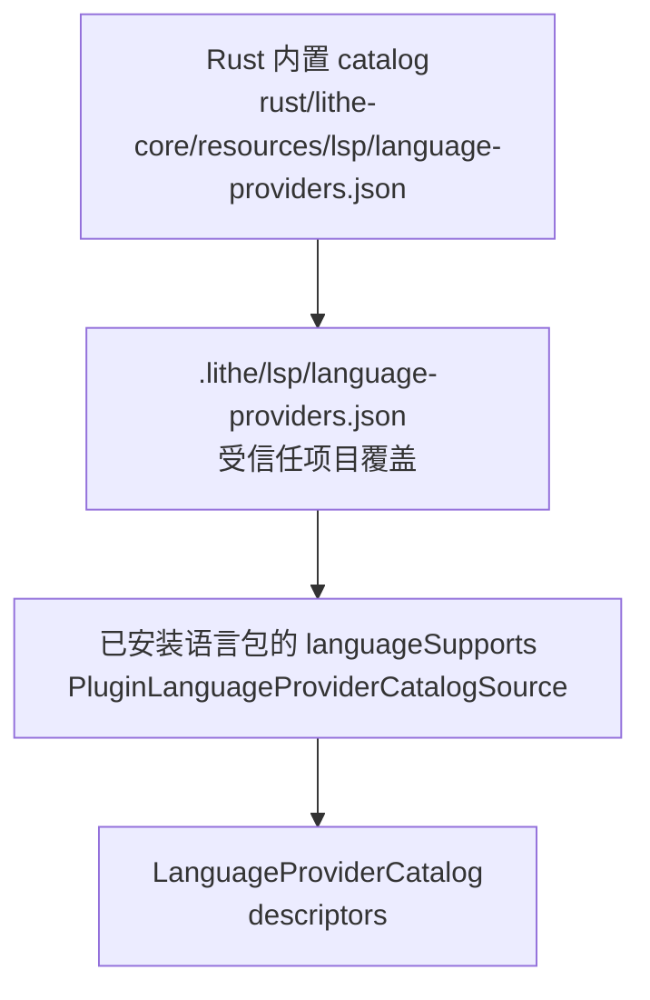
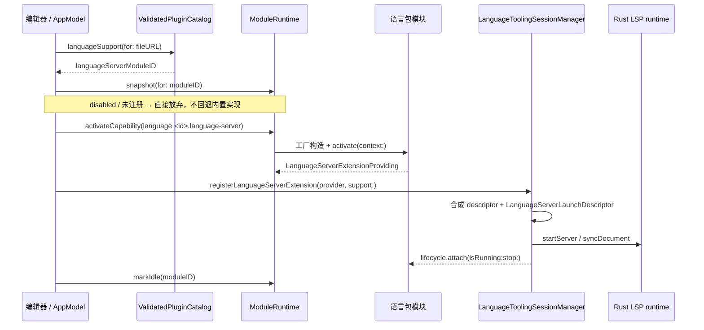

# 多语言适配架构

本文说明 Lithe 如何识别一门语言、把它的能力分配到哪些层，以及新增一门语言时应该走哪条路径。
LSP 协议细节、会话状态机与 JDTLS 专属约束以
[`language-tooling.md`](language-tooling.md) 为准；模块生命周期与插件包机制分别以
[`module-runtime.md`](module-runtime.md) 和
[`plugin-architecture.md`](plugin-architecture.md) 为准。

## 设计目标

1. **语言身份与语言能力分离**。catalog 只回答“这个文件属于哪门语言、理论上有哪些能力”，
   能不能用取决于运行时是否真的拿到了 provider、可执行文件和服务器 capability。
2. **能力按进程归属划分**。不启动进程的能力（识别、高亮、关键字补全、当前文件符号）常驻；
   启动进程的能力（LSP、Run、Test、Debug）必须属于某个可禁用、可休眠的模块。
3. **一门语言的进程能力只有一个所有者**。语言包一旦声明拥有 LSP/Run/Test，宿主不再保留
   内置回退路径，即使这个包被禁用、隔离或加载失败。
4. **UI 与服务不按语言名写分支**。语言差异进入 descriptor、manifest 或独立 adapter。
5. **发现工具，不安装工具**。可执行文件解析、环境变量与安装入口属于平台层安全边界。

## 语言身份：三层合成的 catalog

`LanguageProviderCatalog` 是唯一的语言识别来源，由三层按顺序合成：



| 层 | 提供者 | 提供内容 |
| --- | --- | --- |
| Rust 内置 catalog | `RustLanguageProviderCatalogSource` | 稳定 `id`、文件匹配规则、`languageId`、能力集合、LSP 启动候选与安装入口 |
| 项目覆盖 | Rust catalog 加载器 | 按 `id` 覆盖内置字段、新增 provider、`disabled: true` 关停 provider |
| 语言包覆盖 | `PluginLanguageProviderCatalogSource` | 用 `LanguageSupportDeclaration` 补充扩展名/文件名，并**重写**进程类能力 |

第三层的语义最强，也最容易被误读：
`macos/Sources/Lithe/Core/Language/PluginLanguageProviderCatalogSource.swift:56` 会先
`subtract([.run, .languageServer, .debugAdapter, .testing])`，再按 manifest 里声明的模块 ID
逐项加回。因此“某语言由包拥有”这件事由**安装记录**决定，而不是由“当前进程是否加载了这个 Bundle”
决定；禁用包之后该语言的进程能力显示为不可用，而不是悄悄回落到内置实现。

读取 catalog 全程是惰性的：解析 manifest 不加载插件代码，也不探测 `go`/`gopls` 之类的工具。

## 三种接入形态

| 形态 | 代表 | 声明位置 | 模块归属 | 进程归属 |
| --- | --- | --- | --- | --- |
| 内置语言 | Java | Rust catalog | 内置 Language Intelligence / Execution / Debug 模块 | 宿主 |
| 打包语言插件（builtIn 入口） | Python、Node.js、Rust、C/C++、Ruby… | `BundledLanguagePluginCatalog` | `BundledLanguageServerModule` / `BundledLanguageExecutionModule` | 宿主 `LanguageExecutionHostProviding` 提供 session，模块持有 |
| 官方原生包（nativeBundle 入口） | Go | `Plugins/mac/Official/<Name>/plugin.json` | 包内自带模块实现 | 宿主提供 session，包模块持有并负责停止 |

三者共用同一套 ID 规则，UI 与 AppModel 不区分来源：

```text
模块 ID        dev.lithe.language.<languageID>.language-server
               dev.lithe.language.<languageID>.execution
能力 ID        dev.lithe.capability.language.<languageID>.language-server
               dev.lithe.capability.language.<languageID>.execution
               dev.lithe.capability.language.<languageID>.testing
```

`BundledLanguagePluginCatalog`（`macos/Sources/LitheModuleAPI/Catalog/BundledLanguagePluginCatalog.swift`）
描述 40+ 门非 Java 语言的识别元数据，其中：

- `executableNames` 非空 ⇒ 生成一个 language-server 模块；
- `supportsExecution == true` ⇒ 生成一个 execution 模块（同时导出 execution 与 testing 能力）；
- 两者都不满足的语言（如 `json`、`markdown`、`dart`）只贡献识别与高亮，不产生模块。

Go 不在这张表里，它是第一个走原生包路径的官方语言包，避免同一门语言被两个 owner 声明
（`ValidatedPluginCatalog` 会以 `duplicateLanguageSupport` 直接拒绝）。

## 能力矩阵

| 能力 | 归属 | 说明 |
| --- | --- | --- |
| 文件识别 / 语言 ID | Rust catalog + 插件 overlay | 纯元数据，无进程 |
| 语法高亮 | macOS 视图层 | `Views/Editor/SyntaxHighlighting`，按 `format-mappings.json` 选择 adapter；未映射的代码文件走 `GenericSyntaxHighlightingAdapter` 的通用正则着色，颜色来自 `color-mappings.json` |
| 轻量编辑智能 | Rust Core `lsp/lightweight` + Swift 关键字表 | 当前文件符号、hover、导航、关键字补全，不启动进程 |
| LSP | 语言包模块 → `LanguageToolingSessionManager` → Rust LSP runtime | 详见 [`language-tooling.md`](language-tooling.md) |
| Run | `RunService` + `LanguageRunExtensionProviding` | 运行计划由 provider 生成，进程由宿主创建、模块持有 |
| Test | `LanguageTestService` + `LanguageTestExtensionProviding` | Java 走 JDT Test 扩展命令；其他语言由包声明发现与执行计划 |
| Debug | `DebugModule` + DAP 适配器 | Java/Go/Node 有专用 transport，其余走 `StdioDebugAdapterLaunch` |
| 工具链解析 | `RunToolchainRegistry` | 把 `project-python`、`project-cargo` 等标识符解析成可执行文件与环境变量 |

## 运行时激活链路

打开一个文档时的 LSP 激活顺序（`AppModel.activateLanguageServerIfAvailable`，
`macos/Sources/Lithe/Models/AppModel/AppModel.swift:1306`）：



三个必须保持的性质：

1. **注册回调是双向的**。`registerLanguageServerExtension`
   （`macos/Sources/LitheLanguageIntelligenceModule/Services/LanguageToolingSessionManager.swift:130`）
   除了拿到启动参数，还会把 `isRunning`/`stop` 回填给模块的 lifecycle，模块因此可以在
   sleep/disable 时真正停掉服务器，并在资源计数归零后才算停止完成。
2. **同步成功即活动时间戳**。每次成功 `syncDocument` 后调用 `markIdle`，让 10 分钟空闲策略
   以“最近一次真实编辑”为准。
3. **`extensionRequiredProviderIDs` 是禁止回退开关**。它由已安装语言包的语言 ID 集合构成，
   传给 `LanguagePackRegistry`、`RunService`、`LanguageTestService` 和 session manager；
   命中该集合但没有注册 provider 时，`runtime(for:)` 返回 `nil`
   （同文件 `:1153`），宿主报告能力不可用而不是自己启动进程。

## Run 与 Test 的路由

```text
用户触发 Run/Test
  → 解析目标语言（当前文件 URL 或 RunConfiguration.kind.providerID）
  → pluginCatalog.languageSupport(...) 有 owner？
      是 → activateCapability(language.<id>.execution / .testing)
           → register(LanguageRunExtensionProviding / LanguageTestExtensionProviding)
      否 → 使用 LanguagePackRegistry 中的内置 StandardLanguageRunProvider / TestProvider
  → provider 产出 LanguageRunExtensionPlan / LanguageTestExtensionPlan
  → RunToolchainRegistry 解析 executable 与环境
  → 宿主创建进程 session，语言模块持有并持有租约
```

计划与执行严格分离：provider 只返回
`LanguageRunExtensionPlan { executable, arguments, workingDirectory, environment }`，
其中 `executable` 是 `.toolchain("project-cargo")` 这样的**标识符**或 `.command("npm")`，
真正的可执行文件由 `RunToolchainRegistry`
（`macos/Sources/Lithe/Core/Ports/RunToolchainProviders.swift`）解析。所有相对路径都要过
`checkedPath`：非空、非绝对路径、不含 `..`，越界立即报 `invalidRelativePath`。

进程 session 由宿主服务 `LanguageExecutionHostProviding` 创建，但包装在模块自己的
`ModuleResource` 里：启动时取租约、结束时释放，禁用或休眠模块会停止池中所有 session 并
等待操作系统进程退出。

项目类型识别（Cargo、Go、Gradle、npm、Python、Make、Compose、Procfile、Shell）在 Rust
`rust/lithe-core/src/execution/detectors/` 内完成，返回确定性排序的候选运行配置，Swift 不
重复实现探测规则。

## Debug 适配

- Java：`CoreDebugAdapterProtocolSession` + `MacJavaDebugAdapterTransport`，调试端口由
  JDT LS 的 Java Debug 扩展提供。
- Go：`dlv dap`；Node：`js-debug`；两者都有专用 transport 以处理各自的握手差异。
- 其他语言：`LanguagePackRegistry.standardDebugAdapterDefinition` 提供 stdio 启动描述
  （`python -m debugpy.adapter`、`lldb-dap`，Rust 额外有 `xcrun lldb-dap` 兜底）。
- 被语言包接管的语言 (`extensionRequiredProviderIDs`) 不生成内置 `debugAdapterLaunch`，
  避免包禁用后仍能启动调试器。

## 工具发现与项目配置的安全边界

- 查找顺序：项目 `.lithe` 工具目录 → `LITHE_<TOOL>_PATH` / `LITHE_TOOL_<TOOL>_PATH` →
  `PATH` → 常见系统目录；Go 工具额外检查 `GOBIN`、`GOPATH/bin`、`~/go/bin`、`~/.go/bin`。
- 存在 shim/proxy 的工具（如 rustup proxy）通过 `validationArguments` 做无副作用探测，
  探测结果按路径+参数缓存 30 秒。
- 项目级 JSON 只能声明 typed 字段：可执行文件名、参数、环境变量、`initializationOptions`。
  它不能声明 shell、任意安装命令，也不能关闭路径/URL 校验。
- 安装入口来自 catalog 的 `languageServerInstallation`：`brew install <formula>` 以参数数组
  直接执行（不经 shell），否则只打开官方 HTTPS 页面。Swift UI 不维护任何 provider ID 分支。
- 用户可在 LSP 控制中心为单个 provider 设置可执行文件覆盖路径；路径失效时回落到 catalog 候选
  自动探测，而不是直接失败。
- 项目语言设置面板（`Views/App/ProjectLanguageSettingsView.swift`）只在当前项目确实命中该语言时
  出现，判定依据是项目清单文件或 catalog 的 `handles(fileURL:)`，见
  `Models/AppModel/AppModel+LanguageSettings.swift`。

## 新增一门语言

先按下表选路径，再执行对应清单。

| 需求 | 路径 |
| --- | --- |
| 只要识别 + 高亮 + 轻量补全 | 在 Rust catalog 增加 descriptor（必要时在 `format-mappings.json` 增加高亮映射） |
| 需要 LSP 或 Run/Test，且可复用通用 stdio 运行时 | 在 `BundledLanguagePluginCatalog` 增加 specification |
| 需要自有逻辑（专属测试发现、非标准启动、独立发布节奏） | 新建 `Plugins/mac/Official/<Name>` 原生包 |
| 仅为某个项目临时接一个语言服务器 | 项目 `.lithe/lsp/language-providers.json` |

### A. catalog-only

1. 在 `rust/lithe-core/resources/lsp/language-providers.json` 增加稳定 `id`、
   `fileExtensions`、`languageId`、`capabilities`。
2. 高亮默认可用：未在 `macos/Sources/Lithe/Resources/SyntaxHighlighting/format-mappings.json`
   中映射的文件自动走 `generic` adapter。只有配置类格式（JSON/YAML/TOML/XML/INI/properties/env）
   才需要在该文件里映射到专用 adapter。
3. 运行 `./scripts/verify-rust-core.sh` 与 `./scripts/verify-shared-contracts.sh`。

### B. 打包语言插件

1. 在 `BundledLanguagePluginCatalog.specifications` 增加一条，填 `executableNames`、
   `arguments`、必要的 `validationArguments`、`languageIdentifier`、`supportsExecution`。
2. 需要运行/测试时，在 `BundledLanguageExecutionCapability` 的 `launchPlan`、`testPlan`、
   `supportsProject`、`isTestFile` 中补该语言分支，并在 `RunToolchainRegistry.standardProviders()`
   注册对应 `project-*` 工具链标识符。
3. 模块工厂无需改动：`MacServiceContainer` 会按 specification 自动注册 language-server 与
   execution 模块（`macos/Sources/Lithe/Platform/MacOS/MacServiceContainer.swift:444`）。
4. 补 `macos/Tests/` 下的模块测试：禁用不构造、激活导出能力、休眠释放资源。

### C. 原生官方包

参见 [`plugin-architecture.md`](plugin-architecture.md#扩展一个新插件) 的完整步骤；语言相关的
额外要求是：

1. `plugin.json` 的 `languageSupports` 必须声明 `fileExtensions`/`fileNames`/`projectFileNames`
   中至少一项，且每个 `*ModuleID` 都在本包的 `modules` 中声明。
2. LSP 与 Execution 必须是两个模块，使编辑智能可以独立于运行/测试失败与休眠。
3. 语言 ID 全局唯一；不要与 `BundledLanguagePluginCatalog` 中已有的 ID 冲突。

### 通用检查清单

1. 稳定 `id`、文件匹配规则、`languageId` 已定义；存在 proxy 的工具声明了 `validationArguments`。
2. 能力以运行时协商结果为准，不把 catalog 的 `languageServer` 标记当成功能证明。
3. UI、AppModel、session manager 中没有新增按语言名的分支。
4. provider 失败、缺失、返回空结果时，本地轻量能力仍可用。
5. 进程能力有明确 owner，禁用后不存在隐式回退路径。
6. 相对路径全部经过越界校验，没有硬编码开发机路径。
7. 验证：`./scripts/test-macos.sh`、`./scripts/verify-service-boundaries.sh`、
   `./scripts/verify-module-boundaries.sh`；涉及 catalog 时追加 `./scripts/verify-rust-core.sh`。

## 当前限制

- LSP 仅支持 stdio + `Content-Length` framing，无 socket/TCP 与自定义握手。
- 一个 provider 在一个 workspace root 下只有一个 session，尚无 multi-root。
- 通用高亮是正则着色，不是语法树着色；只有 Java 在 Rust Core 侧使用 tree-sitter 做导航候选分析。
- `BundledLanguageExecutionCapability` 的运行/测试计划目前只覆盖 Python、Node.js、Rust，
  其他打包语言只有 LSP。
- 语言包被禁用后 Swift Bundle 仍映射在进程内，切换 owner 需要重启（见插件文档的 restart-required）。
