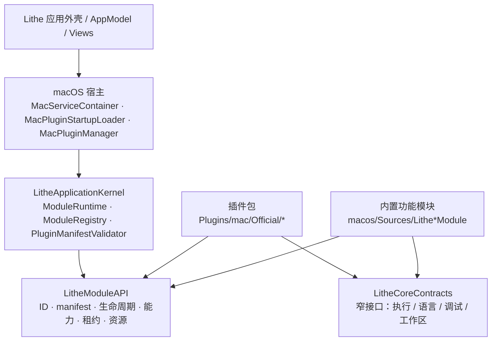
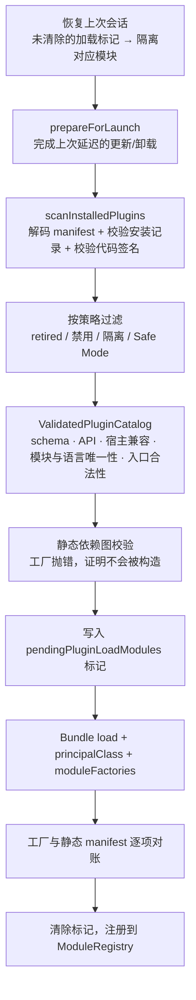

# 插件架构与扩展指南

本文说明 Lithe 的插件分层、契约类型、加载与恢复流程，以及新增一个插件的完整步骤。
模块状态机、休眠/唤醒与资源归零规则以 [`module-runtime.md`](module-runtime.md) 为准；
语言类插件的额外约定见 [`language-support.md`](language-support.md)。

## 概念分层

Lithe 里“插件”不是一个概念，而是四层，必须分开理解：

| 概念 | 类型 | 含义 | 生命周期 |
| --- | --- | --- | --- |
| Plugin package | `PluginManifest` | 分发、安装、启用、签名与版本的单位 | 安装/更新/回滚/卸载，跨进程持久 |
| Module | `ModuleManifest` + `LitheModule` | 运行与依赖边界，资源的唯一归属 | disabled → inactive → active → idle → sleeping |
| Capability | `ModuleCapabilityID` → `AnyObject` | 模块对外暴露的唯一能力，消费方按 ID 取用 | 随模块激活发布、随休眠撤销 |
| Contribution | `ModuleContribution` | 惰性 UI 元数据（命令、工具窗、设置、状态栏） | 静态数据，读取不构造模块 |

一个包可以拥有多个模块（Go Support 拥有 LSP 与 Execution 两个），一个模块可以导出多个能力
（Execution 同时导出 execution 与 testing）。**一个模块只能属于一个包，一个能力只能有一个
活跃 provider**，冲突在静态校验阶段就失败。

## 分层与依赖方向



硬性方向约束：

- `LitheModuleAPI` 不 import UI、平台适配器、Rust bridge 或任何功能实现。
- 插件包与功能模块**不能** import `Lithe` 可执行目标、SwiftUI、AppKit
  （`scripts/verify-module-boundaries.sh` 会检查）。
- 插件通过 `PluginHostContext` 按 ID 取窄协议，不构造 `Mac*` 适配器。
- 宿主不 import 插件实现；它只认 manifest、工厂和能力 ID。

## 契约类型

### PluginManifest（`plugin.json`）

| 字段 | 约束 |
| --- | --- |
| `schemaVersion` | 必须等于 `PluginManifest.currentSchemaVersion`（当前 1） |
| `id` | 全局唯一，`dev.lithe.plugin.<name>` |
| `version` | `major.minor.patch` |
| `apiVersion` | 必须等于宿主支持的 Plugin API 版本（当前 1） |
| `hostCompatibility` | `minimum` / 可选 `maximumExclusive`，必须包含宿主版本（当前 0.3.0） |
| `vendor.signatureRequirement` | 目前只有 `sameTeamAsHost` |
| `entrypoint` | `builtIn`（只填 `targetName`）或 `nativeBundle`（填 `bundleIdentifier` + `principalClass` + 相对 `bundlePath`），两组字段互斥 |
| `modules` | 至少一个模块声明；ID 按字典序稳定排序 |
| `languageSupports` | 可选；语言包用它做惰性识别 |

模块声明使用扁平 JSON 而不是嵌套 manifest：`id`、`displayName`、`scope`、`defaultState`、
`activationPolicy`、`sleepPolicy{kind,afterSeconds}`、`moduleDependencies`、
`capabilityDependencies`、`providedCapabilities`、`contributions`、`required`。
`sleepPolicy` 只接受 `never`（不能带 `afterSeconds`）和 `whenIdle`（必须带正数 `afterSeconds`）。

### 入口协议

```swift
@MainActor
public protocol LithePluginEntrypoint: AnyObject {
    init()
    func moduleFactories(context: PluginHostContext) throws -> [ModuleFactory]
}
```

principal class 必须是 `@objc(<PrincipalClassName>)` 的 `NSObject` 子类，名称与 manifest 中
`entrypoint.principalClass` 一致。`moduleFactories` 只**构造工厂**，不得在其中启动进程、
连接或定时器——工厂闭包被调用才意味着模块真正被激活。

### 宿主服务

```swift
public extension PluginHostServiceID {
    static let languageExecution = PluginHostServiceID("dev.lithe.host.language-execution.v1")
}
```

服务 ID 带显式版本后缀，协议定义在 `LitheCoreContracts`。当前唯一的宿主服务是
`LanguageExecutionHostProviding`：它按 `ownerModuleID` 创建进程 session，让宿主保留进程
注册表与强制终止能力，同时由插件模块持有 session、租约与停止责任。新增宿主服务时定义新的
`*.v2` ID，不要修改既有协议的语义。

## 启动加载流程

`MacPluginStartupLoader.load(policy:)` 的顺序不可重排，因为它决定了“在触碰任何原生代码之前
就能失败”：



关键性质：

- **静态先于动态**。schema、API 版本、宿主兼容区间、模块/语言唯一性、入口字段组合、
  `bundlePath` 相对路径安全性（非空、非绝对、不含 `..`、解析后仍在包目录内）全部在
  `Bundle` 创建之前完成。
- **工厂必须与 manifest 完全一致**。`MacNativePluginLoader` 逐项比较 `factory.manifest` 与
  `declaration.manifest`、`contributions`，不一致抛 `factoryCatalogMismatch`；
  `ModuleRegistry.validate()` 再做一次“工厂 ↔ 已安装包”的双向对账，缺一方即失败。
- **失败是局部的**。单个包失败只产生一条管理面 issue 并隔离其模块，不会替换宿主必需的内置
  catalog，也不阻止应用外壳启动。若整体静态图校验失败，则丢弃全部候选包而保留内置模块。
- **恢复标记先于加载**。加载前写入模块 ID，加载成功后保留至进程正常退出；下次启动若发现
  残留标记，这些模块在触碰任何 Bundle 之前被隔离。多个项目窗口共享同一个进程级恢复协调器，
  后开的窗口不会把当前进程的标记误判为上次崩溃。
- **Safe Mode**（`--safe-mode`）只启动必需模块，不调用任何可选模块工厂，也不覆盖用户的
  启用偏好。

## 包存储与安装状态

`MacPluginPackageStore` 管理 `Application Support/Lithe/Plugins/<pluginID>/`：
按版本存放目录 + 一个原子替换的 `installation.json` 活跃版本指针。

| 状态 | 含义 |
| --- | --- |
| `installed` | 指针指向的版本即当前活跃版本 |
| `updateStaged` | 新版本已落盘校验，等待下次启动切换指针 |
| `uninstallPending` | 卸载已登记，等待下次启动前清理 |

因为 Swift 原生 Bundle 不能安全卸载，安装、更新、回滚、卸载与“禁用一个已加载的包”都会进入
**restart-required** 状态：模块图立即停止并释放资源，但代码保持映射直到进程退出。
`retiredPluginIDs` 中的包保留磁盘数据但永不注册、永不加载。

## 运行时行为

模块状态机、租约、资源归零与休眠序列见 [`module-runtime.md`](module-runtime.md)。插件相关的
补充规则：

- 能力按需激活：`ModuleRuntime.activateCapability(id)` 会先激活声明的依赖，再构造模块，
  最后返回导出对象；消费方拿到的永远是协议类型，不是具体实现。
- 模块导出的能力集合必须与 manifest 中 `providedCapabilities` 完全一致，多导出报
  `undeclaredExportedCapability`，少导出报 `missingExportedCapability`。
- 休眠或禁用会调用 `clearModuleBindings(for:)`，把该模块注册过的语言服务器、运行、测试扩展
  逐一注销（`macos/Sources/Lithe/Models/AppModel/AppModel.swift:286`），避免悬挂 provider。
- 长生命周期资源必须注册为 `ModuleResource`；停止后资源活跃计数不为零会进入
  `sleepBlocked` 或 `failed`，这是可观测的失败而不是静默泄漏。
- Contribution 是惰性数据：Workbench 遍历贡献并委派给动作/渲染器注册表，不允许对具体
  contribution ID 做 switch（`verify-module-boundaries.sh` 会检查这一点）。

## 扩展一个新插件

### 路径一：内置目标（`entrypoint.kind = builtIn`）

适用于随产品一起编译、不需要独立发布节奏的功能。

1. 在 `macos/Sources/Lithe<Feature>Module/` 建目标，依赖 `LitheModuleAPI` +
   `LitheCoreContracts`，在 `Package.swift` 注册 target 与 library product。
2. 定义 `moduleManifest`（稳定 ID、scope、默认状态、激活与休眠策略、依赖、导出能力）与
   `moduleContributions`。
3. 实现 `LitheModule`：`activate` 注册资源并构造能力，`prepareForSleep`/`sleep`/`shutdown`
   释放能力与资源。
4. 若模块要出现在插件管理面板，把 manifest 加入 `BuiltInPluginCatalog`（或语言场景下的
   `BundledLanguagePluginCatalog`）。
5. 在 `MacServiceContainer` 注册 `ModuleFactory`，工厂闭包内构造平台适配器；构造本身必须惰性。
6. 在 `macos/Tests/Lithe<Feature>ModuleTests/` 添加生命周期测试。

### 路径二：原生官方包（`entrypoint.kind = nativeBundle`）

以 `Plugins/mac/Official/GoSupport` 为模板。

1. **目录**
   ```text
   Plugins/mac/Official/<Name>/
   ├── plugin.json                 # 静态 manifest
   ├── Info.plist                  # CFBundleExecutable / NSPrincipalClass
   ├── Sources/Lithe<Name>Module/
   │   ├── Plugin/                 # @objc principal class 入口
   │   ├── Module/                 # LitheModule 实现
   │   ├── Capabilities/           # 导出的能力实现
   │   └── Support/                # 共享标识符
   └── Tests/Lithe<Name>ModuleTests/
   ```
2. **Package.swift**：新增 `path: "Plugins/mac/Official/<Name>/Sources/Lithe<Name>Module"`
   的 target 与对应 test target，语言模式 `.v6`；**不要**把它加入 `Lithe` 可执行目标的依赖。
3. **manifest**：填写唯一 `id`、版本与 `hostCompatibility`、`vendor`、`entrypoint`、模块声明；
   语言包补 `languageSupports`。manifest 与代码里的 `ModuleManifest` 必须逐字段相等。
4. **入口**：
   ```swift
   @MainActor
   @objc(Lithe<Name>PluginEntrypoint)
   public final class <Name>PluginEntrypoint: NSObject, LithePluginEntrypoint {
       public func moduleFactories(context: PluginHostContext) throws -> [ModuleFactory] {
           let host = context.service(.languageExecution) as? any LanguageExecutionHostProviding
           return [ModuleFactory(manifest: <X>Module.moduleManifest) { <X>Module(host: host) }]
       }
   }
   ```
5. **可选官方目录**：需要让宿主在未安装时也认识这个包，就把 manifest 加入
   `OfficialPluginCatalog`；它不属于宿主静态模块图，只有签名包存在时才可用。
6. **构建与打包**：`build-official-plugins.sh` 需要 `.build/<triple>/<configuration>/Modules/`
   下已有 `LitheModuleAPI.swiftmodule` 与 `LitheCoreContracts.swiftmodule`，因此先构建再打包：
   ```bash
   swift build --triple arm64-apple-macosx --product LitheOfficialPluginVerifier
   ./scripts/build-official-plugins.sh --triple arm64-apple-macosx --plugin-id <id>
   ```
   插件以 `swiftc -emit-library` 单独编译（`-Xlinker -undefined dynamic_lookup`，符号在加载时
   由宿主进程提供），随后 `codesign` 签名。产物为 `<pluginID>/plugin.json` + `<bundlePath>`，
   最终打包进 `Contents/Resources/OfficialPlugins/`。macOS 的 `Contents/PlugIns` 保留给标准
   code bundle，不要往里放包目录。
7. **测试**：必须覆盖禁用不构造工厂、激活导出声明的能力、活跃租约阻止休眠、休眠释放全部资源、
   停止后进程确实退出。`OfficialPluginCatalog` 只接受已具备这些测试的包。

### 提交前检查清单

1. manifest ↔ 代码 manifest ↔ contributions 三者一致。
2. 模块 ID、能力 ID、语言 ID 全局唯一，且未与内置或已有包冲突。
3. 模块只依赖 `LitheModuleAPI`、`LitheCoreContracts` 和窄工作流库，无 SwiftUI/AppKit/`Lithe`。
4. 所有长生命周期资源都注册到 `ModuleResource`，停止路径有界（含强制终止兜底）。
5. 非中断性工作（Run/Test/Debug/Terminal/导入导出）持有租约。
6. 失败返回稳定错误，不吞异常，不暴露凭证或环境内容。
7. 无硬编码开发机路径、密钥或私有端点。
8. 验证：
   ```bash
   ./scripts/verify-module-boundaries.sh
   ./scripts/verify-service-boundaries.sh
   ./scripts/verify-official-plugins.sh   # 构建每个官方包并逐个跑 manifest / 图校验
   ./scripts/test-macos.sh
   ```

## 边界红线

- 不要在 `moduleFactories` 或模块构造函数里启动进程、连接、定时器或 watcher。
- 不要把 `AppServices`/`AppModel` 变成具体功能服务的持有者；模块能力通过 runtime 取。
- 不要在 Workbench 或 AppModel 中按 contribution ID、模块类型或语言名写分支。
- 不要用宿主内置实现兜底一个已被包声明的进程能力。
- 不要修改已发布的模块 ID、能力 ID、JSON 字段名、C 符号或 principal class 名——它们是兼容面。

## 当前限制

- 进程内隔离，不是进程隔离：可选模块的缺陷仍可能终止应用进程，恢复依赖持久标记 +
  自动隔离 + Safe Mode。
- Swift Bundle 不可安全卸载，禁用/更新/卸载都需要重启才能完成状态切换。
- 目前仅支持同 Team ID 签名的官方包，尚无第三方市场与更细粒度的权限模型。
- 宿主服务面很窄，当前只有 `dev.lithe.host.language-execution.v1`；其他能力需要先在
  `LitheCoreContracts` 中定义窄协议再暴露。
- 只有数据库连接、语言服务器、非 Java 语言支持这三类进程/连接后端允许走原生包路径。
