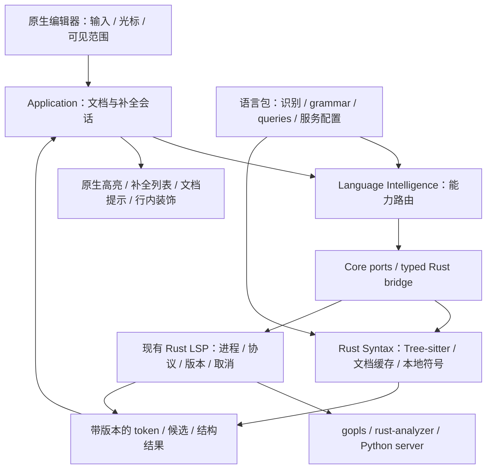

# 多语言高亮、自动补全与提示方案

状态：待实施的技术方案；本次仅分析与文档落地，不代表下述能力已经实现。

核对日期：2026-09-05。代码基线：`dev/aiide`，`bf6f7d60`。范围：macOS，优先 Go、Rust、Python，保留现有编辑器、模块与插件体系，方便持续合并上游。Java 默认工具链、Maven/Spring、Windows 的既定裁剪范围不变。

## 1. 建议采用的路线

采用 **Rust Tree-sitter 语法引擎 + 现有 Rust LSP 运行时 + 声明式语言包 + 原生编辑器交互**。

- Tree-sitter 负责不依赖工具链的准确语法高亮，并为折叠、结构导航、当前文件符号提供语法基础。
- LSP 负责类型推导、跨文件补全、定义与引用、诊断、重命名等语义能力。继续使用 gopls、rust-analyzer、basedpyright/pyright。
- Rust 负责解析、协议、候选归一化、范围校验和可复用的数据处理；Swift/AppKit 负责光标、输入法、弹窗、文本属性与主题。
- 语言包声明识别规则、语法资源、服务端与配置贡献。新增语言通常增加数据和适配，不复制编辑器或再造一套语言服务运行时。

“基于 Rust 成熟项目”指复用 Rust 生态中的引擎与组件，并不要求所有语言服务器也用 Rust 实现。把 gopls 换成自行实现的 Go 分析器，会明显扩大成本，也降低一期的可用性。

一期不重写 `NSTextView`、文本布局、终端、调试或项目管理；不一次性引入完整 Helix/Lapce 编辑器，也不新建所有语言共用的类型推导系统。

## 2. 当前项目实际如何支持不同语言

### 2.1 高亮：语言识别、语法识别和语义着色是不同层次

| 当前链路 | 已有实现 | 实际边界 |
| --- | --- | --- |
| 文件识别 | 语言目录及插件中的扩展名、文件名、项目标记 | 识别为 Go/Rust/Python，不等于已经接入对应语法解析器 |
| 配置文件高亮 | JSON、YAML、TOML、XML、INI、properties、env 等专用 Swift adapter | 可继续使用，不需要为了统一而一次性重写 |
| 一般代码高亮 | `GenericSyntaxHighlightingAdapter` 的正则扫描 | 关键字、注解、大写名称、数字、字符串、注释；Go/Rust/Python 主要走此路径 |
| Java 结构着色 | Rust 的 Tree-sitter Java 解析结果叠加到编辑器 | 属于本地语法树推导，不是 LSP semantic tokens；也不代表默认包仍包含 JDK |
| 颜色与应用范围 | Swift 高亮 palette、`NSTextStorage`、已有可见范围处理 | 保留原生渲染和主题，逐步替换 token 来源 |

证据：

- [SyntaxHighlighter.swift](../../macos/Sources/Lithe/Views/Editor/SyntaxHighlighting/SyntaxHighlighter.swift)：选择格式 adapter，并应用 Java 语法角色。
- [format-mappings.json](../../macos/Sources/Lithe/Resources/SyntaxHighlighting/format-mappings.json)：当前专用格式映射；Go/Rust/Python 未配置专用 adapter。
- [GenericSyntaxHighlightingAdapter.swift](../../macos/Sources/Lithe/Views/Editor/SyntaxHighlighting/GenericSyntaxHighlightingAdapter.swift)：六类正则依次覆盖属性，注释最后处理。
- [Cargo.toml](../../rust/lithe-core/Cargo.toml)、[java_syntax.rs](../../rust/lithe-core/src/languages/java_syntax.rs)：当前依赖 `tree-sitter = 0.25` 和 Java grammar，没有通用的 Go/Rust/Python parser registry。

通用正则容易误判字符串里的 `//`、Go 原始字符串、Python 三引号与 f-string、Rust 生命周期和嵌套注释。继续增加正则可以解决零散样例，但无法稳定提供语言结构。现有 Java 高亮入口每次构造 parser 并以 `old_tree = None` 解析，也不能直接称为通用增量引擎。

### 2.2 补全与提示：底层已有，协议和交互仍有缺口

| 能力 | 当前情况 | 建议 |
| --- | --- | --- |
| LSP 生命周期 | Rust 已拥有进程、stdio JSON-RPC、初始化、文档同步、请求、取消和事件 | 原位扩展，避免引入第二个 LSP client |
| 服务发现与语言包 | Go 使用 gopls；Rust 使用 rust-analyzer；Python 使用 basedpyright/pyright 路线 | 复用发现、安装、模块归属与 Settings 入口 |
| 本地补全 | Rust 当前文件标识符扫描，加 Swift 关键字列表 | 作为离线回退；后续用语法作用域改善精度 |
| provider 排序 | LSP 优先，其次预留 project symbols，再到 builtin | 保留分层；`projectSymbols` 的优先级声明不代表已有项目级索引 |
| 失败回退 | completion/hover 的 provider 返回 failure 或抛错时，路由直接失败 | 修复成隔离服务失败、继续可用本地能力，并保留可诊断的错误记录 |
| 候选合并 | provider 层和 AppModel 都存在按 `label` 去重 | 同名但不同签名、导入来源、替换文本可能被丢弃，需要统一候选身份 |
| 补全 UI | 快捷键/菜单触发，原生 `NSMenu` 显示最多 200 项 | 不适合持续输入中的自动补全，应替换为跟随光标的非阻塞列表 |
| 接受候选 | 已支持 `textEdit`、`additionalTextEdits`、按需 resolve | 保留自动导入和工作区编辑校验，补齐版本约束及交互代码片段 |
| snippet | 所有主编辑文本都经过 `plainText` 展平；初始化却声明 snippet 支持 | 先让能力声明与实际行为一致，再实现占位符和 Tab 跳转 |
| hover | DTO 有 Markdown 标记，当前窗口按普通等宽文本展示 | 接通受控 Markdown、代码块高亮、尺寸约束和滚动 |
| diagnostics / code actions | 已有协议、模型和编辑器入口 | 改进一致的提示、问题导航与修复交互，不从零实现 |
| signature help / semantic tokens | 本次核对未见完整的通用端到端支持 | 新增能力协商、契约和编辑器展示 |
| inlay hints | Rust 已有请求、解析和归一化；Swift 操作枚举也已有入口 | 补齐服务投影、设置与编辑器通用渲染；无需再造协议层 |

主要证据：

- [LanguageFeatureProvider.swift](../../macos/Sources/LitheLanguageIntelligenceModule/Providers/LanguageFeatureProvider.swift)、[LanguageToolingSessionManager.swift](../../macos/Sources/LitheLanguageIntelligenceModule/Services/LanguageToolingSessionManager.swift)：能力路由、优先级及失败处理。
- [Rust LSP client](../../rust/lithe-core/src/lsp/interface/client.rs)、[engine](../../rust/lithe-core/src/lsp/interface/engine.rs)、[transport](../../rust/lithe-core/src/lsp/interface/transport.rs)：现有运行时及结果归一化。completion 目前投影为 items，未保留完整列表上下文。
- [LanguageToolingContracts.swift](../../macos/Sources/LitheCoreContracts/Language/LanguageToolingContracts.swift)：当前 completion DTO 未包含 `insertTextFormat` 等完整交互信息。
- [CodeEditorView.swift](../../macos/Sources/Lithe/Views/Editor/CodeEditorView.swift)：`requestLanguageCompletions`、`presentLanguageCompletions`、`presentLanguageHover`。
- [AppModel+Development.swift](../../macos/Sources/Lithe/Models/AppModel/AppModel+Development.swift)：请求后的再次去重、resolve、snippet 展平与工作区编辑。
- [language-providers.json](../../rust/lithe-core/resources/lsp/language-providers.json)、[BundledLanguagePluginCatalog.swift](../../macos/Sources/LitheModuleAPI/Catalog/BundledLanguagePluginCatalog.swift)：服务端目录及语言插件声明。

注意：已有架构文档中关于“provider 报错后自动回退”的描述不能作为实现已完成的依据；当前源码在上述失败分支直接结束请求。实施时应一并更新对应描述。

## 3. Rust 成熟项目如何取舍

| 项目 | 复用方式 | 本方案中的边界 |
| --- | --- | --- |
| Tree-sitter | 直接复用 Rust binding、各语言 grammar 和 query | 一期核心依赖；识别语法，不代替类型系统 |
| tree-sitter-highlight | 复用 capture、locals、injections 的语义与实现参考；可用于原型对照 | 不能仅因使用 Highlighter 就宣称编辑器已增量解析，需单独验证缓存与解析路径 |
| Helix | 参考语言配置、grammar revision 固定、queries 和按能力选服务端 | 不整体嵌入内部 editor crates；移植代码或资源前核对版本与许可证 |
| Lapce | 参考 Rust 后台、语言服务和补全状态管理的职责拆分 | 保留 Lithe 原生 UI，不接入整套 Floem 编辑器 |
| nucleo | 可选的候选模糊匹配组件 | 有排序需求和基准收益后再加入；不无条件覆盖服务端排序 |
| syntect | 可选的长尾语法高亮方案 | 一期不用第二套高亮引擎；它不提供跨文件语义补全 |
| rowan / salsa | 将来开发自有 DSL 分析器时再评估 | 是构建分析器的基础设施，不是通用多语言智能 SDK |
| tower-lsp-server | 将来自研 DSL 的 LSP 服务端框架候选 | 服务端框架，不替换现有 Rust LSP 客户端 |
| Rope 类文本结构 | 大文件基准证明有必要时再评估 | 一期不因加入解析器而重写原生文本存储 |

依据：[Tree-sitter 高亮文档](https://tree-sitter.github.io/tree-sitter/3-syntax-highlighting.html)、[Helix 语言配置](https://docs.helix-editor.com/languages.html)、[Lapce](https://github.com/lapce/lapce)、[nucleo](https://github.com/helix-editor/nucleo)、[syntect](https://github.com/trishume/syntect)、[rowan](https://github.com/rust-analyzer/rowan)、[tower-lsp-server](https://github.com/tower-lsp-community/tower-lsp-server)。

版本与资源管理：沿用当前 Tree-sitter 0.25 基线，选取 ABI/API 兼容的 grammar 版本。固定 grammar、query 的提交与校验信息，避免运行时拉取 latest。Helix 仓库采用 [MPL-2.0](https://github.com/helix-editor/helix/blob/master/LICENSE)，不能默认所有可复制资源都是 MIT；引入前逐项记录来源与许可证。

### 三种重点语言的服务端选择

| 语言 | 一期默认 | Rust 生态相关选择 |
| --- | --- | --- |
| Go | gopls | 使用官方 Go 分析能力；IDE 核心用 Rust 不影响服务端用 Go |
| Rust | rust-analyzer | 使用独立 LSP 进程，避免嵌入其内部分析器后承担版本耦合 |
| Python | 延续 basedpyright/pyright，并绑定项目解释器与环境 | ty 作为可切换试验 provider；通过真实项目补全、导入、类型、环境识别对比后再决定默认值 |

参考：[gopls](https://go.dev/gopls/)、[rust-analyzer](https://rust-analyzer.github.io/book/)、[basedpyright](https://docs.basedpyright.com/latest/)、[ty language server](https://docs.astral.sh/ty/features/language-server/)。这里没有假定 ty 已与当前默认方案完全等价。格式化/lint 工具与语义补全服务端按能力组合，避免两个 provider 重复提供同一批诊断或争抢格式化。

## 4. 推荐架构与所有权



Views 只接收模型和显示结果，不直接调用 C ABI、不创建 parser、不拥有语言服务器进程。沿用 [repository-layout](repository-layout.md)、[application-boundary](../../shared/contracts/application-boundary.md) 与 [Rust Core API](../../shared/contracts/rust-core-api.md) 的边界。

### 4.1 Rust 文档缓存与增量解析

新增通用 syntax 模块，概念接口为 `open / change / queryHighlights / querySymbols / close`；这些是拟新增操作，不能当作当前 API 调用。

1. 缓存键使用项目会话 ID 与文档 ID，附带文档版本和生命周期 generation。同一路径在不同项目/会话中的缓冲区不能串用。
2. 每份缓存保存文本快照、行索引、UTF-8/UTF-16 转换信息、语法树及对应 grammar/query 版本。复用已编译 query；parser 的线程归属固定，不并发修改同一棵树。
3. 初次打开传完整快照；后续用带前后版本的增量编辑更新缓存。版本缺口触发完整重同步，不能继续应用未知基线的范围。
4. 对旧树应用 `InputEdit`，再传入旧树进行解析。只重算受影响语法区域及必要祖先/注入层，向 UI 批量返回与视口有关的 token 范围。
5. “只画可见范围”不等于“只解析可见行”：跨行字符串、注释和作用域需要完整语法上下文。文本改变但节点结构未改变时，也不能只靠 `changed_ranges` 判断所有高亮失效。
6. 后台合并连续编辑、取消过期工作；回包必须核对版本、项目、文档和 generation。关闭文件、项目休眠或卸载语言包时释放缓存和任务。

[Parser API](https://docs.rs/tree-sitter/0.25.10/tree_sitter/struct.Parser.html) 明确允许复用经过编辑的旧树。[Highlighter 公共 API](https://docs.rs/tree-sitter-highlight/latest/tree_sitter_highlight/struct.Highlighter.html) 接收源码和配置，而非调用方的旧树。因此实施前先做三语言原型：验证持久 Tree + query 的增量路线，并用高亮库作为结果对照；若先采用整份 Highlighter，则明确其性能边界，不重复解析后再声称共享缓存。

### 4.2 坐标与渲染契约

| 边界 | 坐标规则 |
| --- | --- |
| Tree-sitter | UTF-8 byte offset；Point 列为字节数 |
| 现有 LSP / 编辑器契约 | 零基行、UTF-16 列；在协议边界明确编码协商 |
| AppKit `NSRange` | 整份文本的 UTF-16 offset 与 length |
| 产品结果列表 | 展示时转换为一基行号，不反向污染编辑坐标 |

统一转换组件覆盖 emoji、中文、组合字符、CRLF、跨行替换与文件末尾；不能把 Rust byte offset 直接作为 `NSRange`。新增共享契约保留稳定字段、排序、错误码和 operation/cancellation 语义。

Rust 返回语义角色，例如 keyword、string、comment、type、function、parameter，不返回 `NSColor`。Swift 统一映射现有 palette。基础 syntax 与后续 semantic tokens 分层合成，语义 token 只覆盖有效范围；服务离线或结果过期时基础高亮仍在。诊断下划线、搜索选区与选中背景分开管理，避免重刷高亮时相互清除。

主题切换重新映射颜色即可，不重新启动语言服务。原生文本内容、输入法 marked text、撤销栈和光标布局保持由编辑器管理。

## 5. 自动补全和提示如何补齐

### 5.1 补全会话，而非一次弹出菜单

新增独立的 completion feature model 和原生 popup，保存请求位置、文档版本、候选列表、选中 ID、触发原因和取消句柄。编辑器继续拥有输入焦点。

- 输入标识符或服务声明的触发字符时请求；手动快捷键立即请求。自动触发采用可调的短防抖，默认数值由交互基准确认。
- 输入法组合期间不抢按键、不提交补全；组合完成后再触发。
- 同一词内继续输入优先过滤已有候选，按列表完整性决定是否向服务端重新请求。位置或上下文离开有效范围即结束会话。
- 新结果只更新当前会话，尽量保留用户已选候选；旧项目、旧文档或旧版本回包不得覆盖当前列表。
- 弹窗按光标锚定、屏幕边界自动翻转，统一字号、行高、类型图标与路径/来源说明；详情按需加载并受尺寸约束。
- 上下选择、Esc 关闭、Enter 接受、Tab 的接受/替换行为可配置；没有有效补全时保留正常换行与缩进。快捷键复用现有 keymap。

### 5.2 协议与候选模型

新增或保留完整列表上下文、触发上下文、插入格式、insert/replace 范围、默认值及文档格式；按能力逐项接通 Rust 归一化、Swift DTO、会话和 UI。只有端到端支持后才在 initialize/dynamic registration 中声明能力。

补全协议中，列表完整性决定继续输入时是否重新计算；服务端可提供过滤/排序文本、触发字符、代码片段及延迟解析内容。设计应遵守这些字段的实际含义，避免将响应提前压扁为字符串列表。参考 [LSP 3.17 completion 定义](https://github.com/microsoft/language-server-protocol/blob/gh-pages/_specifications/lsp/3.17/language/completion.md)。

建议策略：

| 问题 | 处理方式 |
| --- | --- |
| 服务报错 | 记录结构化错误，按场景继续可用本地 provider；取消、项目关闭、过期请求应直接结束，不能借回退重新弹窗 |
| 本地可用性 | 关键词与当前文件符号不依赖外部 LSP 启动；禁用插件时不偷偷启动其进程 provider |
| 合并去重 | 用候选来源、替换范围、插入文本、类型及签名建立稳定身份；只合并确实等价的项 |
| 排序 | 优先尊重有效上下文和语义候选；组内结合服务排序、前缀、模糊匹配；不要让普通文本词覆盖精确成员补全 |
| resolve | 复用现有 resolve，缓存于当前会话；展示详情时按需请求，接受时处理必要导入编辑 |
| 接受候选 | 核对快照版本和编辑范围；主编辑与 import 等附加编辑作为同一次用户操作，支持一次 Undo |
| snippets | 根据插入格式区分普通文本与 snippet；实现占位符、镜像、Tab/Shift-Tab、最终光标与退出规则 |

当前 `snippetSupport = true` 与仅展平占位符的行为不一致，应在协议修复批次中解决。普通插入文本也不能无条件解释 `$` 为 snippet 语法。

### 5.3 提示的建设顺序

1. **文档提示**：复用现有 hover 请求，正确展示 Markdown、代码块、签名，支持固定查看与滚动。
2. **参数提示**：接入 signature help，处理嵌套调用、活动参数、重触发字符与键盘触发。
3. **诊断与修复**：复用 diagnostics/code actions，统一严重程度、悬浮说明、问题窗口跳转、修复预览和应用反馈；保留版本校验。
4. **语义着色**：新增 semantic tokens 能力协商、legend 映射、完整/范围/增量结果缓存；只请求双方都支持的形式。
5. **行内提示**：复用 Rust inlay hints 操作，补齐 Swift 投影和原生装饰层；按语言开关参数名/类型提示，不能向文档插入提示字符串改变真实内容。

AI 补全后续接入单独的 provider/ghost-text 通道，用户开启后使用；与确定性的 LSP 补全保持可辨认的来源和接受行为，不成为高亮或基本提示的前置依赖。

## 6. 方便扩展的语言包设计

复用 [LanguageSupportDeclaration](../../macos/Sources/LitheModuleAPI/Plugins/PluginTypes.swift) 的 `id`、文件识别、项目识别和语言服务/运行/测试/调试 module ID。扩展字段放在同一归属链上，避免语法目录、补全目录和 Settings 各维护一份互相漂移的语言名单。

下面是**拟议的声明扩展示意**，不是当前可安装 manifest；`syntax` 与 `editorConfiguration` 尚需定义 schema、兼容策略和消费者。现有 module 引用继续由正式 package manifest 提供。

```json
{
  "id": "rust",
  "displayName": "Rust",
  "fileExtensions": ["rs"],
  "projectFileNames": ["Cargo.toml"],
  "syntax": {
    "grammarID": "tree-sitter-rust",
    "highlights": "queries/rust/highlights.scm",
    "locals": "queries/rust/locals.scm"
  },
  "editorConfiguration": {
    "lineComment": "//",
    "snippets": "snippets/rust.json"
  }
}
```

资源是否需要 locals/injections 由语言实际实现决定，不为保持字段齐全而添加无效 query。根目录、初始化选项、配置字段与服务端参数扩展现有 provider/tooling 声明；Settings 从语言包贡献生成通用项，复杂特殊设置保留小型专用页面。

### 新增语言的实际成本

| 场景 | 需要增加的内容 | 是否改编辑器 |
| --- | --- | --- |
| 已内置 grammar，新增文件类型或 query | 识别规则、query、主题角色映射与样例 | 通常不需要 |
| 新增 LSP provider | 发现/安装声明、参数、根目录策略、设置与能力验收 | 标准 LSP 通常不需要 |
| 新增尚未编译的 grammar | Rust grammar 依赖、parser factory 注册、query、打包与 ABI 验证 | 通常不需要，但必须重新构建核心 |
| 新增标准协议尚未支持的能力 | Rust/Swift 契约、能力路由、通用 UI | 需要一次性扩展通用能力 |
| 语言特有构建/测试/调试 | 对应已有插件 capability 和生命周期适配 | 不应复制整个工作台 |

query 是数据，grammar 是可执行 parser，部分语言还有 C scanner。不能承诺“复制一个 JSON 就支持任意新语言”。一期静态内置 Go/Rust/Python grammar，保证离线高亮；后续确有按需下载 parser 的需求，再评估签名原生包或 WASM 的体积、ABI、加载与生命周期成本，不预先加入沉重运行时。

## 7. 开箱即用、体积与多项目

- 三种重点语言的语法高亮随主包提供；打开源码无需等待安装 SDK 或索引完成。
- 语义服务沿用环境发现与工具安装入口，展示 ready / missing / starting / failed。打开一个文件不批量下载所有语言服务器。
- Go 工具链、Rust toolchain、Python 解释器/虚拟环境按项目保存并传给所属服务；混合项目按语言和工作区根确定会话，避免每个 tab 启一个进程。
- 缓存、请求和进程归属遵守现有模块生命周期。切换项目、拆出窗口、合并窗口都不改变文档身份或重建无关服务。
- parser 数量、语法树内存、大文件阈值、索引范围可观测并有上限；大文件允许逐级降级，不能阻塞输入。
- 二进制体积按“grammar + scanner + queries + 可选服务端”分别实测。现阶段不给未测量的 MB 收益，也不因追求高亮移除其他已保留功能。

## 8. 分批实施建议

| 批次 | 交付内容 | 完成标准 |
| --- | --- | --- |
| P0：补齐现有链路 | 修正错误回退、多层 label 去重、版本保护与能力声明；补全协议字段贯通 | LSP 失败仍有本地候选；过期结果不弹窗、不编辑；普通文本不会被错误展平 |
| P1：三语言语法 | Rust syntax registry、缓存与坐标转换；Go/Rust/Python grammar/query；原生 palette 投影 | 三语言离线正确高亮，跨行编辑与输入法稳定，性能/体积有基准 |
| P2：完整补全交互 | 非阻塞 popup、自动触发、过滤排序、详情、snippet、导入与撤销 | 三语言真实项目可持续输入并准确接受候选，功能与 IDEA 常用操作对齐 |
| P3：提示与扩展 | signature、hover 优化、行内提示、semantic tokens、语言包 schema | 按语言能力启用，新增一种标准 LSP 语言无需改通用编辑器 |

P0 和 P1 可拆为独立可评审改动；P2 依赖稳定的协议与文档版本，不能只替换弹窗外观。P3 按功能逐项发布，每项有开关和回归样例。各批次不夹带与语言能力无关的工作台重构，减少上游 merge 冲突。

预计主要改动归属：

| 路径 | 改动方向 |
| --- | --- |
| `rust/lithe-core/src/languages/` | 新增通用 syntax 子模块、grammar registry、文档缓存、语法结果 |
| `rust/lithe-core/src/lsp/` | 补全信息保留、能力归一化、本地候选与新增协议操作 |
| `rust/lithe-core/resources/` | grammar/query 资源及现有语言 provider 配置 |
| `macos/Sources/LitheCoreContracts/Language/` | 版本化语法与补全/提示 DTO、能力接口 |
| `macos/Sources/LitheLanguageIntelligenceModule/` | provider 路由、会话与生命周期适配 |
| `macos/Sources/Lithe/Core/` | typed Rust bridge 和 ports，避免 View 直接 FFI |
| `macos/Sources/Lithe/Application/` | 编辑器智能功能状态、补全会话、结果有效性 |
| `macos/Sources/Lithe/Views/Editor/` | token 属性投影、补全 popup、文档与行内装饰 |
| `macos/Sources/LitheModuleAPI/`、`Plugins/mac/` | 语言声明扩展、设置贡献、资源/能力归属 |
| `shared/contracts/`、`shared/fixtures/` | API、坐标、排序、版本与失败语义契约 |

## 9. 验收与性能目标

实施时按 `write-stable-tests` 编写有界、确定性测试；本次文档分析没有新增测试代码。

| 验收面 | 必测内容 |
| --- | --- |
| 语法 | Go 原始字符串/泛型；Rust lifetime/raw string/嵌套注释；Python 三引号/f-string/装饰器；字符串内 URL |
| 编辑坐标 | 中文、emoji、组合字符、CRLF、跨行删除、Undo/Redo、输入法组合；高亮与光标位置一致 |
| 增量一致性 | 增量编辑结果与从同一文本完整解析的结果一致；语法错误恢复及跨视口作用域 |
| 补全 | 成员、局部变量、类型、包导入；同 label 不同签名；未完成列表重请求；snippet 与一次撤销 |
| 生命周期 | 超时、崩溃、取消、项目关闭、同路径不同会话、窗口合并/拆分、禁用语言插件 |
| UI | 真实 Go/Rust/Python 项目运行、输入、点击、快捷键和截图；亮暗主题、屏幕边界、缩放 |
| 扩展性 | 增加一种已有 grammar 的语言配置和一种标准 LSP provider，不改通用 UI |

初始性能目标需在固定的 ARM64 机器与固定语料上实测确认：主线程新增智能处理 p95 小于 8 ms；约万行文件的普通局部编辑解析 p95 小于 20 ms；本地候选计算 p95 小于 30 ms。它们是拟定验收目标，当前没有测量结果。外部 LSP 的响应时间单独统计，不能混入本地引擎指标掩盖瓶颈。

同时记录冷启动、10 万行文件退化、连续输入期间 CPU/内存、多个项目峰值和压缩包增量；设置明确的大文件/长任务上限。正确性、输入流畅和内存上限优先于追求单一平均延迟。

实施后的最小验证按变更范围执行：Rust comments/format 与 Rust Core 检查、Swift 测试、service boundaries、共享契约检查、`git diff --check`；高亮引擎与补全 UI 必须各有一次真实运行验收。文档中的架构和预算通过这些验证后，才更新为已实现状态。
