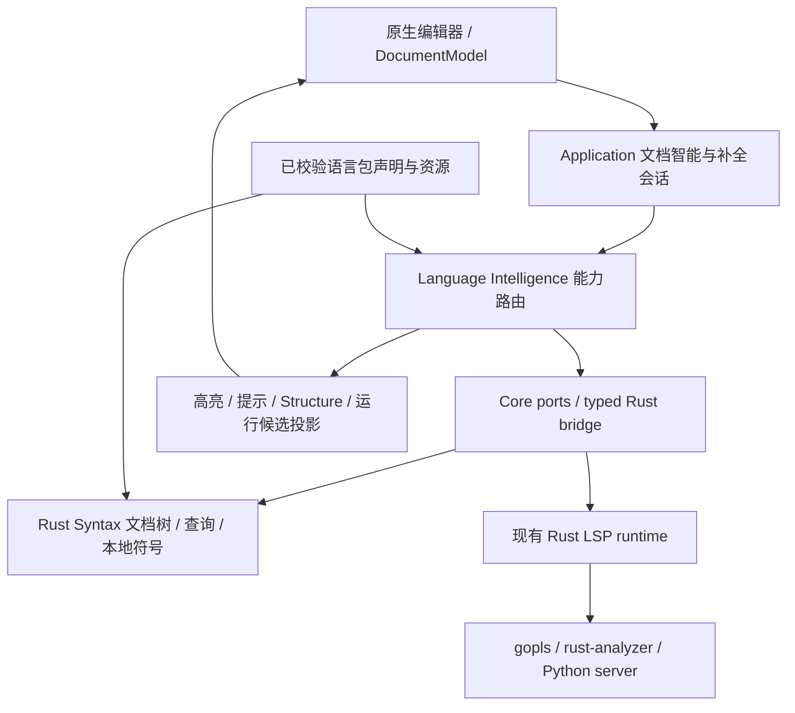

# 语法高亮、离线补全与语言插件：实施方案

状态：**尚未实现**。2026-09-06 独立设计基线复核为历史结论，见 [审查记录](goland-parity-implementation.md#plan-review)。2026-09-08 已完成 [L0–L2 第二版方案复核](syntax-l0-l2-engine.md#l0-l2-plan-review)：首轮 6 项 P1、3 项 P2 均在方案层闭环，候选身份、错误确认、取消、模块接线与资源契约已同步修订。本文是语言能力实施依据，不能用方案中的接口、预算或验收项证明产品已支持对应功能。

目标是在当前原生编辑器和 Rust Core 上，逐批对齐 GoLand 的编辑、高亮、补全、提示与常规文件体验，并让语言包扩展这些能力。本文保留“**不启动 LSP 也可用的语法层**”定位；跨文件类型分析、精确成员、导入、重构仍由完整 LSP 链路提供。Tree-sitter 不替代类型系统或 formatter。

配套文档：[总体语言路线](rust-language-intelligence-roadmap.md)、[LSP 契约](language-tooling.md)、[多语言适配](language-support.md)、[插件架构](plugin-architecture.md)、[插件实现](../../macos/Sources/LitheModuleAPI/Plugins/PluginTypes.swift)、[仓库边界](repository-layout.md)。`language-support.md` / `plugin-architecture.md` 已随 `953c84da` 提交，描述的是**当前已实现的分层**；本文描述的是**尚未实现的语言引擎**，两者冲突时以源码为准（见第 1 节末）。实施前需独立评审各批次，修订结论后再编码、运行验收、按批提交；未通过的批次保持未完成。

## 1. 当前实现与明确缺口

以下依据源码而非架构文档中的目标描述。

| 层 | 已有实现 | 缺口及复用方式 |
| --- | --- | --- |
| 语言识别 | Rust provider catalog、项目覆盖、插件 `languageSupports` | 高亮还有独立格式表；统一身份解析入口，保留已有识别规则与优先级兼容 |
| 配置高亮 | Swift 专用 adapter 覆盖 JSON/YAML/TOML/XML/INI/properties/ENV/generic config | 继续使用已验证的适配器，逐格式迁移；这些不是完整语义服务或 formatter |
| 通用源码高亮 | `GenericSyntaxHighlightingAdapter` 的混合关键字和正则 | Go/Rust 等关键字不全，跨行上下文有限；新增通用 Rust 语法结果投影 |
| Tree-sitter | Core 已依赖 `tree-sitter = 0.25`、`tree-sitter-java = 0.23`；Java 结构与语法分类 | 每次创建 parser 并整文 parse；没有通用文档 Tree 缓存，也没有 Go/Rust/Python grammar |
| 本地补全 | Rust 当前文件标识符；Swift 硬编码多语言关键字 | 缺作用域、可靠候选身份和可声明资源；替换本地 provider，不重写完整 LSP runtime |
| provider 路由 | `languageServer(200)` 在 `builtin(0)` 之前，成功补全合并；hover/导航取首个非空 | 当前失败直接终止，**不会自动回退**；多处按 label 去重丢失不同签名候选 |
| 补全协议/UI | text edit、additional edits、resolve 等部分链路；手动 `NSMenu` | 缺持久会话、自动触发、完整列表/插入格式、文档面板；`snippetSupport = true` 与占位符展平不一致 |
| 提示/格式化 | 已有 hover、diagnostics、code actions、formatting 等 LSP 操作 | 原生呈现和版本保护须逐项贯通；Rust inlay hints 操作存在不代表通用编辑器已显示 |
| 插件 | 现有包 schema/API 为 1；识别字段与 LSP/Run/Test/Debug module ID | 没有 grammar/query/snippet/editor 配置正式声明；原生包仅同 Team 签名，不能直接安装 Zed/JetBrains 扩展 |

核对入口：

- [高亮格式表](../../macos/Sources/Lithe/Resources/SyntaxHighlighting/format-mappings.json)、[Swift 高亮入口](../../macos/Sources/Lithe/Views/Editor/SyntaxHighlighting/SyntaxHighlighter.swift)、[通用正则](../../macos/Sources/Lithe/Views/Editor/SyntaxHighlighting/GenericSyntaxHighlightingAdapter.swift)。
- [Rust 依赖](../../rust/lithe-core/Cargo.toml)、[Java 分类](../../rust/lithe-core/src/languages/java_syntax.rs)、[本地符号](../../rust/lithe-core/src/lsp/lightweight/symbols.rs)。
- [provider 路由](../../macos/Sources/LitheLanguageIntelligenceModule/Services/LanguageToolingSessionManager.swift) 的 `routeCompletions` / `routeHover` / `routeNavigation`；[内置 provider](../../macos/Sources/LitheLanguageIntelligenceModule/Providers/LanguageFeatureProvider.swift)。
- [补全 DTO](../../macos/Sources/LitheCoreContracts/Language/LanguageToolingContracts.swift)、[initialize 能力](../../rust/lithe-core/src/lsp/interface/client.rs)、[接受补全与格式化](../../macos/Sources/Lithe/Models/AppModel/AppModel+Development.swift)、[原生编辑器](../../macos/Sources/Lithe/Views/Editor/CodeEditorView.swift)。
- [插件声明](../../macos/Sources/LitheModuleAPI/Plugins/PluginTypes.swift)、[插件 catalog 适配](../../macos/Sources/Lithe/Core/Language/PluginLanguageProviderCatalogSource.swift)。

原稿“provider 路由无需修改”“补全只有本地关键字”“增量耗时不随文件长度线性增长”不能作为事实或验收标准。`language-support.md` 的失败回退描述与当前源码存在差异，实施路由批次时同步核对相关文档，不假定其已经实现。

## 2. 能力边界与对标验收

| 用户操作 | 离线语法层 | LSP/其他能力 | GoLand 对标的可观察结果 |
| --- | --- | --- | --- |
| 打开/编辑源码 | Tree-sitter token、括号、折叠、文档符号 | 就绪后叠加 semantic tokens | 打开即着色；未闭合字符串、注释、连续输入不污染后续文本；光标不跳 |
| 换行、缩进与括号 | 声明驱动的缩进增减判定、括号对与包围/展开选区 | on-type/range formatting、LSP 提供的缩进结果 | 回车按语言缩进；配对与包围不吞用户输入；无声明的语言保持现有行为而不是猜测 |
| 输入/手动补全 | 当前作用域、文件内符号、关键词、snippet | 类型成员、跨文件符号、导入、resolve | 光标旁列表，方向键/接受/取消/文档一致；保持编辑焦点 |
| hover/参数提示 | 高置信同文件声明与注释 | 精确类型、依赖文档、活动签名 | 可读签名、代码块、参数定位；不把猜测标成类型分析结果 |
| 格式化 | 有正式 formatter 才提供 | LSP formatting 或所属工具模块 | 保留编码/换行；变更可预览，一次 Undo；未支持格式明确不可用 |
| Structure/TODO/运行入口 | 通用符号、注释范围、候选入口 | LSP symbols/code lens、Run/Test provider 验证 | 工具窗消费统一结果；点击定位，运行配置使用真实工作目录/参数 |
| 重构 | 语法选区、包围/展开等可证明局部操作 | prepareRename、rename、code actions、workspace edit | 跨文件编辑有预览与版本校验；语法 rename 不冒充安全语义重构 |

重构行所列的 LSP 侧能力（prepareRename、selectionRange、workspace edit 的顺序/版本/资源操作）
当前**均不存在于客户端**，由 [B6 重构方案](goland-parity-b6-refactor.md) 的 B6a 交付；本文的 L8
只提供语法选区与包围/展开，不覆盖语义重构。两份方案共用同一 workspace edit 契约与编辑事务：
第 7 节的格式化事务与 B6b 的 `WorkspaceTextEditCoordinator` 是同一个实现，不做两份。
| 更换主题/语言包 | role 重映射、声明驱动识别与语法 | 模块按能力启停 | 无须改编辑器即可扩展已支持契约；设置项实际生效 |

截图使用同一示例、字体大小和窗口尺寸，分别记录外观和交互。Go/Rust/Python 语义能力分别以 GoLand/RustRover/PyCharm 的常用操作为参照，保留 GoLand 风格的统一交互；不能用“看起来接近”代替补全正确性。

用户已明确可参考正在打开的 RustRover，本机版本为 **2026.2.1 / 262.9437.161**。Rust 样例的高亮、补全候选/文档/参数提示、inlay hints、重构和运行 gutter 以该版本实际操作为基线；Cargo 和 Rust 设置由工作台 B7/B4 批次共同验收。记录 edition、features、target 与 toolchain，避免两边编译条件不同导致误判。

## 3. Rust 复用与边界

沿用 Rust Tree-sitter 0.25 基线，首批引入兼容的 [Go grammar](https://github.com/tree-sitter/tree-sitter-go)、[Rust grammar](https://github.com/tree-sitter/tree-sitter-rust)、[Python grammar](https://github.com/tree-sitter/tree-sitter-python)。选定版本需在 Cargo.lock 固定，不能直接依赖 upstream latest。grammar crate 与 query 来源分别审查，不推断同名资源许可证相同。

Tree-sitter highlights/locals/injections 适合共享语法结果；持久 Tree、文档缓存与 UI 生命周期是 Lithe 自己负责的工程。调用 Highlighter 不自动实现旧树复用。以持久 Parser/Tree + Query 为目标，用官方高亮库做原型结果对照，避免每次着色重复解析。[Tree-sitter 高亮文档](https://tree-sitter.github.io/tree-sitter/3-syntax-highlighting.html)、[0.25.10 Parser API](https://docs.rs/tree-sitter/0.25.10/tree_sitter/struct.Parser.html)。

参考 [Helix 的语言/grammar 配置](https://docs.helix-editor.com/languages.html) 与 [Zed 语言扩展分层](https://zed.dev/docs/extensions/languages)，采用“识别、grammar、query、LSP 分开声明”的结构，不嵌入完整编辑器。复制资源前逐文件固定 revision、许可证和 NOTICE。模糊排序先使用项目已有能力，只有基准证明收益才引入额外 crate。



Views 不构造 parser、进程、Rust C ABI 或平台适配器。Rust 负责确定性解析、坐标、校验与候选；Application 负责状态、取消与结果适用性；平台层负责原生呈现、资源读取、工具发现和插件 worker 启停。已有 Rust LSP runtime 继续拥有语言服务器进程与协议会话，不创建第二套 LSP 运行时。

建议 `rust/lithe-core/src/languages/syntax/` 拆分 registry、document、coordinates、highlight、locals、completion、structure；资源放 `rust/lithe-core/resources/languages/<id>/`。保留旧 Java 命令作为兼容路径，**不把 Java 查询迁移当作三语言上线前置条件**。将来迁移按语义 fixture 验证差异，不能保证手工 walker 与查询输出逐字节相同。

### 3.1 与 Zed / Lapce 的栈对比

下表用于说明选型理由与可复用范围。Zed/Lapce 的实现细节与授权条款以各自上游仓库当时的 revision 为准，**实施前逐项核对，不能把本表当作授权结论或兼容性证明**。

| 维度 | Lithe 现状/本方案决策 | Zed | Lapce | 本方案结论 |
| --- | --- | --- | --- | --- |
| UI 与文本渲染 | SwiftUI + AppKit `NSTextView`（TextKit 1），折叠与装饰自研 | 自研 GPU UI 框架，自绘文本 | Rust 响应式 UI，自绘文本 | 不采用。更换渲染栈等于重写编辑器，并放弃输入法、无障碍与系统集成 |
| 文本模型 | `NSTextStorage` + 第 4 节版本化 edit 协议 | rope + CRDT（服务协同编辑） | rope 衍生实现 | 不引入 CRDT；保留“增量 edit 是一等公民”的协议形状 |
| 语法引擎 | Tree-sitter 0.25，当前仅 Java 且为手写 walker | Tree-sitter，query 驱动 | Tree-sitter，query 驱动 | 底座相同，差距在 query 化与文档 Tree 缓存，即第 3–4 节内容 |
| grammar 分发 | 编译期 crate 并在 Cargo.lock 固定；新 grammar 走 6.3 原生 worker | 安装时按 git revision 获取并本地编译 | 获取预编译动态库 | 保持现方案。运行时下载/编译不满足确定性构建与签名公证约束 |
| 插件隔离 | 原生 Bundle（进程内）+ 每语言包独立 syntax worker 进程 | WASM 沙箱 | WASI 沙箱 | 保持 6.3 决策；沙箱强度差异与授权路径见 3.2 |
| 语言声明 | 6.1 的 `languageResources`（识别/grammar/query/editor 分离） | 扩展清单 + 每语言配置 + query 目录 | 插件清单 + 注册表 | 形状已一致，继续对齐字段集合 |
| 语言服务器获取 | catalog 声明 Homebrew formula 或官方页面 | 扩展内的适配层决定二进制与参数 | 插件负责获取并启动语言服务器 | 缺口。安装路径仍是短板，纳入插件批次评估，不在本文件承诺 |
| 补全 UI 与排序 | 手动 `NSMenu`，无模糊排序 | 自绘列表、文档面板、模糊排序 | 同类交互 | 交互模型由 L3 对齐；模糊排序先用项目已有能力，基准证明收益再引入 crate |

**可复用且风险较低的三项**，均为公开设计约定或上游共享资源，不涉及复制 Zed/Lapce 代码：

1. **上游 grammar 与其自带 query**。来源是 Tree-sitter 官方或 grammar 维护仓库，与 Zed/Lapce 无从属关系；按第 3 节要求固定 revision、分别审查 grammar 与 query 许可证并记录 NOTICE。
2. **query 职责划分的命名约定**：`highlights` / `locals` / `injections` / `brackets` / `indents` / `outline` / `overrides` / `runnables`。槽位在 6.1 一次定义，批次归属与缺省语义同样以 6.1 为准；仅声明槽位不构成能力交付。
3. **每语言编辑行为配置的字段集合**：行注释、块注释、括号对与其换行行为、构成单词的字符集、缩进增减判定。这类字段一旦发布再补需要提升资源 schema，因此在资源 schema 1 一次占位。

### 3.2 明确不采用的部分及理由

- **不引入 WASM/WASI runtime**。6.3 已选择签名校验的独立 worker 进程，同样获得崩溃隔离，且避免 C scanner 移植与额外 runtime 的体积、启动与调试成本。代价必须如实记录：**worker 具备普通进程权限，签名与 receipt 不是沙箱**，第三方来源仍走 6.3 的显式授权路径。
- **不复制 Zed 代码**。其主仓库授权与本仓库 Apache-2.0 的兼容性需要法务级确认，因此只参考公开文档描述的分层与字段设计。Lapce 的授权与本仓库一致的部分可作为实现参考，但仍需逐文件记录来源、revision 与 NOTICE，不因“同许可证”跳过审查。
- **不因跨进程可能性重写现有能力面**，但**新增宿主服务优先定义可序列化的 JSON 请求/响应契约**而不是 Swift 协议对象。现有 `LanguageRunExtensionPlan` 一类值类型是正确示范；`PluginHostContext` 返回对象引用的既有服务保持不变，不在本方案批次内改动。

## 4. 版本化语法契约

以下是**拟议 API**，实现批次先更新 [Rust Core API](../../shared/contracts/rust-core-api.md)、共享 fixture、Rust dispatch 和所有 Swift 消费方，不能调用尚不存在的命令。

### 4.1 标识、操作和错误

文档请求携带 `schemaVersion: 1`、`workspaceSessionID`、`documentID`、`generation`、`version`、`operationID`、`languageID` 和 `resourceRevision`。`documentID` 是打开文档稳定 ID，不是文件路径；同路径不同项目、虚拟文档、未命名文档不可串用。相对文件名只作为识别元数据，不作缓存主键。`closeWorkspace` 只需 schema、workspaceSessionID 与 operationID；其余身份不伪填。generation 是同一文档会话的递增整数，资源/语言切换与休眠后重建使用新 generation，视图转移不递增。payload 的 `operationID` 与外层既有 `operationId` 必须相同；外层 `id` 是本次传输请求 ID，可与重试的 operationID 不同。

| 拟议命令 | 行为 |
| --- | --- |
| `syntax.open` | 完整 UTF-8 快照、语言、revision；同 generation/version 可幂等确认 |
| `syntax.change` | `baseVersion` → `version`、有序增量编辑；严格按 base 快照解释 |
| `syntax.resync` | 完整快照替换；显式恢复版本缺口，不能把错误增量应用到新文本 |
| `syntax.highlights` | 指定版本、UTF-16 视口；返回 token、实际覆盖范围、状态 |
| `syntax.completions` | 位置、触发原因、前缀范围；返回本地候选及稳定身份 |
| `syntax.structure` | 符号、折叠、结构选区、运行候选；子能力显式标注支持情况 |
| `syntax.hints` | 高置信本地 hover/signature；没有可靠结果则为空 |
| `syntax.cancel` | `targetKind: text/query/parse`、targetOperationID；只取消同一文档身份下的目标，返回目标的状态快照，不撤销 accepted 文本 |
| `syntax.retry` | 显式重试当前 accepted 版本；只重新调度解析，不传文本、不修改版本；返回新的 parseOperationID |
| `syntax.close` / `syntax.closeWorkspace` | 撤销任务并释放文档/会话全部缓存；重复关闭幂等 |

所有结果回显身份、版本、operationID、资源 revision。旧 generation 关闭后永不复活；版本单调递增不要求连续整数，但 change 的 base 必须精确匹配。Undo/Redo 生成新 version，不回退版本号。

稳定错误为拟议的 `syntax.unsupportedVersion`、`syntax.documentNotOpen`、`syntax.resyncRequired`、`syntax.invalidRange`、`syntax.grammarUnavailable`、`syntax.resourceRejected`、`syntax.cancelled`、`syntax.budgetExceeded`、`syntax.operationConflict`。最后一项用于 operationID 被不同 payload 重用、同版本快照内容冲突；不把该冲突当作可自动恢复的版本缺口。使用现有 CoreError envelope，保留 `details: String?`，以新增可选 `error.context` 承载 typed syntax 状态；不得把 details 改成对象或从文案提取版本。正式 wire 决策及五个 JSON 示例见 [待实现契约](../../shared/contracts/rust-core-api.md#planned-syntax-v1)。`resyncRequired` 返回当前接受版本，不返回文本；UI 只重同步一次当前快照，失败后等待新编辑或明确重试，避免循环重解析。

### 4.1.1 文本接受和解析完成分开确认

每份文档维护 `acceptedTextVersion`（Core 已原子接受的文本）、`parsedVersion`（最后完整成功解析的 Tree 版本，可为 null）、`parseTargetVersion`、`parseOperationID` 和 `pendingEdits`。请求的 `version` 是目标文档版本，不能隐含“已完成解析”。同文档的文本变更、resync、close 在同一串行状态机内提交；解析在独立不可变快照上运行。

| 时点/事件 | 确定的状态与响应 |
| --- | --- |
| change 校验/应用前 | 先验证 base、全部有序范围和内存预算，在临时快照生成新文本；未通过或已取消时不改变 accepted 文本/版本，error.context 返回 `disposition: notApplied`、当前 acceptedTextVersion/parsedVersion |
| 文本事务提交点 | 一次原子交换文本、行索引、acceptedTextVersion 和有序 edit ledger；change 成功立即返回 `disposition: applied`、acceptedTextVersion、parsedVersion、parseState，不等待 Tree 解析 |
| 提交后收到取消/解析超时 | 不撤销已接受文本，也不把成功 ack 改成 generic cancelled。取消 text operation 只取回原 applied ack，不隐式取消已派生的 parse；取消 parse 必须使用 parseOperationID，解析状态才变为 cancelled/budgetExceeded。取消响应的 targetDisposition 指目标 text operation；query/parse 目标该值为 null |
| 完整 parse 成功 | 只有任务仍拥有当前 generation/resourceRevision/parseOperationID 且目标版本仍是当前 acceptedTextVersion 时才发布 Tree/符号/结果，更新 parsedVersion；旧任务成功仅释放资源，不覆盖新状态 |
| close 与 parse/resync 交错 | close 撤销 generation、取消任务并清缓存；随后到达的旧 change/resync/parse 一律 documentNotOpen/过期，不隐式重新 open；重新打开必须显式 open 新 generation |

语法查询选择**同一请求有界等待并直接返回最终结果**，不新增广播事件或轮询循环。Application 收到 applied ack 后，对当前需要显示的 highlights/structure 各发一次查询；目标版本已经 parsed 则直接计算，否则登记该版本的有界 waiter，由 parse 完成唤醒并在原查询 completion 中返回结果。`pending` 只表示应用的 loading/ack parseState，不能作为查询的最终响应。用户停止输入后，已在途查询仍会取得完成结果，不依赖下一次按键。

内置 Core 的查询由平台适配器的受限后台执行器调用 typed Rust operation；等待不得占用主线程、Swift cooperative executor 或负责 parse 的 worker 池。外部 syntax worker 则保留原 Content-Length 请求 ID，完成后回复该请求，宿主 async port 仍只完成一次。查询从登记起共用初始 100 ms 预算（包括等待解析和 query），用完成信号/有界等待，不定时重发；取消、版本变化或 close 立即移除 waiter。预算到期返回 `syntax.budgetExceeded`，若该版本解析尚在跑则一并取消该轮，保留 accepted 文本并结束 loading，只有新编辑或显式 Retry 才新建任务。解析在 deadline 后完成也不得发布结果；所有 waiter 在成功、取消、超时和关闭路径都必须释放。

查询取消只撤销对应 waiter，避免关闭一个视图时终止另一视图共享的解析；显式取消 parse、解析自身 deadline 或上述共享版本的 query 超时才终止该轮 parse，并完成所有依赖该轮的 waiter。对已经 failed/cancelled/budgetExceeded 的版本，滚动/主题查询返回终态，不自动启动解析；Retry 先发 `syntax.retry` 再发一次所需查询。相同版本已有在跑解析时 retry 返回现有任务，不创建第二个 worker。

不得把旧 Tree 的结果标成新版本。解析失败不丢 accepted 文本；`parsedVersion` 仍指向原来的完整 Tree。对旧 Tree 的 `InputEdit` 在任务私有 clone 上进行，编辑过但未 parse 完的工作树不冒充已完成版本；取消后丢弃该工作树，后续从已知版本的 Tree/快照重建。

成功 ack 丢失后的同 operationID 重试应幂等：每文档缓存最近 32 个文本提交确认及请求 digest；相同 ID/相同请求返回原确认，不再应用 edits，相同 ID/不同 payload 拒绝。记录已淘汰或连接中断导致接受状态无法确认时，不盲目重发 delta；使用下述一次完整 resync。worker 重启以新 connection epoch 隔离全部旧回包，需重新 open/resync，不把旧连接 ack 当新进程状态。

同 generation/version 的 open 或 resync 仅在语言、资源及文本 digest 全部相同时幂等；内容不同返回 operationConflict，不覆盖文本。取消状态无法确认时 targetDisposition 为 null，不能据此继续 delta。先取得在途文本事务的终态或隔离旧传输，再按 §4.1.2 恢复。

### 4.1.2 A → B → C 的合并规则

每文档“一项在跑、一项合并待办”限制的是**解析作业**，不是把依赖中间版本的同步 delta 丢掉。Core 已接受 B 后再接受 B→C，分别确认 accepted B/C；正在跑的 B 可取消，新待办指向 C。最后完整 Tree 若仍属于 A，ledger 必须保存 A→B、B→C 的有序 edits，并在私有旧树上依序 replay 后 parse C；不能只拿 B→C 编辑 A。

传输端同文档只发一个未确认的文本事务。尚未发送的 A→B 与 B→C 可以合为 `baseVersion: A, version: C`，edits 原样串接且逐项以上一 edit 后的文本解释。相邻 edits 只有经过等价性验证才能压缩，不能用坐标不同的最后 edit 覆盖前一个。Core 已接受每次同步而只是 parse 落后时，增量 ledger 超过初始 128 项或 256 KiB 则丢弃旧 Tree、从当前 accepted 快照完整 parse；无需让 UI 再传一遍已知文本。

如果是传输待办溢出、base 不匹配或 ack 状态未知，等待/取消当前事务的有界确认后，发送**一份最新完整快照 resync**，清掉被快照覆盖的旧 delta。resync 本身也有原子提交点和 applied/notApplied 确认，不接受低于当前 accepted 的版本。其在途期间新编辑以该快照为基线继续排队；恢复链路只允许一次自动 resync，失败或再度无法保留依赖时暂停这次恢复并显示状态，等待明确重试或新的编辑触发新恢复，不能紧循环发送快照。这个边界不暂停原生文本输入。

L1/L7 的共享 fixture 用可控 gate 固定：A→B→C 合并与逐次应用结果相同；提交前取消仍在 A；提交后取消 ack 为 applied B 且 B→C 可接续；B 的旧 parse 晚于 C 完成不覆盖 C；解析取消后重建等于全量解析；ack 重试不重复编辑；resync 与 close 先后两种顺序均不复活文档。每个 fixture 同时断言 acceptedTextVersion、parsedVersion、确认 disposition 和 UI 可用结果版本，不能只比较最终文本。

另用可控完成信号和注入时钟验证：applied 后只发送一次 query，用户不再输入也能收到准确版本的 highlights/structure；超时结束 loading、取消解析并释放 waiter，之后完成信号不能修改 UI，也没有自动重请求；显式 Retry 才产生新 operation；close 与 ready 同时到达仍只完成一次且不复活文档。

<a id="syntax-cancellation-boundary"></a>
### 4.1.3 提交确认、调度和取消的实际边界

Rust dispatcher 在解码 envelope/command 后把 syntax 命令分流到 domain-finalized 路径：这些命令自行完成校验、提交前 deadline 检查和错误 context，不经过会丢失 context 的 generic 前置取消返回，也不在返回后执行会把成功替换为 generic cancelled 的统一后置检查。仅 syntax 分支适用；其他命令的前后取消检查不变。query 在自身完成点判定 deadline，不得在刚完成后被外层改写而丢失版本。JSON 编码失败仍为传输未知状态，按一次恢复处理，不能伪造 notApplied。

`languages/syntax/runtime.rs` 拥有任务与 waiter 注册，`task.rs` 拥有 `Arc` 取消 token、单调 deadline、完成信号；文本请求、查询、后台 parse 使用不同 operationID。parseOperationID 由 Core 分配，终态不复用。任务不得引用同步命令的 thread-local `cancellation::Scope`，不能在 change 返回时被 Drop 注销。调度器在终态注销句柄，响应缓存单独保留文本 ack。

宿主使用 typed `syntax.cancel`，不把 `lithe_core_cancel(changeID)` 当作 ack 后取消 parse 的接口。cancel 的控制通道不排在正在等待的 query 后面。尚未进入 Core 的排队请求由平台原子取消并完成；进入 Core 与取消相撞时，Core 为尚未登记的 text/query 目标保留按完整身份+operationID 索引的 early-cancel 标记，注册时先消费标记再决定提交，不能依赖同步 FFI 暴露不存在的“已登记”回调。标记在目标终态或 generation 关闭后释放，初始全局上限 128；满额时撤销目标 generation 并返回预算状态，不淘汰仍可能被在途请求消费的标记。unknown 取消响应不是 notApplied 证明，平台仍等待原 completion 或执行有界隔离恢复。重试同 operationID 的并发副本由平台合并，Core 在幂等登记中也只允许一个提交者。

共享 parse 池最多 2 个 OS worker；状态机锁内不等待解析、query 或线程退出。macOS adapter 使用独立受限 query 执行器（初值 4 个工作线程、最多 64 个排队查询，每视图同类只保留最新一个）；文本使用独立有界提交队列，cancel/close 的控制通道不被数据提交积压阻塞。排队等待也计入宿主 100 ms 查询总预算，进入 Core 时传剩余预算；队列满返回 budgetExceeded 并结束 loading，不增加线程或轮询重试。文本待办沿用每文档 128 项/256 KiB 上限，超限走一次快照恢复。

文本校验/构造在锁外针对 captured base 进行，提交时重验 base/关闭标记。单次文本传输初始 500 ms deadline；未收到确认时先取得终态，或撤销旧 generation/传输 epoch 使其无法再提交，再恢复，不能在未隔离的旧事务旁假设 notApplied。close 先撤销身份并唤醒 waiter，再在锁外有界回收；测试必须通过真实 dispatcher 与 Swift 解码验证提交前后取消。

### 4.2 坐标与增量编辑

- Tree-sitter 使用 UTF-8 byte offset，Point column 也是字节数；LSP/编辑器 DTO 使用零基行、UTF-16 列；AppKit NSRange 是全文 UTF-16 offset/length；产品列表显示一基行号。
- v1 edits 使用全文 UTF-16 半开区间 `{start, length}`，按顺序解释：后一个范围针对前一个应用后的文本。不要与“全部基于旧版本、倒序应用”的 workspace edit 混用。
- Core 校验边界、越界、负数和溢出，不切开 surrogate pair 或 UTF-8 code point；CRLF 按两个 code unit 计算。替换文本长度和换行索引由 Core 计算，不信任调用方字节计数。
- 同文档串行应用 `InputEdit` 再复用旧 Tree 解析；任务针对不可变快照。持有旧树的读者不能与编辑同一树竞争。
- 行索引维护 UTF-8/UTF-16 转换，更新受编辑影响的行；不要把每字节分配 usize 的整文转换表作为大文件长期缓存。
- parser 取消后按 API reset 或恢复同一任务，不能把未完成解析状态复用于另一文档。[固定版本 Rust binding](https://github.com/tree-sitter/tree-sitter/blob/v0.25.10/lib/binding_rust/lib.rs)。

### 4.3 缓存、生命周期与预算

文档模型是文本真源，cache 不写回旧文本。保存快照、Tree、坐标索引、局部符号和有限视口 token；query 按 `(resourceRevision, queryKind)` 编译共享，不按 tab 重复编译。resourceRevision 是下述整组资源内容身份，不是包内递增版本号。

<a id="resolved-syntax-resources"></a>
`ResolvedSyntaxResourcesV1` 固定包含 ownerPackageID、ownerModuleID（纯数据包可为 null）、languageID、grammarID、grammarABI、grammarSourceRevision、grammarDigest、runtimeContractVersion，以及八个槽位各自的 UTF-8 内容 SHA-256（缺省为 null）和 editor/keywords/snippets/formatter 声明的 digest。平台从已校验安装资源生成观测值，Rust 以固定字段顺序、JSON 数组、明确 null、UTF-8/无额外空白编码，使用现有 sha2 生成 `resourceRevision = "sha256:" + 小写十六进制摘要`；不纳入机器路径。grammarDigest 绑定固定 parser/scanner 构建输入，worker 还必须匹配其 executable digest/协议握手。ABI 只校验接口，不替代 grammar 内容身份。

资源集整体不可变；内容、owner 或引擎语义版本变更即生成不同 resourceRevision。启用 epoch 单独由宿主递增，资源更新/禁用/回滚关闭旧 generation 再显式 open 新 generation；即使回滚到同一 digest，旧 generation 的回包仍不能生效。L1/L2 用内部 bundled 资源清单，L5 的 manifest v2 与资源 schema 1 适配这份既定身份，不提前宣称安装能力可用。L4 的新槽位资源只改变内容身份，无须新增编辑器语言分支。

以下为**内部预算初值，需以实测校正**，不是现有性能数据：

| 资源 | 初始限制与超限行为 |
| --- | --- |
| 同时解析 | 全进程最多 2 个 worker；同文档 1 个在跑、1 个合并待办，优先可见编辑器；不占用 LSP I/O 线程 |
| 文档缓存 | 全进程最多 64 个、每 workspace 最多 24 个；软预算 128 MiB（快照/索引/结果/估算 Tree），LRU 先淘汰不可见文档；另测 RSS，不把估算当绝对内存上限 |
| 文件大小 | 4 MiB 或 100,000 行起进入大文件模式，8 MiB 以上默认停止整文语法/符号扫描；基本编辑/搜索可用，提供恢复入口 |
| 单次任务 | 普通编辑目标 20 ms p95；解析/query 100 ms 软 deadline，支持取消回调；超时停止该轮，不立即无限重试 |
| 查询资源 | 每语言每类 query 最多 256 KiB；编译 cache 最多 64 组；match 限额与 deadline 同时生效 |
| 注入 | 深度最多 3、每文档最多 64 个片段；循环拒绝，预算不足优先保留父语言 |
| 结果 | 每文档只留最新两份视口结果；一次补全最多 200 项；性能日志不写文档、原始候选和环境内容 |

内置 C scanner 在进程内执行，不具备恶意 parser 硬隔离；仅使用随产品编译并审计的 parser。实测不响应取消的 grammar 暂停默认启用并修复，不能用无限后台任务掩盖卡顿。动态语言插件使用第 6.3 节独立进程。

关闭文档/项目、项目休眠、语言关联改变、资源更新均取消并回收。文档目录中的身份、accepted 版本/digest 与已关闭 generation 高水位独立于重缓存；LRU 先逐出 Tree/结果，再逐出不可见文档的文本/索引，返回 resyncRequired 要求一次当前快照，不隐式 open 已关闭文档。64/24 个限制指重缓存，目录随文档/项目生命周期回收；关闭 workspace 后平台拒绝其所有请求，Core 保留会话撤销信息，重开项目分配新 sessionID。窗口合并/拆分只转移视图引用，不改变 generation；最后一个文档所有者关闭才发送 close，移走一个视图只取消该视图 query。禁用插件撤销其资源；进程能力继续遵循安装包所有权，不能恢复宿主进程 fallback。

### 4.4 视口、角色和失效

裁剪视口限制 query/绘制，不代表只解析可见行。跨行字符串/注释、祖先作用域和注入需完整上下文。失效范围至少合并文本 edits、Tree changed ranges、相关祖先和注入依赖；仅 changed ranges 会漏掉“树形未变、文本改变”的 token。

沿用当前 20 个 `SyntaxHighlightingColorRole` wire 名，新增 Rust enum 和共享映射 fixture。capture 显式映射；未知 capture 记录一次资源诊断并安全忽略。新增角色需 Rust/Swift/主题默认值/fixture 同步扩展。

重叠 capture 按固定资源优先级、capture 优先级、节点深度（较大优先），再按 pattern index、capture index（较小优先）裁决并切成不重叠 span，再按范围排序；只 sort/dedup 相同范围不能解决交叉覆盖。删除字符、闭合注释后要清除旧颜色。

合成顺序：默认文本色 → 基础语法 → 有效 semantic tokens；诊断下划线、搜索和选择独立保留。主题切换只重映射 role，不重新 parse/启动 LSP。IME marked text 期间不改文本、不抢焦点、不破坏撤销栈和光标布局；语法属性批量小范围更新。

L2 投影接收 `SyntaxHighlightSnapshot`：完整文档身份/operationID、parsedVersion、视图 requestID、resourceRevision、`coveredRanges`（当前版本 UTF-16 半开区间）和不重叠 role spans。视图 requestID 为宿主本地订阅标识，与该次 query operationID 关联，不新增另一套 wire 请求 ID。空 spans 仍须把 coveredRanges 恢复默认 foreground，再叠加有效 semantic tokens；不调用 `setAttributes` 清理其他装饰。旧/新坐标的 invalidations 先经过 edit ledger 变换到当前版本；范围过碎时可保守扩大为当前视口，不逐次全量重绘文档。

每个视图只选一个基础着色来源：bundled 资源验证通过即进入 syntax loading，清理受影响可见范围的旧 foreground，等待结果期间用默认文本色；ready 应用 syntax。只有资源不可用或本轮终态失败才切到原 adapter fallback，并一次清除旧 syntax 的可见属性/范围缓存。fallback 持续到新编辑或显式 Retry；滚动只绘制当前来源，不能在 syntax loading/ready 时先正则后覆盖。未知语言和既有配置格式维持其 adapter，Java 保留旧结果路径。

应用结果前同时比对 workspaceSessionID、documentID、generation、version、languageID、resourceRevision、connection epoch、view requestID；不只看 revision。theme epoch 只影响 palette，迟到 role 按当前主题映射，不能恢复旧颜色。IME 组合期间文档增量仍同步；与 marked range 相交的属性延至 composition 结束并重验版本后应用，语法结果不写文本、不发布全页 SwiftUI 状态。视口更新合并在已有编辑器调度路径中；缓存 role 重映射不重新解析。

## 5. 补全与提示的完整链路

### 5.1 协议与 provider

复用现有 Rust LSP，逐字段贯通到 Swift DTO/UI：`CompletionList.isIncomplete`、trigger、itemDefaults、insertTextFormat/Mode、insert/replace ranges、preselect、commitCharacters、label details、markup kind、resolve data、command、additional edits。只声明端到端实现的 optional capability。[LSP 3.17 Completion](https://github.com/microsoft/language-server-protocol/blob/gh-pages/_specifications/lsp/3.17/language/completion.md)。

L0 明确发送 `snippetSupport: false`；完整 L3 会话验收后再开启。`insertTextFormat` 缺省/null 按 plainText(1)，普通字符串不经 snippet 展平，`$1`/`${name}` 原样插入。仍返回 snippet(2) 的不合规/旧服务器候选在 L0 拒绝并记录诊断，继续本地 provider，不把模板损坏后插入。L0 不声明未支持的 itemDefaults/insertReplaceSupport；收到未支持的 edit/default 形状就拒绝该候选，不忽略 edit 后退化为 label 插入。Rust parse、Swift DTO 与 resolve 回传三处保留格式，附加 edits 有一项非法便拒绝该候选，不用 filter_map 静默删掉导入。

失败区分可恢复 provider 缺失/超时/崩溃/拒绝、无候选成功、用户取消、项目关闭、过期结果。前两类可继续本地 provider；后三类直接结束，不借 fallback 重新弹窗。保留结构化故障状态，自动补全失败不每次弹通知。禁用包允许独立宿主离线语法，不能启动该包拥有的进程能力。

候选身份由 provider、主插入范围/文本、插入格式、类型/签名和必要附加编辑确定，保留 resolve data；禁止仅 label 去重。精确成员优先，保留 LSP 过滤/排序语义，组内再做前缀/模糊排序。同 label 的不同签名、不同 import 来源可选且提交正确编辑。

<a id="completion-identity-v1"></a>
L0 统一在 Rust `lsp/lightweight/completion_identity.rs` 生成身份；新增批量 typed operation `lsp.completionIdentities`，Swift provider/manager 经 `BuiltinLanguageFeatureCore` 调用，Swift 不再实现第二种摘要。主范围缺省时先绑定请求时捕获的 fallbackRange。规范输入为固定字段顺序的 JSON 数组：identityVersion(1)、providerID（含 builtin/LSP 来源）、label、kind、detail/签名、主范围和 newText、insertTextFormat、按原序保留的 additional edits、原始 resolve data 的规范化内容。可选字段缺省统一 null，空串与 null 不合并；数组保序，data 的对象键递归按 UTF-8 字节排序，数字由固定 serde_json 编码，不作 Unicode 文本归一化。SHA-256 使用现有 sha2，wire 为 `completion:v1:<hex>`；不纳入 sortText、filterText、documentation 或当前数组下标。

每次返回以确定性 ID 去重，末端 AppModel/NSMenu 不再按 label 二次过滤；相同 ID 仍需比较规范输入，检测不相等则报告冲突并拒绝该批，不能覆盖字典值。data 变化保守视为不同候选；resolve 使用原始 data、原 provider/session，并保持选中的原 ID 与请求快照，不用 resolve 后新增 edits 重置选中项或投递到当前语言的另一 provider。结果刷新仅排序变化时 ID 保持；L0 文本变化即结束当前手动会话，L3 再扩展连续前缀会话。

归一化返回 `items + issues`；不支持的 snippet/edit/default/command 候选产生稳定 issue code，
每批最多 64 条、不记录源文本。L0 未实现的 completion command 不静默丢掉后继续插入；
resolve 收到不支持字段同样为 typed rejected。Swift payload/manager 保留这些诊断并按可恢复失败
处理，不把 Rust filter_map 丢项后的空列表冒充无候选成功。

L0 维护轻量请求上下文：workspace session、documentID/generation/revision、provider session epoch、光标/替换范围、operationID 与取消句柄。请求前、各 provider 回调、resolve 返回、菜单展示和同步提交前逐次核对；开始 IME、光标移出范围、输入、切文件、Esc、项目关闭使会话失效。LanguageServerSession 保留 runtime error code/stage，不能先展平字符串再猜取消原因；可恢复 missing/notReady/timeout/crash/rejected 才继续 builtin，无候选成功照常继续，cancelled/closed/stale 直接结束。

接受时主 edit 与 additional edits 作为同一已打开文档事务，经 B6b1 的同步快路径验证 revision/范围/重叠，B6b2 提供一次 Undo；resolve 期间文本变化直接丢弃，失败 fallback 到原 item 也必须通过同一快照校验。因此 L0 硬依赖 B6b2，不另写临时 workspace edit 实现。L0 保留 NSMenu 外观，但会话回调必须修改；“不改 UI”只指不交付 L3 popup。

### 5.2 本地候选与提示

`locals.scm` 提供作用域/定义/引用，语言差异进入 query 和少量解析适配器。局部 → 参数 → 外层 → 文档 → 关键词/snippet 固定排序。同名遮蔽、声明前可见性和闭包规则按语言已实现规则处理；未知时保守返回“当前文件候选”，不套用统一作用域语义。

成员启发式只使用同文件出现且可关联 receiver 的成员；证据不足返回空，不混入全文词。注释/字符串默认不返回代码候选，路径/文档/注入由对应上下文允许。关键词/snippet 迁到资源后删除 Swift 语言表；缺资源保留通用标识符兜底。

hover 返回声明与相邻文档；signature 仅在调用与声明可靠匹配时出现，处理嵌套逗号和活动参数。跨文件、重载、泛型采用 LSP。本地来源可辨识，不与精确提示重复。

### 5.3 原生会话

独立 feature model 保存完整文档身份、版本、光标/替换范围、触发原因、候选、选中 ID、operation/取消句柄。原生 popup 不夺编辑焦点，锚定光标并按屏幕边界翻转；列表显示图标、label、参数/detail、来源，配可滚动文档，尺寸受屏幕/编辑器约束。

- 输入标识符和 LSP 触发字符自动请求；手动立即请求。自动防抖初值 100 ms，可设置并经基准确定默认。
- 同一词继续输入优先筛选；isIncomplete 时重请求。离开范围、切文件、开始 IME、Esc、关闭项目结束会话。
- 新结果核对完整身份，保留仍存在的用户选中项；异步到达不强制选第一项。
- 上下键选择、Enter 接受、Tab 插入/替换、Esc 退出走 keymap；无有效候选时正常换行/缩进。
- 接受前校验快照；主 edit、import 等 additional edits 检查重叠/版本，作为一次事务；resolve edit 不应用到旧基线。
- snippet 支持序号占位符、默认值、镜像、选择项、最终 `$0`、Tab/Shift-Tab、取消和范围跟踪；transform 未实现前明确处理并测试，不能错位插入；一次 Undo 撤回接受操作。
- Quick Documentation 显示 Markdown/代码块，Parameter Info 标活动参数；inlay hints 是布局装饰，不写入文本；均按语言/用户设置生效。

Go 复用 gopls，Rust 复用 rust-analyzer，Python 延续当前默认 provider；换 Python server 不是语法前置条件。semantic tokens、signature/inlay 按协商逐项接通，避免两套提示互相覆盖。AI 推荐另设可选 provider，不作为基础编辑前提。

## 6. 语言包与常规格式

### 6.1 声明与兼容

扩展现有 `languageSupports`，不再造独立语言名单。识别、语法资源、编辑行为、设置和进程 module 引用归属同包；读声明不加载 Bundle、不执行项目命令、不下载 parser。

拟议 manifest schema 2 支持 `languageResources`，资源 schema 独立为 1；宿主显式接受旧 manifest v1 并按旧默认适配，旧宿主拒绝 v2，不依赖其静默忽略字段。新增宿主协议/二进制 ABI 时提升对应 API/service ID，不能假设加 JSON 字段就兼容原生 Bundle。正式 schema 由插件批次一次定义，主题和语言共用资源校验机制。

下面是**资源子声明示意，不是当前可安装 plugin.json**：

```json
{
  "schemaVersion": 1,
  "languageID": "rust",
  "grammar": { "id": "tree-sitter-rust", "delivery": "bundled" },
  "queries": {
    "highlights": "languages/rust/highlights.scm",
    "locals": "languages/rust/locals.scm",
    "outline": null,
    "injections": null,
    "brackets": null,
    "indents": null,
    "overrides": null,
    "runnables": null
  },
  "editor": {
    "lineComment": "//",
    "blockComment": ["/*", "*/"],
    "brackets": [
      { "open": "{", "close": "}", "newline": true },
      { "open": "(", "close": ")" },
      { "open": "\"", "close": "\"", "notIn": ["string", "comment"] }
    ],
    "wordCharacters": ["_"],
    "indentSize": 4,
    "useTabs": false,
    "keywords": "languages/rust/keywords.json",
    "snippets": "languages/rust/snippets.json"
  }
}
```

`queries` 的八个槽位（highlights/locals/outline/injections/brackets/indents/overrides/runnables）与 `editor` 字段在资源 schema 1 一次定义。除 `highlights` 外全部可缺省，**缺省语义是该能力不可用，而不是回退到猜测规则**：无 `outline` 不产出语法 Structure（已就绪 LSP symbols 独立可用）；无 `indents` 不新增语法缩进，无 `brackets` 保持编辑器现有配对行为，无 `overrides` 时注释/字符串抑制沿用 5.2 的默认判定，无 `runnables` 时该语言不产出语法级运行候选。`injections` 缺省时不做嵌套语言解析，其预算见 4.3。

批次归属：`highlights` 属 L2，`locals`/`outline` 属 L4，`injections` 随 6.2 的 Markdown/HTML 验收在 L6 落地，`indents`/`brackets`/`overrides`/`runnables` 属 L8。L4 的符号/折叠范围用 outline query 消费同一 Tree，不在高亮 query 中猜结构。声明存在不等于能力已交付。运行候选与上下文抑制以 query 表达而非在 Rust 内按语言分支实现，否则每新增一门语言都要改引擎代码，与“新增语言即新增声明与资源”的目标冲突。

包索引记录 revision、grammar ABI、大小、SHA-256、来源 revision/许可证。query 与固定 grammar 成对验证，不能把 Zed/Helix predicates/captures 默认视为全部兼容。

<a id="syntax-query-validation"></a>
L2 支持且执行 Tree-sitter 0.25.10 的 text predicates：eq?/not-eq?/any-eq?/any-not-eq?、match?/not-match?/any-match?/any-not-match?、any-of?/not-any-of?；参数遵循固定 binding 的验证规则。启用前逐 pattern 检查 general_predicates、property_predicates、property_settings：L2 暂不支持任何自定义 predicate/property，包含 #is? local、#set! priority 的资源均拒绝，不能因 Query::new 成功便忽略语义。选用/修订上游 query 时去掉不支持的规则必须同时给出语义等价语料；需 locals 的资源留 L4，再提升内部 runtimeContractVersion。

未知 capture 可以诊断后忽略；未知 predicate/property 会拒绝整份资源并保留上一可用资源。重叠顺序在内部已校验捕获表中明定为（资源层优先级、capture 优先级、节点深度、pattern index、capture index）的全序，再切分 span；不偷偷支持资源 #set! 优先级。测试需有“编译成功但不允许的 predicate/property”负例，以及同语料满足/不满足 text predicate 的结果对照。包更新在所有受支持槽位编译及语义校验通过后才原子启用；尚未交付的槽位可以校验并保留声明，但能力保持不可用。

已内置 grammar 的资源包可添加识别/query/关键字/snippet/设置/LSP/formatter 声明，无须改通用编辑器。纯数据包类型由插件批次正式扩展，不能伪装成空 native Bundle。尚未内置 grammar 在前期随宿主发布，最终以 6.3 节安装，不把“修改 Cargo.toml 重编宿主”当插件扩展完成。

安装拒绝绝对路径、`..`、逃出包目录的 symlink、损坏/超限、未知 ABI、未允许签名、散列不符；query 预编译及上述语义校验成功后原子启用。资源更新更换 resourceRevision 并递增启用 epoch、取消旧任务；回滚恢复整组资源，失败保留上个可用版本并显示诊断。两个包扩展同语言时各保留 owner 身份，由用户/项目显式选择资源集；无选择时保持当前可用集，不能由安装顺序覆盖。同一项目每语言仅激活一套基础语法资源。原生 Bundle 仍遵守重启卸载；第三方市场签名策略另行评审。

ABI 校验针对实际执行 parser 的 runtime：bundled grammar 必须被宿主支持，worker grammar
须与其包内 runtime 匹配，不要求等于宿主 ABI。第三方 worker 的执行/握手及 query 预编译均在
§6.3 的明确本地授权后进行；安装前静态校验不偷跑 worker。新增包若无当前可用集也无用户选择，
优先使用仍受支持的 bundled 集，否则保持 plain/fallback 并等待选择，不能隐式随机选包。

设置按语言贡献 File Types、Tabs and Indents、Completion、Inlay Hints、Formatter、Language Server 的已实现项。优先级：本次显式选择 > 项目设置/EditorConfig 已支持字段 > 用户语言设置 > 包默认 > 通用默认；显示有效值与来源。工作区数据不能越过现有信任边界启动任意工具。

### 6.2 文件矩阵

用户 `11.png` 的 TOML、Dockerfile/Compose、SQL、Make、LOG、CSV 全部纳入验收。Languages/Themes/Icon Themes/Language Servers/Debug Adapters/MCP Servers/Snippets 分类用于目录展示，不代表执行能力已支持；Theme/Keymap 由工作台批次负责。

识别顺序：显式关联 → 已验证声明中的精确文件名 → 明确 glob/后缀 → 有界首行/shebang → plain text；冲突稳定裁决并提供配置。保留现有大小写规范；`.env.*`、`Dockerfile.*` 仅按声明匹配；`.conf` 不全局猜 nginx，SQL 方言由连接/项目/用户选择。

| 格式/样例 | 高亮与编辑验收 | 格式化/补全边界 |
| --- | --- | --- |
| Go / Rust / Python | Go 泛型/原始串；Rust lifetime/raw string/嵌套注释；Python decorator/f-string/三引号 | LSP + 本地 fallback；formatter 各自验证 |
| JS / TS / JSX / TSX | import、类型、模板串、JSX 嵌入，各 grammar 单测 | 标准 LSP 与声明的 formatter |
| JSON / JSONC | key/value、转义、数字；JSONC 注释/尾逗号单独识别 | 保留顺序和数字文本；不能删注释后美化 JSONC |
| YAML / Compose | anchor/block scalar/多文档，`compose.yaml`/`docker-compose.yml` | schema completion 需真实 schema/provider；保留注释和标量含义 |
| TOML | `Cargo.toml`/`pyproject.toml`，table/array/datetime/多行串 | formatter 按能力提供；保留注释/顺序/原值 |
| Dockerfile | 指令、ARG/ENV、续行、heredoc、RUN shell | 指令/路径 snippet；无可靠 formatter 时禁用 |
| SQL | 关键词、quoted identifier、字符串/注释、选定方言 | 复用数据库端口；方言 formatter 才改写，不捏造 schema 连接 |
| Make | `Makefile`/`GNUmakefile`/`.mk`，目标、变量、recipe/续行 | recipe Tab 保真；禁止通用空格缩进/trim 破坏命令；无可靠 formatter 则不可用 |
| LOG | 等级、时间、栈、多行消息/链接；可见范围处理 | 日志查看默认只读展示，不补全/重排/格式化；普通文件编辑权限另由文档决定 |
| CSV / TSV | 引号转义、嵌入换行、分隔符、列辨识 | 不转换数字/前导零/空值/公式文本；显示对齐不改源；无无损 formatter 则不美化 |
| XML / HTML | 标签/属性/实体/CDATA，HTML script/style 注入 | mixed content 空白不随意改写，formatter 保留语义 |
| INI / EditorConfig / properties / ENV / config | section/key/value、转义/续行/注释，路径不误标注释 | 保留顺序、重复 key、转义；只执行格式明确定义的动作 |
| Markdown | 标题/列表/链接/引用/围栏，Go/Rust/JSON fenced 注入 | 保留预览；不破坏代码块、硬换行、嵌入 HTML |
| shell | `.sh`/shebang、引号/变量/替换/heredoc | 只用声明 shell 方言的 formatter，不执行文件验证语法 |
| 未知/二进制/超大文件 | plain text、既有二进制处理、大文件降级 | 不虚构语义，取消/切换其他文件立即可用 |

这是交付矩阵，不是当前支持清单。LOG/CSV 可用轻量确定性 tokenizer；已有配置 adapter 可以保留，不能为“全部 Tree-sitter”移除正确功能。源码优先共享语法引擎，常规格式选保真且可扩展的最小实现。

### 6.3 新 grammar 独立安装：采用受信任的原生 worker

最终选择 **每语言包一个原生 syntax worker 可执行文件，parser 静态链接 worker，宿主通过版本化 UTF-8 JSON 通信**。正式官方分发仍要求同 Team 签名；显式本地授权路径见下文。不在宿主 `dlopen` 下载的 C scanner，不引入完整 WASM runtime；这是一项新增能力，不是当前插件已支持行为。用户安装宿主从未内置的 grammar 必须无需重编宿主。

- 包新增声明 `syntaxWorker`：包内相对 executable、`protocol: language.syntax.worker.v1`、支持的语言/grammar revision、资源上限、owner module。Swift 平台适配器校验签名/架构/散列后启动，模块登记资源与租约；Core/Application 只依赖窄 worker port。
- worker 以现有 Rust syntax 确定性组件实现；编译期共享模块或抽取小型共享 crate，避免复制引擎。包可用不同 Tree-sitter ABI，只要其内部 parser/runtime ABI 匹配，并通过 v1 wire conformance；不跨进程传 Rust 对象/指针/TSLanguage。
- stdin/stdout 使用 Content-Length 帧承载 JSON，stdout 只供协议、stderr 受限诊断。初始化协商 protocolVersion、能力、grammar/resource revision；文档操作复用 syntax v1 身份/范围/错误语义，增加按 operationID 取消和 shutdown。未知版本在发送文档正文前拒绝。解码前检查头长度和帧大小，输入最多 64 MiB（含 JSON 转义膨胀）、输出最多 16 MiB，超限关闭故障连接；不是读到 EOF 才决定失败。
- 同包多文档共享进程，不按 tab 启动；全局 worker 并发与缓存预算统一调度。默认最多 2 个活跃外部 syntax worker，空闲 60 秒退出；新需求优先置换无在跑任务的 LRU worker，无空位时有界取消低优先级不可见任务，不能无限等待槽位。唤醒后 resync 当前可见文档。解析 100 ms 软 deadline；卡住 2 秒先终止，再有界强停；单 worker RSS 超 256 MiB 回收 cache/终止，外部 worker 合计 RSS 预算 512 MiB，内置 cache 的 128 MiB 软预算另计；这些都是待实测初值。
- worker 不负责 LSP、formatter 或运行用户代码；宿主仅传该包负责的文档快照，不传项目环境/凭证。签名或授权 receipt 不是沙箱，worker 仍有普通进程权限。正式来源继续走官方签名策略，本地来源必须走下述明确授权；自动市场下载和工作区声明不得借此获得执行权限。
- 禁用/卸载立即取消任务、关闭 stdin 并有界停止进程；不等待 Swift Bundle 卸载。资源更新先验证新 worker 与 queries，停止旧进程，再原子切换 revision；失败回滚并重同步。旧回包按 generation/revision 丢弃，不恢复已关闭文档。
- worker 崩溃只撤销本包语法能力，基础文本编辑保留；限速一次自动恢复，持续失败显示可重试诊断，不无限重启。helper/子进程全部纳入生命周期检查。
- L7 采用 Lua 作为示例：catalog 虽已识别 `.lua`，主包不增加 Lua parser；示例包单独带 [tree-sitter-lua](https://github.com/tree-sitter-grammars/tree-sitter-lua)。上游为 [MIT](https://raw.githubusercontent.com/tree-sitter-grammars/tree-sitter-lua/main/LICENSE.md)，实现时固定具体 revision 并保留 scanner 来源声明。Lua 函数/局部变量/长注释须实际高亮、本地补全；`documentSymbols`/Structure 和同文件 definition 导航共用语法结果，验证遮蔽、UTF-16 位置和跳转返回。跨文件 Lua 语义导航不由本地猜测实现。

**本地可执行插件的真实安装信任路径（L7 必交付）**：当前安装宿主为 adhoc、`TeamIdentifier=not set`；两个缺失 Team ID 不能解释为“同 Team”。正式签名校验保留，另在 manifest v2/安装记录中明确本地可执行资源授权类型，只适用于独立 worker/formatter，不放开任意进程内 Bundle。

1. 仅用户在 Plugins 中主动“从本地安装”可进入该路径。先在不可执行阶段校验 schema、兼容性、文件清单、相对路径/符号链接、代码签名完整性、架构、工具版本声明和散列；此时不运行 `--version` 或 worker handshake。adhoc 的有效签名不证明发布者身份。未签名、损坏、越界、未知协议包仍拒绝；用户批准后才运行工具版本/能力探测，不匹配则禁用并报告。
2. 显示来源位置、包 ID/版本、发行者可验证状态、将启动的 worker/formatter 清单和“可执行本机进程、不是沙箱”的权限说明。明确确认后才将包原子安装到宿主管理目录并生成 trust receipt；取消时不执行、不保留授权。不能以已打开项目、其他插件授权或 QA 标志替代该动作。
3. receipt 绑定规范化包内容 digest、package ID/version、每个 executable 的相对路径和 SHA-256、协议版本及用户授权时间/来源。每次启动前复核，任何内容变化、升级、替换或新增 executable 都使原授权失效并要求重新确认；不隐式信任全部 adhoc，也不启动用户所选的原始目录。撤销授权立即停止对应进程；卸载删除 receipt；回滚亦须取得对目标内容的有效新授权。
4. SHA-256/签名失败阻止加载并给出可操作错误，不改 verifier 为恒真。QA 使用自建无网络行为 fixture，真实点击该安装与授权流程，核验取消无进程、批准才执行、篡改/升级无旧授权、卸载无 receipt/子进程。实际 Lua 集成包再完成同一安装路径；仅测试 verifier mock 不算交付。

**Lua 格式化使用独立 StyLua adapter（L7 必交付）**：采用已发布的 [StyLua 2.5.2](https://github.com/JohnnyMorganz/StyLua/releases/tag/v2.5.2) 作为外部 CLI，不嵌入 syntax worker。按 [固定版本使用文档](https://raw.githubusercontent.com/JohnnyMorganz/StyLua/v2.5.2/README.md) 使用 stdin/stdout 和 `--stdin-filepath`，由通用格式化模块的 process port 执行。插件包携带固定版本、同信任策略的可执行文件，记录构建 revision/目标架构/SHA-256；附 [MPL-2.0 许可证](https://raw.githubusercontent.com/JohnnyMorganz/StyLua/v2.5.2/LICENSE.md) 与对应源代码获取说明，保持独立二进制分发边界。

- 拟议声明在同一 `languageResources.schemaVersion: 1` 下增加 `formatters`：稳定 provider ID、`languageID: lua`、owner module、`adapter: stdinStdout.v1`、包内相对 executable、`toolVersion: 2.5.2`、受控 argv 模板、受支持 Lua dialect 和 timeout；必须被正式 manifest/validator、安装索引、Settings、能力路由、进程管理共同消费。与 syntax worker 单独登记资源/operation，不复用其协议执行 formatter。
- 只从已验证安装目录或用户明确选择并授权的工具位置解析 executable，不能从项目目录/PATH 偷偷换成同名程序。工作目录为受信任项目根；配置文件只接受已解析且处于允许根内的 `stylua.toml`/`.stylua.toml` 或用户明确选择文件；使用显式 `--config-path` 或宿主管理的默认配置，禁用无边界向父目录探测。Lua dialect、缩进/换行和 ignore 设置显示有效值，argv 不经过 shell。
- 请求保存 document generation/version、operationID、包 revision、工具/配置 digest；把文档快照写入 stdin、只接收有界 stdout（不传源文件给 CLI 原地写）。初始 timeout 5 秒、输出上限 16 MiB；取消、关闭文档/项目、禁用插件、超时均停止进程树并完成有界清理，失败保留原文。候选输出可用 `--verify` 辅助检查，但它不代替自身范围/版本验证和人工 diff。
- 完成时身份、版本、工具和配置必须仍匹配；过期结果丢弃。输出转为现有格式化编辑事务，预览后或按用户已选择的直接格式化方式一次应用，保留 BOM/换行策略、选择和滚动，一次 Undo/Redo 对应整次格式化。Lua parse 错误、含中文/emoji、CRLF、长字符串/注释、取消后晚到结果、格式化中继续输入、禁用/升级中请求都要验收。

L7 最终实际执行安装 → Lua 高亮/补全/Structure/definition → StyLua 格式化/配置切换/Undo → 取消与版本冲突 → 禁用 → 升级/重新授权/回滚 → 卸载。检查主包 registry/依赖确实没有 Lua grammar，formatter 由独立进程提供，完整目标不能用仅高亮的示例通过。

## 7. 格式化与编辑事务

Tree-sitter 不负责风格格式化。复用 LSP formatting/workspace edit，补齐版本和 Undo；CLI formatter 由所属模块/平台 adapter 启动，Services/Views 不直接创建 Process。Go 依据 [gopls transformation](https://go.dev/gopls/features/transformation)，Rust 依据 [rust-analyzer formatter 配置](https://rust-analyzer.github.io/book/configuration.html)，Python 可显式选择 [Ruff formatter](https://docs.astral.sh/ruff/formatter/)，类型服务器不等于 formatter。

每文件只选一个 formatter；format 与 organize imports 分开，可配置串行组合。流程：捕获版本 → 能力检查 → 请求/取消 → 校验 edits → 需要时 diff 预览 → 一次事务应用 → 同步语法/LSP → 更新选择/滚动。等待时文本变更则丢弃或重请求，不强套旧 edits。

只读文档不改写；保存时格式化按语言可关闭。CLI 使用 argv 和 stdin/stdout 或受控临时文件，禁止拼 shell；失败/超时/非法输出保留原文。保留 BOM、CRLF/LF、末尾换行/编码策略；JSON 数字、CSV 前导零、Make Tab、XML mixed content 是发布门槛。

## 8. 分批交付与评审门槛

编号与总体路线 P0–P3 对应，拆小以利上游 merge。每批独立 review 接口、所有权、失败清理、性能与验收；阻断问题解决后再实现。

| 批次 | 内容与依赖 | 自动验证 | 用户验收/完成证据 |
| --- | --- | --- | --- |
| L0 / P0 | 错误分类、候选身份、completion DTO、真实能力、版本保护；硬依赖 B6b2 同一事务/Undo | 同 label 不同签名/导入；报错 fallback；取消/过期；普通 `$`；真实 resolve 往返 | 三语言服务停止/恢复仍可输入、候选正确；菜单接受/一次 Undo 与基线截图 |
| L1 / P1 | syntax v1、accepted/parsed 状态机、有序 delta 合并、坐标/缓存/预算、单语言原型 | A→B→C、提交前后取消/ack 重试、resync/close、增量/全量等价、UTF-8/16/CRLF、淘汰 | 连续输入/撤销/跨行无光标错位；解析/RSS/体积基线 |
| L2 / P1 | Go/Rust/Python grammar/query、投影、主题；保留已有路径 | 重叠 capture、跨视口、树形不变文本编辑、IME | 三语言离线打开/编辑/滚动/切主题；无双重全量着色 |
| L3 / P2 | 自动 popup、文档/排序/resolve、snippet/undo；依赖 L0/L1 | 可控迟到/取消、isIncomplete、选中保持、insert/replace、附加 edits | 成员/导入/参数视频，键鼠接受、一次 Undo、屏幕边界 |
| L4 / P3 | locals/hover/signature/symbols/folding、semantic/inlay，接 Structure/入口 | 遮蔽/嵌套/错语法、过期语义、折叠边界 | 三语言 Structure/参数/类型提示，点击准确、关闭无任务 |
| L5 / P3 | manifest/resource schema、设置/识别、安装/回滚；依赖插件机制 | v1/v2、路径/散列/query、禁用清理、惰性识别 | 安装已内置 grammar 的资源包，无编辑器改动，坏包局部失败 |
| L6 | 常规格式矩阵、JS/TS、格式化事务；依赖 L2/L5 | 各格式保真、识别/注入预算、格式化取消/过期/undo | 每行固定样例、编辑/高亮截图；可用 formatter 的前后 diff |
| L7 | 6.3 的原生 syntax worker、Lua grammar/本地导航与独立 StyLua adapter、本地执行授权；依赖 L1/L4/L5 及 L6 格式化事务 | wire/ABI、签名/receipt、取消/篡改/升级、符号导航、格式化版本/Undo、进程清理 | 不重编宿主完成 Lua 安装、高亮/补全/Structure/definition/格式化；升级重新授权，卸载无进程/receipt |
| L8 | 3.1 预留槽位的语法驱动编辑行为：`indents` 自动缩进、`brackets` 配对与包围/展开选区、`overrides` 上下文抑制、`runnables` 运行候选；依赖 L2/L4/L5 | 缺省槽位不改变现有行为、缩进不破坏 Make recipe 与已有缩进设置、配对不吞选区/IME 输入、包围与展开可一次 Undo、运行候选与真实 Run/Test provider 一致 | 三语言回车缩进、括号配对与包围操作、注释与字符串内不弹代码补全、gutter 运行入口点击可运行；无声明语言行为不变 |

L0/L1 分别提交，L2/L6 可按语言再拆；L3 不只换 UI，L5 不只加 manifest，L7 必须实际安装。L8 与 L7 无相互依赖，可按资源就绪顺序单独提交，但**不能只提交 6.1 的槽位声明**：每项能力需连同 query 资源、引擎消费与验收一起交付，未交付项在设置与 UI 中保持不可用而不是静默无效果。每批提交说明附实际测试、截图和缺口，不推送；尚未交付的后续批次保持未完成。

L0/L1 会共改 dispatcher、Swift bridge、契约和文档事件，默认按
[L0–L2 细案 §3](syntax-l0-l2-engine.md#3-分批依赖与提交边界) 串行；不再按原四文件清单
宣称可以并发。L1a 用已有 Java grammar 原型，L1c 仍执行原生输入/Undo/IME/关闭验收。

## 9. 验证与完成审计

改测试先读 `write-stable-tests`，通过静态 gate 和 timing harness。单测用固定语料、注入时钟、明确事件顺序/有界 deadline，不依赖真实 LSP、已安装 SDK、外网、个人路径或 sleep。真实语言工具另列集成验收并记录版本。

按修改范围执行，纯文档不无谓跑完整产品构建：

```bash
./.agents/skills/write-stable-tests/scripts/verify-test-stability.sh
./scripts/verify-rust-core-comments.sh
./scripts/verify-rust-core.sh
./scripts/verify-shared-contracts.sh
./scripts/verify-service-boundaries.sh
./scripts/verify-module-boundaries.sh
./scripts/test-macos.sh
git diff --check
```

改测试还需 Swift/Rust timing harness HTML/JUnit；新官方包运行 official plugin 验证。构建、测试、UI 分别记录，编译通过不证明补全焦点正确。

**工具链与调用方式（2026-09-07 复核）**：本机没有安装 Xcode，`/usr/bin/swift` 是 Command Line
Tools 的 6.0.3，**不满足** `Package.swift` 的 tools version 6.2。实际使用的是仓库内解包的
swift.org 工具链，运行 Swift 检查前必须先置于 PATH：

```bash
export PATH="$PWD/.artifacts/toolchains/swift-6.2.4/swift-6.2.4-RELEASE-osx-package.pkg/Payload/usr/bin:$PATH"
./scripts/test-macos.sh -Xlinker -force_load \
  -Xlinker "$PWD/rust/target/macos/aarch64-apple-darwin/debug/liblithe_core.a"
```

不传 `-force_load` 时 `RustCoreBridge().isAvailable` 为 false，约 50 项测试会以
"Rust Core is unavailable" 失败；这是调用方式问题，不是回归。第 9 节其余脚本同此前提。
（`ai-ide-phase-one.md` 记录的 `.n/swift-6.2.4/…` 路径已过期，实际在 `.artifacts/toolchains/`。）

性能语料固定为约 1k/10k/100k 行三语言、长字符串/单行、密集注入/大量 tab；分别测普通编辑、结构变化、大粘贴/Undo。初始目标：新增主线程工作 p95 <8 ms，10k 行普通局部编辑解析 p95 <20 ms，本地补全 p95 <30 ms；长任务以预算降级/可取消为标准。最坏解析仍可能整文工作，**不得承诺亚线性复杂度**。记录机器/构建模式、冷/热 p50/p95/max、RSS、包体/冷编译增量；超预算先修实现复测，不只抬阈值。

人工逐批运行、点击、输入、拖动和截图：暗/亮主题、小窗口/多屏边界、中文 IME、键鼠、切项目/合并/拆分、禁用/恢复插件、LSP 崩溃/重启、请求中关闭文件。使用隔离示例工程；仅 AXValue 不算真实输入；临时 Lithe/worker/子进程和测试包验收后关闭清理。

最终逐条审计本文件能力表、格式表、批次表以及工作台目标的语言项。缺失、未测、仅 schema 声明、只有窄单测均不是完成。保留完整目标和缺口，不能把目标改窄为当前已有实现。
